# 현재 사용 중인 이벤트와 발생 조건

- 확인일: 2026-11-06
- 대상: 서포트비 메인 사이트와 인사이트(docs) 사이트
- 기준: 현재 로컬 코드의 이벤트 정의·호출 지점과 운영 GA4 보고서
- 확인 범위: 코드 연결 여부와 운영 GA의 2026-10-09~2026-11-05 수신 기록을 확인했다. 이벤트별 건수와 확인 한계는 §11에 정리했다. 운영 배포 버전과 신규 행동의 실시간 전송 전체를 검증한 것은 아니다.

이 문서는 추가 이벤트를 요청할 때 참고할 수 있도록, 이벤트명별로 어느 화면·버튼·단계에 연결되어 있는지 정리한 공유용 목록이다. GA 자동 수집 이벤트와 Clarity 이벤트는 별도로 구분했다.

화면에서 위치를 먼저 확인하려면 [§12 화면과 클릭 위치](#12-화면과-클릭-위치)를 참고한다. 주황색 번호와 각 화면 아래 표를 연결해 읽으면 된다.

## 1. 이벤트를 구분하는 방법

현재 가입·견적 흐름은 공통 이벤트명에 `funnel_id`와 `step_id`를 붙여 세부 단계를 구분한다.

예를 들어 구매사 가입의 이메일 입력 화면이 표시되면 다음 조합으로 기록한다.

```text
event_name: funnel_step_view
funnel_id: signup
step_id: email
```

| 필드 | 의미 | 값 |
| --- | --- | --- |
| `funnel_id` | 진행 흐름 | `acquisition`: 유입·비회원 시작, `signup`: 가입, `questions`: 개별 견적 질문, `request`: 회원 견적 요청 |
| `step_id` | 흐름 안의 세부 단계 | 아래 단계별 표 참고 |
| `entry_path` | 진입 경로 | `guest`, `member`, `direct` |
| `contract_type` | 계약 유형 | `new`, `renewal`, `unknown` |
| `mode` | 작성·수정 구분 | `write`, `edit` |
| `progression` | 개별 질문 진행 방식 | `next`, `skip` |
| `error_code` | 오류 종류 | 허용된 고정 코드. 허용 목록 밖 오류는 `UNKNOWN` |

이 필드들은 모든 GA 이벤트에 공통으로 붙는 값이 아니라, 가입·견적 퍼널 이벤트를 구분하는 값이다.

### `contract_type`과 `mode`의 판정 기준

| 필드 | 값 | 코드가 판단하는 기준 |
| --- | --- | --- |
| `contract_type` | `new` | 견적의 계약 유형 질문에서 **신규 계약**을 선택한 초안 값이 전달됨 |
| `contract_type` | `renewal` | 같은 질문에서 **갱신 계약**을 선택한 초안 값이 전달됨 |
| `contract_type` | `unknown` | 아직 선택하지 않았거나, 해당 이벤트 호출에서 계약 유형을 전달하지 않음. 가입 여부나 기존 고객 여부로 추정하지 않음 |
| `mode` | `edit` | 이벤트 호출에서 명시적으로 `edit`을 전달함. 비회원의 개별 답변 수정 화면, 완료된 비회원 초안의 질문 진행 등에 적용 |
| `mode` | `write` | 위 조건 이외의 기본값. 처음 작성, 작성 중 이전 질문으로 돌아가 답변 변경, 회원 작성 흐름, 별도 mode를 전달하지 않는 가입·랜딩 이벤트 등에 적용 |

판정은 이벤트 발생 당시 전달된 값을 기준으로 한다. 나중에 계약 유형을 고르거나 수정해도 과거 이벤트 값이 바뀌지 않는다. `mode=edit`은 모든 입력값 변경을 뜻하지 않으며, UTM 도구의 `mode=internal/general`과도 별개다.


## 2. 이벤트명별 발생 조건

| 이벤트명 | 사이트 | 발생 시점 |
| --- | --- | --- |
| `page_view` | 메인 | 수집 대상 페이지에 진입하거나 페이지 경로가 변경됐을 때 |
| `funnel_step_view` | 메인 | 가입·견적 작성의 특정 단계가 화면에 표시됐을 때 |
| `funnel_step_complete` | 메인 | 해당 단계의 입력 검증을 통과하고 다음으로 진행하거나, 선택 질문을 건너뛰었을 때 |
| `funnel_step_error` | 메인 | 이벤트가 연결된 단계에서 입력 검증·서버 요청·네트워크 오류가 발생했을 때 |
| `funnel_cta_click` | 메인 | 아래 상세 표에 기재한 로그인·가입·상담 요청 버튼을 눌렀을 때 |
| `sign_up` | 메인 | 구매사 계정 생성 성공 응답을 받았을 때. 자동 로그인이나 이메일 인증 완료와는 별개 |
| `quote_request_submitted` | 메인 | 회원 견적 작성 화면에서 최종 상담 요청이 성공했을 때 |
| `docs_main_arrival` | 메인 | 인사이트 사이트에서 유효한 경유 정보가 포함된 링크를 통해 메인에 도착했을 때 |
| `main_site_click` | 인사이트 | 헤더·푸터·본문·CTA 등에서 메인 사이트로 연결되는 링크를 클릭했을 때. 가운데 버튼 클릭도 포함 |
| `utm_tool_action` | 인사이트 | UTM 생성기에서 복사·저장·불러오기·템플릿 적용·CSV 내보내기·도구 공유를 실행했을 때 |

### 메인 사이트의 `page_view` 수집 대상

| 경로 | 화면 |
| --- | --- |
| `/` | 메인 랜딩 |
| `/quote-start` | 비회원 견적 시작 |
| `/rfp-create` | 회원 견적 작성 |
| `/signup/buyer` | 구매사 가입: 이메일·비밀번호 |
| `/signup/buyer/workspace` | 구매사 가입: 회사·사업자 정보 |
| `/signup/buyer/profile` | 구매사 가입: 담당자 정보·휴대전화 인증 |
| `/login` | 로그인 |
| `/pending-approval` | 이메일 인증 안내·입점 승인 대기 |
| `/auth/verify` | 이메일 인증 처리 |
| `/home` | 구매사 홈 |

위 목록은 메인 코드의 수집 허용 경로다. 실제 해당 화면에 도달해야 기록되며, 리다이렉트로 표시되지 않은 화면까지 기록한다는 뜻은 아니다. 견적 상세 등 나머지 경로는 현재 메인의 페이지 조회 수집 대상에서 제외된다. URL의 쿼리와 해시는 제거해 전송한다.

## 3. 화면·단계별 상세 연결

표의 이벤트 약칭은 다음과 같다.

- `view`: `funnel_step_view`
- `complete`: `funnel_step_complete`
- `error`: `funnel_step_error`
- `cta_click`: `funnel_cta_click`

### 유입·비회원 견적 시작: `funnel_id=acquisition`

| `step_id` | 연결 이벤트 | 실제 발생 조건 |
| --- | --- | --- |
| `landing` | `view` | 메인 랜딩 `/` 진입 |
| `quote_start` | `view` | 비회원 견적 시작 `/quote-start` 진입 |
| `draft_complete` | `complete` | 비회원 견적 질문 작성과 초안 저장 완료 |
| `choose_login` | `cta_click` | **[로그인하고 이어 쓸게요]** 클릭 또는 비회원 견적에서 이어진 가입 화면의 로그인 링크 클릭 |
| `choose_signup` | `cta_click` | 비회원 추천 결과에서 **[가입하고 이어갈게요]** 또는 **[선택한 PG사에 자동 요청하기]** 클릭 |
| `member_return` | `view` | 비회원 작성 답변을 이어받아 회원 견적 작성 화면에 진입 |

`choose_signup`은 자동 요청 버튼에서도 사용되므로 가입 선택만을 뜻하는 이벤트로 해석하면 안 된다. 또한 로그인으로 연결되는 모든 링크에 `choose_login`이 붙어 있는 것은 아니다.

### 구매사 가입: `funnel_id=signup`

| `step_id` | 연결 이벤트 | 실제 발생 조건 |
| --- | --- | --- |
| `email` | `view`, `complete` | 이메일·비밀번호·약관 화면 표시 / 입력 검증 후 다음 단계 진행 |
| `company` | `view`, `complete` | 회사·사업자 정보 화면 표시 / **[워크스페이스 만들기]**로 정보 검증을 통과하고 다음 단계 진행 |
| `profile` | `view`, `complete` | 담당자 정보 화면 표시 / **[가입 완료]** 클릭 후 이름·휴대전화 인증 검증 통과 |
| `phone` | `view`, `complete` | 담당자 정보 화면에서 휴대전화 인증 영역 표시 / 휴대전화 인증 성공 |
| `account_created` | `sign_up`, `error` | 계정 생성 성공 / 계정 생성 요청 실패 |
| `auto_login` | `error` | 계정 생성 이후 자동 로그인 실패 |
| `email_verification` | `view`, `complete` | 이메일 인증 안내 화면 표시 / 인증 완료를 확인하고 다음 화면으로 이동 |
| `approval_pending` | `view` | 입점 승인 대기 화면 표시 |
| `app_entry` | `view` | 구매사 업무 화면의 공통 레이아웃 진입 |

- `profile`과 `phone`은 같은 화면에서 함께 노출된다.
- `profile / complete`는 계정 생성 요청 전에 발생하므로 가입 성공과 구분해야 한다. 가입 성공은 `sign_up`으로 확인한다.
- `app_entry`는 최초 가입 직후에만 발생하는 이벤트가 아니다. 재방문으로 업무 화면에 진입할 때도 발생할 수 있다.
- `approval_pending`은 대기 화면 노출이며 관리자 승인 완료 시각을 뜻하지 않는다.
- 비회원 흐름의 내장 가입 폼에서도 가입 단계 이벤트가 발생할 수 있다. 따라서 단계와 페이지 경로가 항상 일대일로 대응하지는 않는다.

### 회원 견적 요청: `funnel_id=request`

| `step_id` | 연결 이벤트 | 실제 발생 조건 |
| --- | --- | --- |
| `entry` | `view` | 회원 견적 작성 화면 진입 |
| `business` | `view`, `complete` | 사업자 정보 단계 표시 / 검증 통과 후 다음 단계 진행 |
| `questions` | `view`, `complete` | 견적 질문 단계 표시 / 질문 작성을 마치고 다음 단계 진행 |
| `recommendation` | `view`, `error` | PG 추천 결과 표시 / 추천 조회 실패 |
| `review` | `view`, `cta_click`, `error` | 최종 확인 영역 표시 / **[상담 요청하기]**로 제출 처리를 시작 / 필수 조건 미충족 |
| `submitted` | `quote_request_submitted`, `error` | 최종 요청 성공 / 서버·네트워크 오류로 요청 실패 |

- PC에서 추천 결과와 최종 확인 영역이 함께 보이면 `recommendation`과 `review`의 노출 이벤트도 함께 발생할 수 있다.
- `review / cta_click`은 제출 처리 함수가 호출된 시점에 기록된다. 버튼에서 응답 기간 확인 등으로 진행이 차단되면 기록되지 않을 수 있다.
- 최종 제출 시 개별 질문의 필수 답변이 누락됐다면 `questions / 해당 질문 ID`로 오류를 기록한다.
- `quote_request_submitted`는 현재 회원 견적 작성의 성공 경로에 연결되어 있다. 비회원 자동 발송 전체를 집계하는 이벤트는 아니다.

## 4. 견적 질문별 이벤트

질문 단위 이벤트는 `funnel_id=questions`로 구분한다.

| 이벤트명 | 발생 조건 |
| --- | --- |
| `funnel_step_view` | 해당 질문이 화면에 표시됐을 때 |
| `funnel_step_complete` | **[다음]·[작성 마치기]·[내용 확인하기]·[수정 완료]**로 검증을 통과하거나, 선택 질문을 건너뛰었을 때 |
| `funnel_step_error` | 질문의 입력 검증에 실패했을 때 |

| 질문 구간 | `step_id` | 질문 내용 | 노출 조건 |
| --- | --- | --- | --- |
| 홈페이지 | `website` | 홈페이지 주소 | 공통 |
| 홈페이지 | `solution` | 홈페이지 제작 방식 | 공통 |
| 판매 정보 | `industry` | 업종 | 공통 |
| 판매 정보 | `products` | 판매하는 상품·서비스 | 공통 |
| 판매 정보 | `sellers` | 다른 판매자의 입점 여부 | 공통 |
| 판매 정보 | `cash` | 환금성 상품 판매 여부 | 공통 |
| 판매 정보 | `price` | 가장 비싼 상품 가격 | 공통 |
| 판매 정보 | `sales` | 판매 방식 | 공통 |
| 판매 정보 | `delivery` | 배송·서비스 완료 기간 | 공통 |
| 계약 조건 | `contract` | 신규·갱신 계약 구분 | 공통 |
| 계약 조건 | `current-pgs` | 현재 이용 중인 PG사 | 갱신 계약 |
| 계약 조건 | `payment` | 견적을 받을 결제수단 | 공통 |
| 계약 조건 | `annual` | 전년도 월 평균 PG 거래액 | 갱신 계약 |
| 계약 조건 | `fee` | 현재 카드 수수료 | 갱신 계약 |
| 계약 조건 | `limit` | 현재 월 정산한도 | 갱신 계약 |
| 계약 조건 | `insurance` | 현재 보증보험 금액 | 갱신 계약 |
| 계약 조건 | `cycle` | 현재 정산주기 | 갱신 계약 |
| 마무리 | `title` | 견적 요청 제목 | 공통 |
| 마무리 | `memo` | PG사에 추가로 전달할 내용 | 공통 |
| 마무리 | `attachments` | 첨부 자료 | 공통 |

- 건너뛰기는 `progression=skip`, 일반 진행은 `progression=next`로 구분한다.
- `annual`이라는 식별자는 유지하고 있지만 현재 질문 내용은 **전년도 월 평균 PG 거래액**이다.
- 비회원 흐름에서 이미 확인했거나 자동 생성되어 생략되는 질문은 개별 질문 노출 이벤트가 발생하지 않을 수 있다.
- 명시적인 비회원 답변 수정 흐름은 `mode=edit`으로 구분한다. 작성 중 뒤로 가서 답변을 고치는 것까지 모두 `edit`은 아니다. 상세 판정은 §1을 참고한다.
- 질문 답변·이메일·전화번호 등 입력 원문은 GA 이벤트에 전송하지 않는다. 내부 여정 기록은 별도다.

## 5. 인사이트 경유·UTM 도구 이벤트

### 인사이트에서 메인으로 이동

| 이벤트명 | 발생 위치 | 발생 조건 |
| --- | --- | --- |
| `main_site_click` | 인사이트 사이트 | 메인으로 연결된 링크를 클릭하거나 가운데 버튼으로 열었을 때 |
| `docs_main_arrival` | 메인 사이트 | 유효한 인사이트 경유 정보를 수신했을 때 |

링크 위치는 헤더·푸터·본문·CTA·404 화면·UTM 도구 등으로 구분한다. 컨텍스트 메뉴로 링크를 여는 경우 클릭 이벤트가 없을 수 있지만, 메인 도착 이벤트는 별도로 수집한다.

`sign_up`과 `quote_request_submitted`에는 전환 시점 기준 30일 이내 마지막 인사이트 경유 정보가 추가된다.

| 필드 | 의미 |
| --- | --- |
| `docs_assisted` | 30일 이내 유효한 인사이트 경유 여부 |
| `docs_path` | 메인으로 이동한 공개 문서 경로 |
| `docs_placement` | 클릭한 링크의 위치 |
| `docs_source` | 인사이트 진입 소스 |
| `docs_medium` | 인사이트 진입 매체 |

### UTM 생성기: `utm_tool_action`

화면 경로는 인사이트 사이트의 `/tools/utm`이다. 이벤트의 `action` 값으로 동작을 구분한다.

| `action` | 발생 조건 |
| --- | --- |
| `copy` | 링크·텍스트를 클립보드에 복사하는 데 성공했을 때 |
| `save` | 이벤트가 연결된 저장 동작이 성공했을 때 |
| `load` | 보관한 링크의 생성 당시 설정을 불러와 복제할 때 |
| `template_apply` | 저장된 템플릿을 적용하거나 편집을 위해 불러올 때 |
| `csv_export` | CSV 내보내기를 실행했을 때 |
| `share` | **[도구 공유]**로 공유 링크를 클립보드에 복사하는 데 성공했을 때 |

`mode`는 `internal` 또는 `general`로 구분한다. 템플릿 저장·탭 전환 등 도구의 모든 동작이 이 이벤트에 연결된 것은 아니다.

## 6. GA 자동 수집 이벤트

아래 항목은 특정 버튼에 직접 연결한 이벤트가 아니다. Google의 자동 수집 동작을 설명한 것이며, 세 이벤트 모두 운영 보고서에서 수신을 확인했다. 기간과 건수는 §11을 참고한다.

| 이벤트명 | 발생 조건 |
| --- | --- |
| `session_start` | 사이트 이용 중 새 세션이 시작됐을 때 자동 발생 |
| `first_visit` | 해당 브라우저에서 사이트를 처음 방문한 것으로 인식됐을 때 자동 발생 |
| `user_engagement` | 페이지를 실제로 보고 이용한 참여 시간을 기록할 때 자동 발생 |

`session_start`는 매 페이지 진입이나 특정 버튼 클릭마다 발생하는 이벤트가 아니다.

운영 보고서에서는 `scroll`, `click`, `form_start`, `form_submit`, `view_search_results`도 실제 수신됐다. 이 기록은 조회 기간에 해당 이벤트가 수집됐다는 증거이며, 현재 향상된 측정 설정이나 발생 호스트를 확정하는 근거는 아니다. 메인·인사이트를 합친 속성 단위로 확인했으며 현재 스트림 설정 화면은 확인하지 않았다.

공식 참고: [자동 수집 이벤트](https://support.google.com/analytics/answer/9234069), [세션 안내](https://support.google.com/analytics/answer/9191807), [사용자 참여](https://support.google.com/analytics/answer/11109416).

## 7. Clarity 이벤트

GA와 별도로 세션 리플레이 연결을 위해 다음 Clarity 이벤트를 호출한다.

| 이벤트명 | 발생 조건 |
| --- | --- |
| `guest_rfp_started` | 비회원 초안에서 홈페이지 주소가 처음 입력되는 변경을 감지했을 때. 이미 시작한 초안 등은 제외 |
| `guest_rfp_completed` | 비회원 초안 작성을 완료했을 때 |
| `guest_rfp_session` | 비회원 초안과 분석 세션의 연결 정보를 수집할 때 |

`guest_rfp_session`은 GA의 `session_start`와 다르며, 분석 정보 재수집 시 반복 호출될 수 있다. 실제 기록은 Clarity SDK 로딩과 관련 기능 설정의 영향을 받는다.

## 8. 추가 이벤트 요청 시 참고할 미수집 구간

다음은 현재 전용 GA 이벤트가 연결되어 있지 않거나 수집 범위가 제한적인 구간이다.

| 구간 | 현재 상태 |
| --- | --- |
| 메인 랜딩의 개별 CTA 클릭 | 전용 클릭 이벤트 없음. 다음 화면 도착과 구분해 집계하기 어려움 |
| 일반 로그인 성공 | 전용 성공 이벤트 없음. `choose_login`은 일부 로그인 링크 클릭만 의미 |
| PG 선택·변경 | 전용 이벤트 없음 |
| 비회원 자동 요청 예약·취소 | 전용 이벤트 없음. 자동 요청 버튼 클릭은 `choose_signup`에 포함 |
| 비회원 실제 자동 발송 완료 | 전용 GA 이벤트 없음. 현재 `quote_request_submitted`만으로 전체 자동 발송 건수를 집계하기 어려움 |
| 관리자 승인 완료 | 전용 이벤트 없음. 승인 대기 화면 노출과 업무 화면 진입만 확인 가능 |
| 모든 입력·서버 오류 | 일부 경로만 수집. 예를 들어 가입 첫 단계의 이메일 중복 확인 오류 지점에는 `funnel_step_error`가 연결되어 있지 않음 |
| 견적 상세 등 허용 목록 밖 페이지 | 메인의 수동 `page_view` 수집 대상에서 제외 |

## 9. 집계 시 유의할 점

- 메인 GA 퍼널은 비회원·구매사 대상이다. PG·운영계정은 제외하고, 개발·데모·튜토리얼은 수집 대상에서 제외하도록 구현되어 있다.
- 같은 화면의 단순 재렌더는 노출 중복을 억제하지만, 단계 복귀·새로고침·실제 재마운트는 다시 기록될 수 있다.
- 단계 완료, 계정 생성 성공, 요청 성공은 서로 다른 시점이다. 클릭 횟수와 성공 건수를 혼용하지 않는다.
- 추적 차단·SDK 로딩·세션 확인 실패 등으로 누락될 수 있으므로 GA 이벤트 수와 업무 DB의 실제 처리 건수가 항상 같지는 않다.

## 10. 확인 근거

### 메인 저장소

- [이벤트·단계 정의](../lib/analytics/funnel-definitions.ts)
- [GA 이벤트 전송·페이지 허용 목록](../lib/analytics/funnel.ts)
- [단계 노출·질문 진행 이벤트](../lib/analytics/use-funnel.tsx)
- [페이지 조회·랜딩 노출](../components/shell/Analytics.tsx)
- [비회원 견적 시작·초안 완료](../components/rfp/GuestQuoteStart.tsx)
- [비회원 추천 결과·가입 선택](../components/rfp/GuestMatchingReview.tsx)
- [비회원 자동 요청 흐름](../components/rfp/GuestRequestFlow.tsx)
- [회원 견적 단계·최종 요청](../components/rfp/RfpCreateWizard.tsx)
- [회원 추천 결과 노출](../components/rfp/RfpMatchingSelection.tsx)
- [최종 요청 버튼](../components/rfp/RfpStep4Review.tsx)
- [견적 질문 목록](../components/rfp/content-questions.ts)
- [견적 질문 진행 처리](../components/rfp/RfpQuestionFlow.tsx)
- [가입 이메일 단계](../components/auth/BuyerSignupEmailForm.tsx)
- [가입 회사 정보 단계](../components/auth/BuyerSignupWorkspaceForm.tsx)
- [가입 담당자·휴대전화 단계](../components/auth/BuyerSignupProfileForm.tsx)
- [계정 생성·자동 로그인](../lib/auth/finalize-signup.ts)
- [이메일 인증 완료](../lib/auth/email-verification-client.ts)
- [Clarity 이벤트 호출](../lib/guest-rfp/clarity.ts)
- [비회원 시작·완료 기록](../lib/guest-rfp/events.ts)
- [Clarity 세션 연결 정보 수집](../lib/guest-rfp/journey-client.ts)
- [기존 퍼널 분석 문서](FUNNEL_ANALYTICS.md)
- [인사이트 경유 추적 문서](DOCS_ATTRIBUTION.md)

### 인사이트 별도 저장소

로컬 `docs-support-b` 저장소의 아래 파일을 확인했다.

- `components/main-site-link.tsx`: `main_site_click`
- `app/tools/utm/utm-generator.tsx`: `utm_tool_action` 호출 지점
- `lib/utm-storage.ts`: UTM 도구의 `action` 값과 이벤트 필드
- `app/layout.tsx`: GA 태그 연결

제품 코드는 변경하지 않았으며 테스트는 실행하지 않았다. 운영 보고서의 수신 기록을 조회한 결과는 다음 절과 같다.

## 11. 운영 GA 실수신 확인 (2026-11-06)

### 조회 대상과 방법

- 확인 시각: 2026-11-06 오전 11시대 KST
- GA4 속성: `supporter-b`, 속성 ID `540469131`, 계정 ID `396924123`
- 조회 기간: GA 화면의 지난 28일, **2026-10-09~2026-11-05**. 확인 당일인 11월 6일은 포함하지 않는다.
- 조회 화면: 보고서 → 사용자 참여 발생 시간 및 유지율 보기 → 이벤트, 그리고 `funnel_step_view` 상세
- 조건: 모든 사용자, 별도 호스트 필터 없음. 메인·인사이트 등을 포함한 해당 속성 전체의 집계다.
- 이벤트 보고서의 데이터 품질 표시: 사용 가능한 데이터 100% 사용
- 방법: 기존 운영 데이터 조회만 수행했다. 가입·견적 요청·가짜 이벤트 생성이나 GA 설정 변경은 하지 않았다.

[GA 이벤트 보고서 열기](https://analytics.google.com/analytics/web/?authuser=3#/a396924123p540469131/reports/explorer?params=_u..nav%3Dmaui&ruid=top-events,business-objectives,examine-user-behavior&collectionId=business-objectives&r=top-events). 링크를 다시 열면 조회 기간은 위 날짜로 맞춰야 한다.

### 이벤트별 실수신 결과

총 **15종, 4,177건, 총 사용자 377명**이 표시됐다. 사용자 수는 이벤트 사이에 중복될 수 있으므로 행별 사용자 수를 합산하지 않는다.

| 이벤트명 | 이벤트 수 | 총 사용자 | 확인 결과 |
| --- | ---: | ---: | --- |
| `page_view` | 1,587 | 375 | 수신 확인. 속성 전체 조회수이며 메인 수동 전송분만 분리한 수치가 아님 |
| `user_engagement` | 684 | 284 | 수신 확인 |
| `session_start` | 586 | 377 | 수신 확인 |
| `scroll` | 409 | 159 | 수신 확인. 코드 목록 외 자동 측정 계열 이벤트 |
| `first_visit` | 359 | 359 | 수신 확인 |
| `funnel_step_view` | 315 | 60 | 수신 확인. 단계 매개변수도 아래와 같이 확인 |
| `funnel_step_complete` | 105 | 6 | 수신 확인 |
| `form_start` | 43 | 10 | 수신 확인. 코드 목록 외 자동 측정 계열 이벤트 |
| `click` | 33 | 9 | 수신 확인. `funnel_cta_click`·`main_site_click`과 별도 이벤트 |
| `main_site_click` | 23 | 8 | 수신 확인 |
| `funnel_step_error` | 20 | 5 | 수신 확인 |
| `funnel_cta_click` | 9 | 2 | 수신 확인 |
| `form_submit` | 2 | 1 | 수신 확인. 가입·견적 성공으로 해석하지 않음 |
| `sign_up` | 1 | 1 | 수신 확인 |
| `view_search_results` | 1 | 1 | 수신 확인. 코드 목록 외 자동 측정 계열 이벤트 |
| `quote_request_submitted` | — | — | 조회 기간의 전체 이벤트 15종 목록에 없음 |
| `docs_main_arrival` | — | — | 조회 기간의 전체 이벤트 15종 목록에 없음 |
| `utm_tool_action` | — | — | 조회 기간의 전체 이벤트 15종 목록에 없음 |

§2의 코드 정의 이벤트 10종 중 7종은 운영 수신 기록을 확인했고, 3종은 이번 기간에서 확인되지 않았다. **목록에 없다는 사실만으로 구현 오류나 전체 기간 미수신을 확정할 수는 없다.** 실제 대상 행동 발생 여부, 배포 상태, 추적 차단 등을 대조하지 않았다.

특히 `main_site_click` 23건과 `docs_main_arrival` 미표시는 인사이트 클릭부터 메인 도착까지의 측정을 추가 확인할 지점이다. 하지만 모든 클릭이 도착을 보장하지 않고 두 이벤트의 배포 시점·사용자 제외 조건도 같다고 확인하지 않았으므로, 이를 곧바로 100% 이탈로 해석하지 않는다.

### `funnel_step_view` 매개변수 수신

이벤트 상세의 맞춤 매개변수 카드에서 다음 값을 확인했다. 각 표는 동일한 315건을 서로 다른 기준으로 나눈 것이며, 개별 사용자 이동 순서를 검증한 결과는 아니다.

| 매개변수 | 수신 값과 이벤트 수 |
| --- | --- |
| `funnel_id` | `questions` 121 / `acquisition` 115 / `request` 64 / `signup` 15 |
| `entry_path` | `member` 108 / `direct` 107 / `guest` 100 |
| `contract_type` | `unknown` 170 / `new` 74 / `renewal` 71 |
| `mode` | `write` 315. 이 이벤트·기간에서 `edit`은 표시되지 않음 |
| `step_id` | 아래 34종, 합계 315건 |

| `step_id` | 이벤트 수 | `step_id` | 이벤트 수 |
| --- | ---: | --- | ---: |
| `landing` | 99 | `attachments` | 23 |
| `questions` | 20 | `quote_start` | 15 |
| `recommendation` | 15 | `review` | 15 |
| `website` | 14 | `business` | 8 |
| `payment` | 8 | `contract` | 7 |
| `industry` | 7 | `delivery` | 6 |
| `email` | 6 | `entry` | 6 |
| `memo` | 6 | `price` | 6 |
| `products` | 6 | `sales` | 6 |
| `sellers` | 6 | `solution` | 6 |
| `title` | 6 | `app_entry` | 5 |
| `cash` | 5 | `current-pgs` | 3 |
| `annual` | 2 | `company` | 1 |
| `cycle` | 1 | `email_verification` | 1 |
| `fee` | 1 | `insurance` | 1 |
| `limit` | 1 | `member_return` | 1 |
| `phone` | 1 | `profile` | 1 |

`approval_pending`은 이 노출 이벤트 상세의 34종 목록에 없었다. 완료·오류·CTA 전용 단계는 이 표의 대상이 아니다. `progression`, `error_code`, `docs_*`의 실제 값은 이번 조회에서 확인하지 않았다.

### 최근 수신과 확인 한계

- GA 홈의 지난 7일(2026-10-30~2026-11-05)에는 활성 사용자 40명, 이벤트 384건, 조회수 87건이 표시됐다. 최근에도 속성 전체의 수신 기록이 존재한다.
- 확인 당시 홈의 최근 30분 활성 사용자는 0명, `funnel_step_view` 상세의 최근 30분 이벤트는 0건이었다. 따라서 이번 확인은 **운영에 이미 수신된 기록 확인**이며 새 행동을 재현한 실시간·DebugView 검증은 아니다.
- 저장소에 기록된 개인 탐색 보고서 링크는 현재 계정에서 “탐색 분석을 찾을 수 없습니다 / 권한이 누락됨”으로 표시됐다. 대신 접근 가능한 표준 이벤트 보고서와 이벤트 상세에서 위 결과를 확인했다.
- 호스트별 분리, 모든 이벤트의 매개변수, 전체 사용자 여정의 순서, 최신 운영 배포 버전, 현재 향상된 측정 설정, Clarity 실수신은 확인하지 않았다.
- 운영 행동을 재현하지 않았으므로 미표시 3종을 정상 수신 또는 수집 장애로 판정하지 않았다.

## 12. 화면과 클릭 위치

아래 이미지는 **어느 화면·버튼에 이벤트가 연결되는지 설명하는 자료**다. 이미지의 주황색 번호를 바로 아래 표와 연결해 읽는다. 번호는 화면마다 다시 시작한다.

- 메인 화면 14장은 현재 저장소의 실제 UI 컴포넌트를 로컬에서 예시 데이터로 렌더링해 캡처했다. 주황색 테두리·번호·상단 설명은 문서용으로 추가했으며, 주변 레이아웃은 일부 단순화했다. 주소창의 `?screen=...`은 캡처용 경로이고, 실제 서비스 경로는 각 절에 적었다.
- 회사명·사업자번호·이메일·PG사·수수료·검증 상태는 예시다. 실제 고객 정보나 실제 국세청 조회 결과가 아니다. 첨부 단계는 업로더 대신 안내문을 넣고 진행 버튼 위치를 보여준다.
- 인사이트 2장은 운영 공개 페이지를 조회해 캡처했다. 번호를 추가하지 않았으므로 표의 화면 위치와 버튼명으로 찾는다.
- 가입·인증·상담 요청을 실제 제출한 수신 증빙은 아니다. **운영 GA 실수신은 §11**, 화면에 연결된 이벤트 조건은 코드 확인 결과다. 비활성 버튼은 필요한 입력·인증·선택을 완료해야 사용할 수 있다.

### 12.1 메인 랜딩 → 비회원 견적 시작

실제 경로: `/` → `/quote-start`.

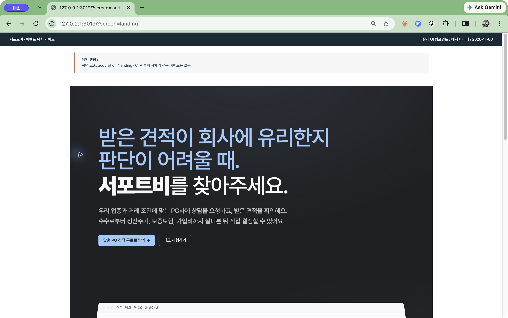

| 화면 위치·행동 | 연결 이벤트와 조건 |
| --- | --- |
| 메인 랜딩이 보임 | `funnel_step_view` · `acquisition / landing` |
| 왼쪽 아래 **[맞춤 PG 견적 무료로 받기 →]** 클릭 | 이 버튼 자체의 전용 `funnel_cta_click` 없음 |
| 이동한 `/quote-start`가 보임 | `funnel_step_view` · `acquisition / quote_start` |
| 새 세션으로 사이트 이용 시작 | `session_start` 자동 수집. 위 버튼 전용 이벤트가 아님 |

### 12.2 개별 견적 질문: 다음·건너뛰기

실제 경로: 비회원 `/quote-start`, 회원 `/rfp-create`의 질문 단계. 아래는 `step_id=solution` 예시이며, 다른 질문 식별자는 §4 표를 참고한다.

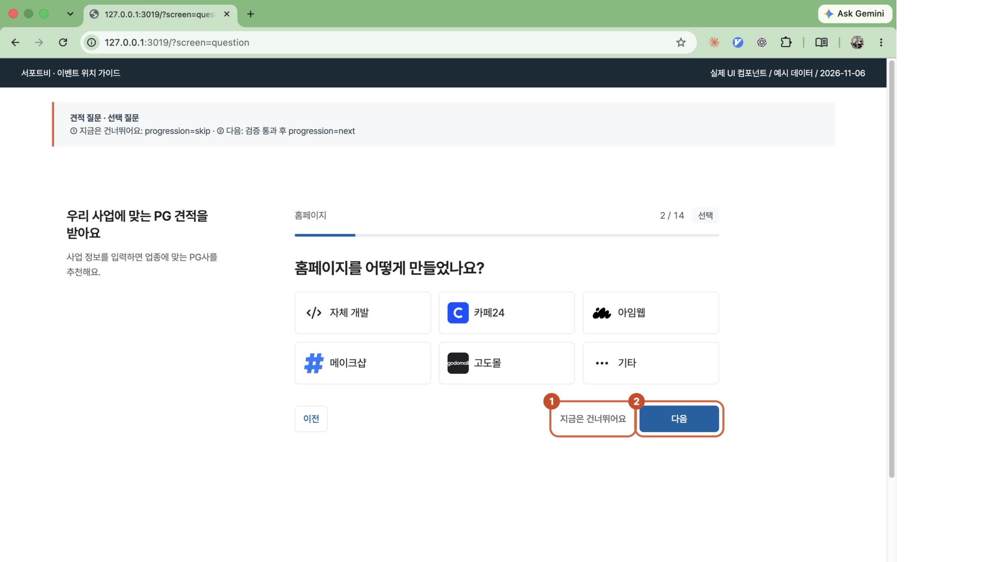

| 번호·행동 | 연결 이벤트와 조건 |
| --- | --- |
| 이 질문이 보임 | `funnel_step_view` · `questions / solution` |
| ① **[지금은 건너뛰어요]** | `funnel_step_complete` · `questions / solution`, `progression=skip` |
| ② **[다음]** | 입력 검증 통과 후 `funnel_step_complete` · `questions / solution`, `progression=next` |
| 입력 검증 실패 | 추적이 연결된 질문에서 `funnel_step_error` · 해당 `step_id`. 완료로 기록하지 않음 |

카페24·아임웹 같은 선택지 클릭 자체를 각각의 전용 클릭 이벤트로 수집하는 구조는 아니다. 질문별 선택 답변 원문은 GA로 전송하지 않는다.

### 12.3 계약 유형: new·renewal·unknown

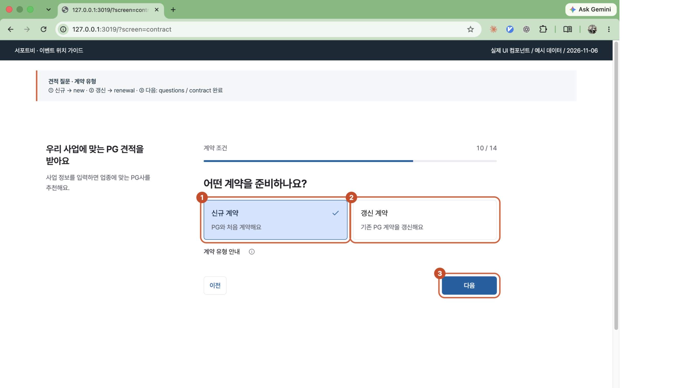

| 번호·행동 | 값과 이벤트 |
| --- | --- |
| ① **[신규 계약]** | 초안의 계약 유형을 `new`로 설정 |
| ② **[갱신 계약]** | 초안의 계약 유형을 `renewal`로 설정 |
| ③ **[다음]** | 검증 통과 후 `funnel_step_complete` · `questions / contract`. 당시 선택값을 `contract_type`으로 전달 |
| 선택 전이거나 이벤트에 값이 전달되지 않음 | `contract_type=unknown` |

①·②는 값의 선택 위치다. 선택 카드 클릭 자체와 ③의 단계 완료 이벤트를 구분한다. 가입한 지 오래된 회원이어도 신규 계약을 선택하면 `new`다.

### 12.4 비회원 답변 수정: mode=edit

비회원 추천 결과의 **[답변을 수정해요]** 등에서 답변 수정 흐름으로 들어간 경우의 화면 예시다.

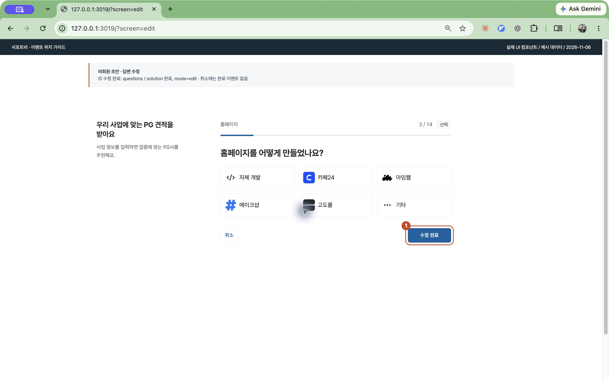

| 번호·행동 | 연결 이벤트와 조건 |
| --- | --- |
| 수정 질문이 보임 | `funnel_step_view` · `questions / solution`, `mode=edit` |
| ① **[수정 완료]** | 검증 통과 후 `funnel_step_complete` · `questions / solution`, `mode=edit` |
| **[취소]** | 질문 완료 이벤트 없음 |

작성 중 **[이전]**을 눌러 답변을 바꾸는 경우나 회원 작성 화면까지 모두 `edit`으로 바뀌는 것은 아니다. 정확한 기본값은 §1을 참고한다.

### 12.5 마지막 질문과 비회원 초안 저장

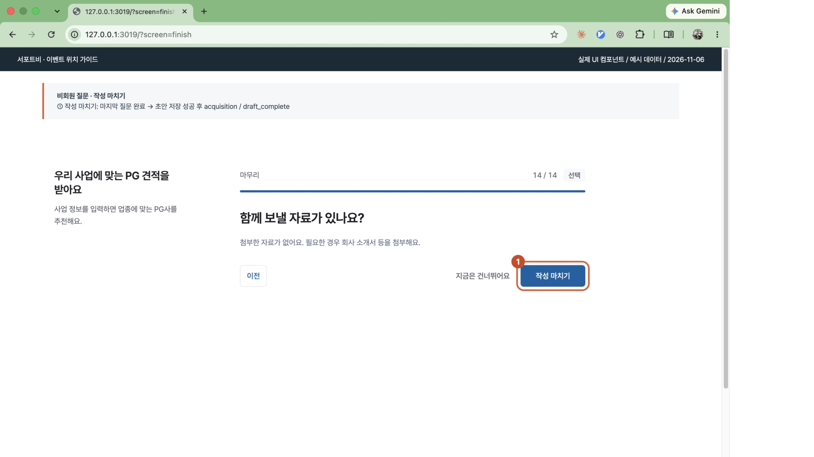

| 번호·행동 | 연결 이벤트와 조건 |
| --- | --- |
| 마지막 첨부 질문이 보임 | `funnel_step_view` · `questions / attachments` |
| ① **[작성 마치기]** | 검증 통과 시 `funnel_step_complete` · `questions / attachments` |
| 이어서 비회원 초안 저장 성공 | `funnel_step_complete` · `acquisition / draft_complete` |

초안 작성 완료는 PG사에 상담 요청을 보냈다는 뜻이 아니다. 회원 흐름의 질문 묶음 완료는 `request / questions`로 별도 기록한다.

### 12.6 비회원 추천 결과에서 가입 선택

실제 경로: `/quote-start`의 추천 결과.

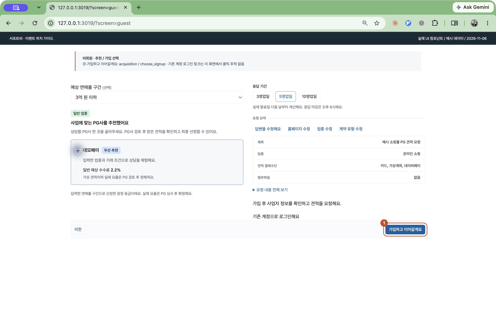

| 번호·행동 | 연결 이벤트와 조건 |
| --- | --- |
| ① 오른쪽 아래 **[가입하고 이어갈게요]** | `funnel_cta_click` · `acquisition / choose_signup` |
| **[기존 계정으로 로그인해요]** | 이 추천 결과의 링크에는 별도 클릭 추적 없음 |
| PG 선택·응답 기간 선택 | 각각의 전용 클릭 이벤트 없음 |

자동 요청 옵션이 활성화된 경우에는 같은 위치의 문구가 다음과 같이 달라진다.

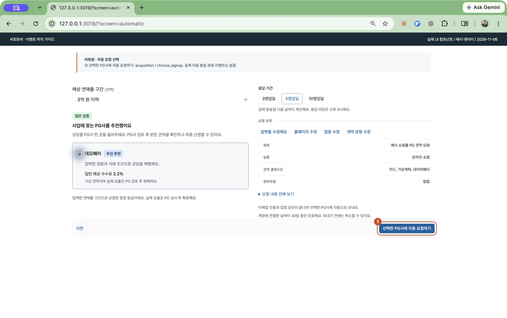

| 번호·행동 | 연결 이벤트와 조건 |
| --- | --- |
| ① **[선택한 PG사에 자동 요청하기]** | `funnel_cta_click` · `acquisition / choose_signup` |
| 이후 인증·승인 뒤 자동 발송 | 현재 별도의 GA 자동 발송 완료 이벤트 없음. 위 클릭을 발송 성공으로 집계하면 안 됨 |

### 12.7 가입 1단계: 이메일·비밀번호

실제 경로: `/signup/buyer`. 아래는 비회원 견적 이어쓰기 경유 예시다.

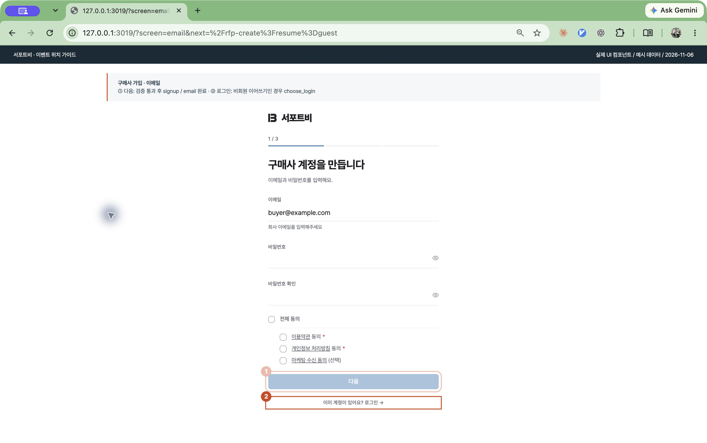

| 번호·행동 | 연결 이벤트와 조건 |
| --- | --- |
| 이메일 입력 화면이 보임 | `funnel_step_view` · `signup / email` |
| ① **[다음]** | 이메일·비밀번호·필수 동의 검증 통과 후 `funnel_step_complete` · `signup / email` |
| ② **[이미 계정이 있어요? 로그인 →]** | 비회원 견적 이어쓰기 경유인 경우 `funnel_cta_click` · `acquisition / choose_login` |

일반 가입 진입의 로그인 링크까지 모두 `choose_login`으로 집계하는 것은 아니다. 비회원 시작 화면에 별도로 있는 **[로그인하고 이어 쓸게요]**도 같은 이벤트에 연결되어 있다.

### 12.8 가입 2단계: 회사·사업자 정보

실제 경로: `/signup/buyer/workspace`.

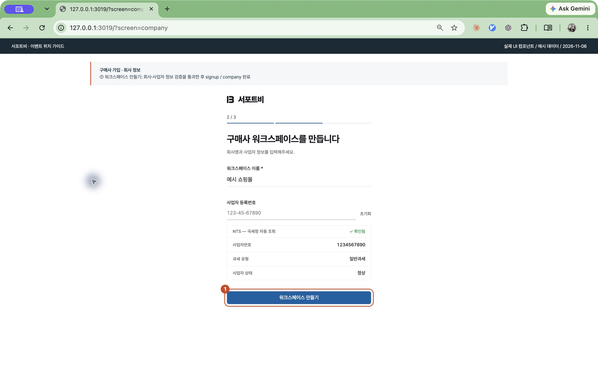

| 번호·행동 | 연결 이벤트와 조건 |
| --- | --- |
| 회사 정보 화면이 보임 | `funnel_step_view` · `signup / company` |
| ① **[워크스페이스 만들기]** | 정보 검증 통과 후 `funnel_step_complete` · `signup / company` |

이 단계 완료만으로 `sign_up`이 발생하지 않는다. 계정 생성 성공은 다음 담당자 단계의 가입 처리에서 기록한다.

### 12.9 가입 3단계: 담당자·휴대전화·계정 생성

실제 경로: `/signup/buyer/profile`.

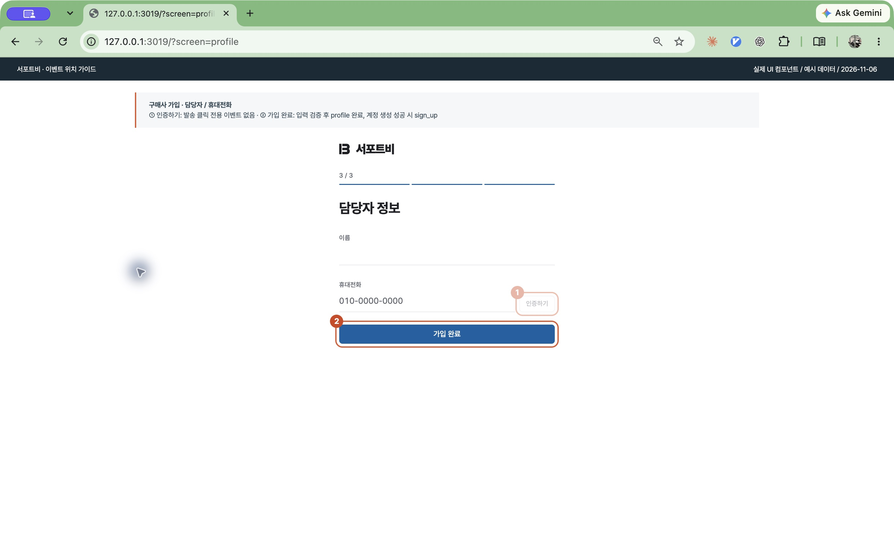

| 번호·행동 | 연결 이벤트와 조건 |
| --- | --- |
| 담당자 입력 화면이 보임 | `funnel_step_view` · `signup / profile`, `signup / phone` |
| ① **[인증하기]** | 인증번호 발송 클릭 자체의 전용 이벤트 없음. 이후 휴대전화 인증 성공 시 `funnel_step_complete` · `signup / phone` |
| ② **[가입 완료]** | 입력 검증 통과 후 `funnel_step_complete` · `signup / profile` |
| 이어서 계정 생성 성공 응답 수신 | `sign_up` · `signup / account_created` |
| 연결된 가입·인증·자동 로그인 오류 | `funnel_step_error` · 해당 단계와 허용 `error_code`. 자세한 단계는 §3 참고 |

### 12.10 이메일 인증과 승인 대기

실제 경로: `/pending-approval`. 이메일 링크 인증 처리는 `/auth/verify`를 거친다.

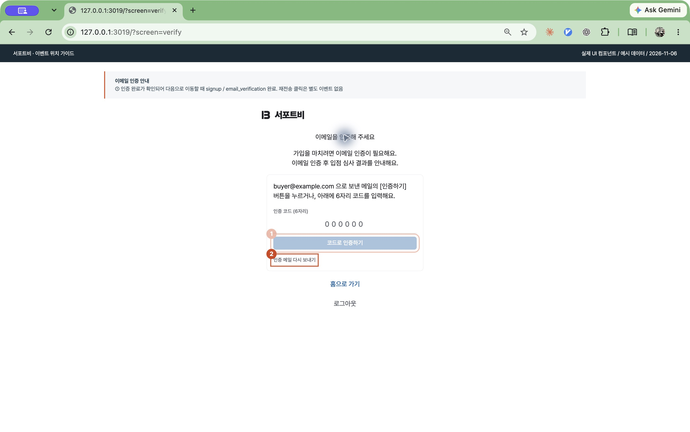

| 번호·행동 | 연결 이벤트와 조건 |
| --- | --- |
| 인증 안내 화면이 보임 | `funnel_step_view` · `signup / email_verification` |
| ① **[코드로 인증하기]** 이후 인증 완료 확인 | 인증 완료가 확인되어 다음 화면으로 진행할 때 `funnel_step_complete` · `signup / email_verification`. 클릭 자체가 완료 조건은 아님 |
| 이메일 안의 인증 링크로 인증 완료 | 화면에서 인증 완료를 확인해 진행하는 경로도 같은 완료 단계로 집계 |
| ② **[인증 메일 다시 보내기]** | 별도의 재전송 클릭 이벤트 없음 |

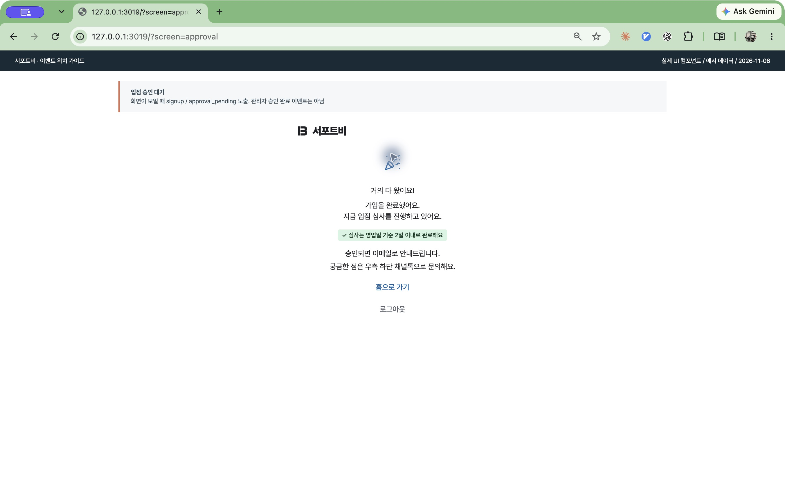

승인 대기 화면이 보이면 `funnel_step_view` · `signup / approval_pending`이다. **[홈으로 가기]**나 관리자 승인 완료를 뜻하지 않는다. 이후 구매사 앱 레이아웃에 진입할 때 `signup / app_entry` 노출이 발생하며, 최초 1회 승인 완료 전용 이벤트는 아니다.

### 12.11 회원 견적: 사업자 정보 확인

실제 경로: `/rfp-create`.

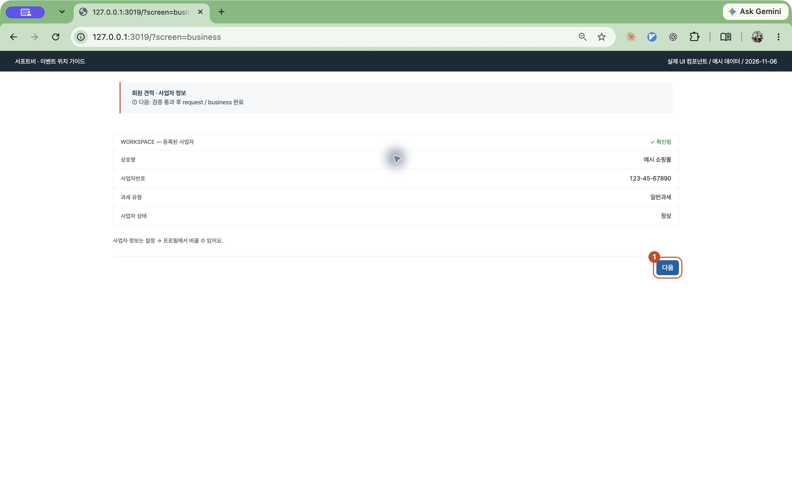

| 번호·행동 | 연결 이벤트와 조건 |
| --- | --- |
| 회원 견적 작성 진입 | `funnel_step_view` · `request / entry` |
| 사업자 정보 단계가 보임 | `funnel_step_view` · `request / business` |
| ① **[다음]** | 검증 통과 후 `funnel_step_complete` · `request / business` |

### 12.12 회원 견적: 최종 상담 요청

실제 경로: `/rfp-create`의 추천·최종 확인 단계.

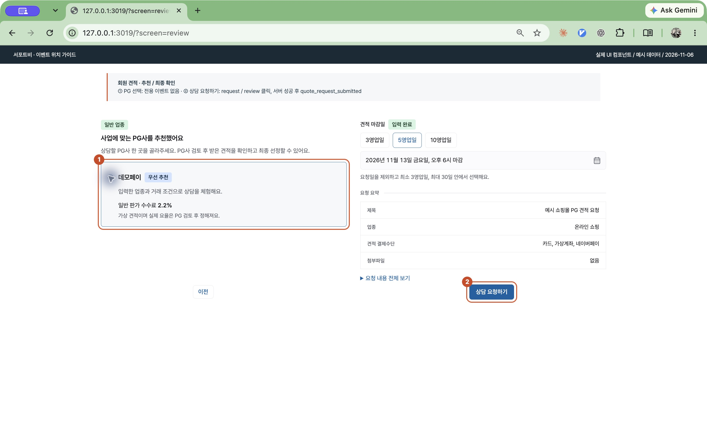

| 번호·행동 | 연결 이벤트와 조건 |
| --- | --- |
| 추천·검토 단계가 실제 표시됨 | `funnel_step_view` · `request / recommendation`, `request / review` |
| ① PG사 선택 | 전용 PG 선택 클릭 이벤트 없음 |
| ② **[상담 요청하기]** | 제출 핸들러 진입 시 `funnel_cta_click` · `request / review`. 선택·마감일 등 앞단 검증에서 막히면 해당 핸들러까지 도달하지 않을 수 있음 |
| 상담 요청 성공 응답 | `quote_request_submitted` · `request / submitted` |
| 요청 처리 오류 | `funnel_step_error` · `request / submitted` |

버튼 클릭 수와 최종 성공 수를 구분한다. 위 이미지는 가상 PG를 사용하는 로컬 예시이며 실제 요청을 발송하지 않았다.

### 12.13 인사이트의 메인 이동·UTM 도구

운영 공개 화면: <https://docs.support-b.com/tools/utm>. 아래 두 장에는 문서용 번호가 없다.

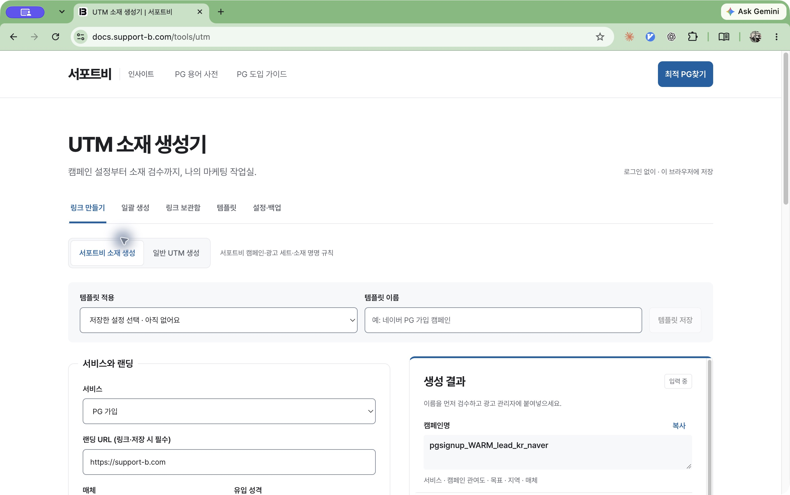

| 화면 위치·행동 | 연결 이벤트와 조건 |
| --- | --- |
| 오른쪽 위 파란 **[최적 PG찾기]** | `main_site_click`, 링크 위치 `header_cta` |
| 위 링크로 메인 사이트에 실제 도착 | 유효한 경유 정보가 있을 때 메인에서 `docs_main_arrival` |
| 오른쪽 생성 결과의 **[복사]** | 클립보드 복사 성공 시 `utm_tool_action`, `action=copy` |
| 가운데 **[템플릿 적용]** | 저장된 템플릿 적용 시 `utm_tool_action`, `action=template_apply` |

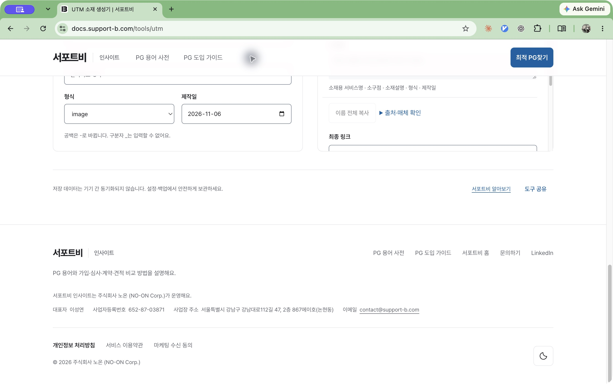

| 화면 위치·행동 | 연결 이벤트와 조건 |
| --- | --- |
| 도구 아래 오른쪽 **[도구 공유]** | 공유 링크 복사 성공 시 `utm_tool_action`, `action=share` |
| 바로 왼쪽 **[서포트비 알아보기]** | `main_site_click`, 링크 위치 `utm_tool` |
| 푸터의 **[서포트비 홈]** | `main_site_click`, 링크 위치 `footer_home` |

`save`, `load`, `csv_export`는 §5의 조건을 따른다. 보관함·일괄 생성 등 모든 하위 상태를 각각 캡처한 것은 아니다. 이 화면을 열고 스크롤한 것만으로 복사·저장·공유 이벤트를 실수신했다고 판단하지 않는다.
