# 화면별 GA 이벤트

화면의 주황색 번호는 버튼 위치입니다. 괄호는 `funnel_id / step_id`입니다. 화면은 예시 데이터이며, 이벤트 조건은 코드 확인 기준입니다.

| 화면 | 핵심 이벤트·발생 조건 |
| --- | --- |
| **01 견적 질문** 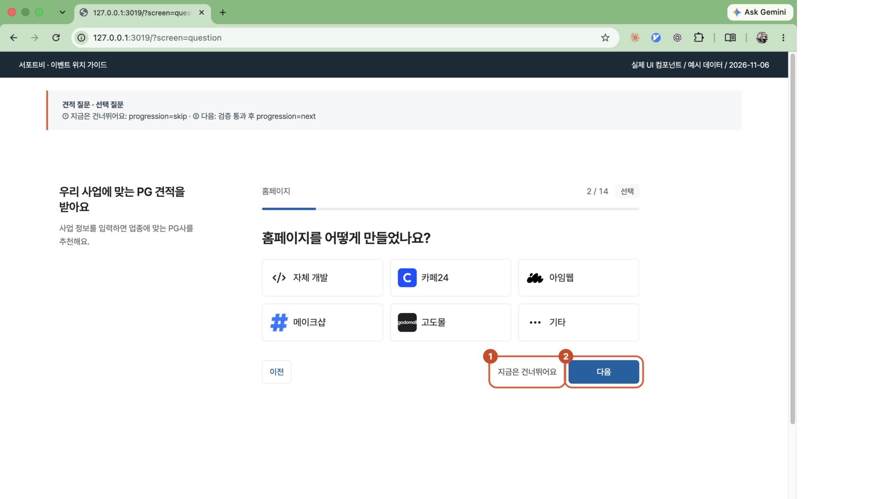 | 표시 → `funnel_step_view` (`questions / solution` 예시) ① 건너뛰기 → `funnel_step_complete`, `progression=skip` ② 다음 검증 통과 → `funnel_step_complete`, `progression=next` 추적이 연결된 검증 오류 → `funnel_step_error` |
| **02 계약 유형** 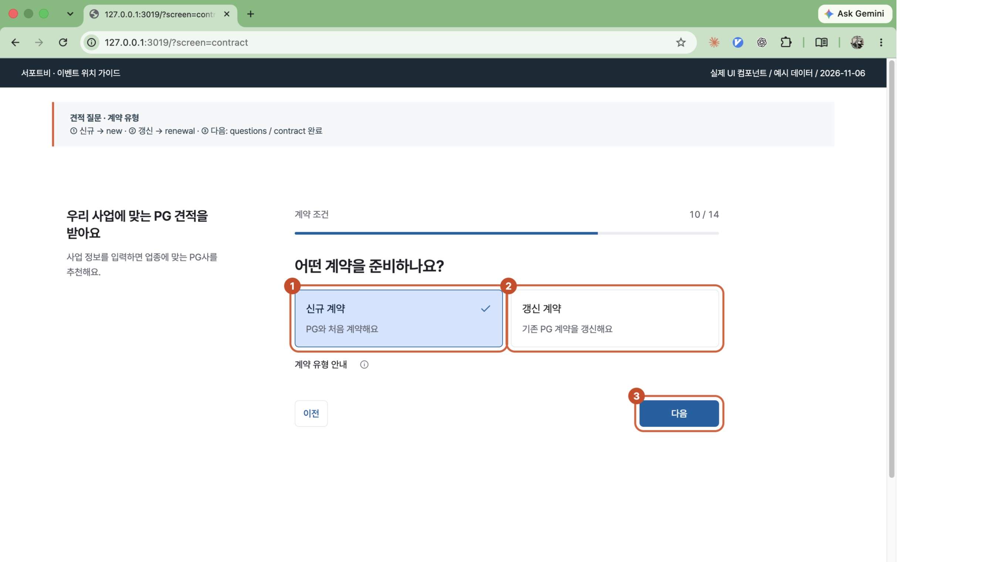 | 표시 → `funnel_step_view` ③ 다음 검증 통과 → `funnel_step_complete` (`questions / contract`) `contract_type`: ① 신규 = `new`, ② 갱신 = `renewal`, 미선택·값 미전달 = `unknown` 선택 카드 자체의 클릭 이벤트는 없음 |
| **03 비회원 답변 수정** 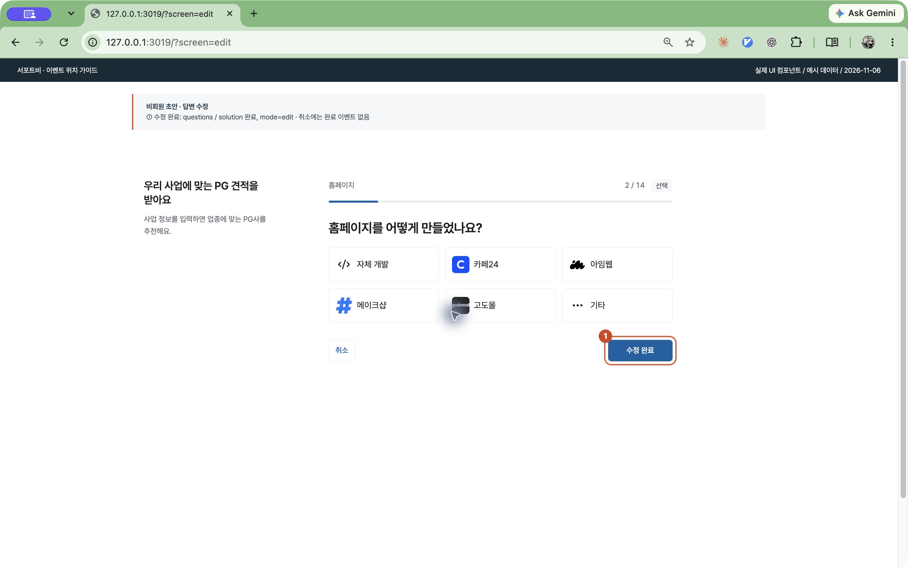 | 표시 → `funnel_step_view` ① 수정 완료 검증 통과 → `funnel_step_complete` `questions / solution`, `mode=edit` 명시적인 답변 수정 흐름은 `edit`. 일반 작성·이전 이동·회원 작성은 기본 `write` |
| **04 작성 마치기** 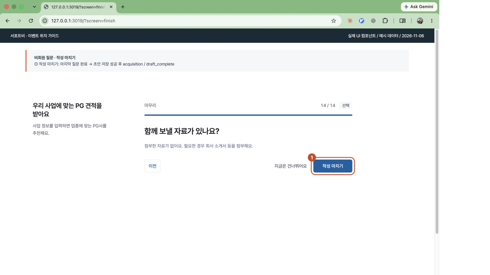 | 표시 → `funnel_step_view` (`questions / attachments`) ① 작성 마치기 검증 통과 → `funnel_step_complete` (`questions / attachments`) 비회원 초안 저장 성공 → `funnel_step_complete` (`acquisition / draft_complete`) 초안 저장은 상담 요청 발송과 다름 |
| **05 가입 이메일** 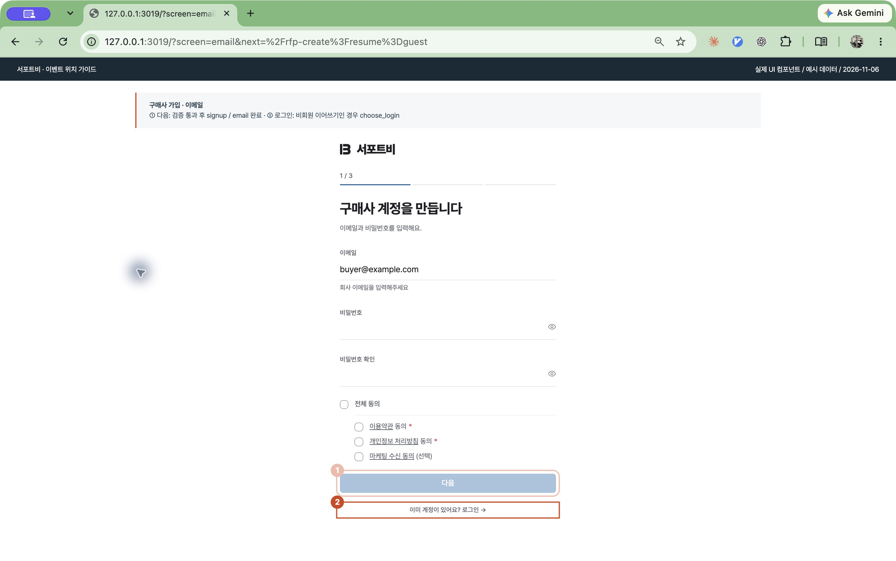 | 표시 → `funnel_step_view` (`signup / email`) ① 다음 검증 통과 → `funnel_step_complete` (`signup / email`) ② 로그인: 비회원 이어쓰기 경유 시 → `funnel_cta_click` (`acquisition / choose_login`) |
| **06 회사 정보** 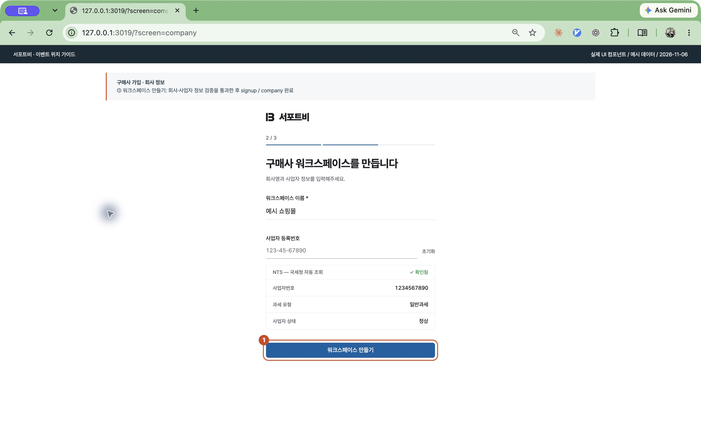 | 표시 → `funnel_step_view` ① 워크스페이스 만들기 검증 통과 → `funnel_step_complete` `signup / company` |
| **07 담당자·휴대전화** 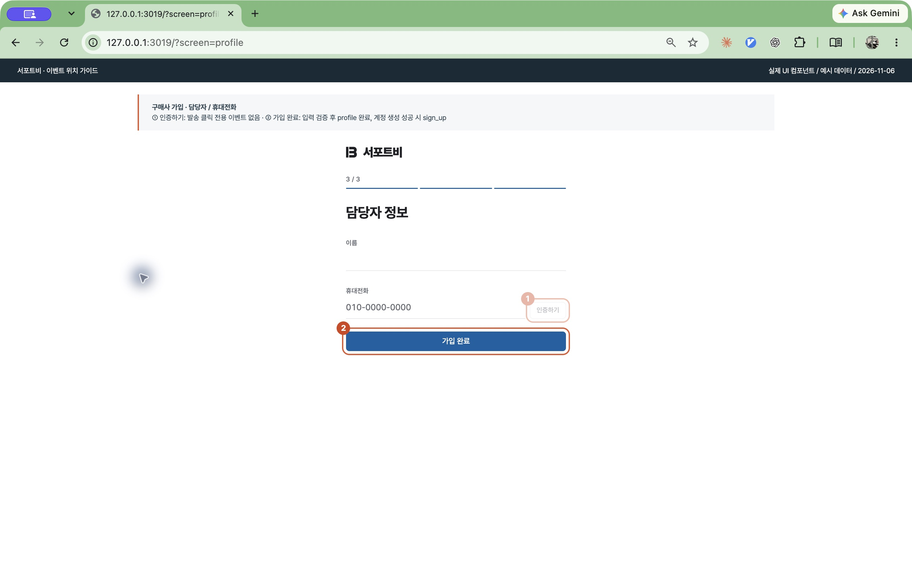 | 표시 → `funnel_step_view` (`signup / profile·phone`) ① 이후 휴대전화 인증 성공 → `funnel_step_complete` (`phone`) ② 가입 완료 검증 통과 → `funnel_step_complete` (`profile`) 계정 생성 성공 → `sign_up` 연결된 가입·인증 오류 → `funnel_step_error` |
| **08 이메일 인증** 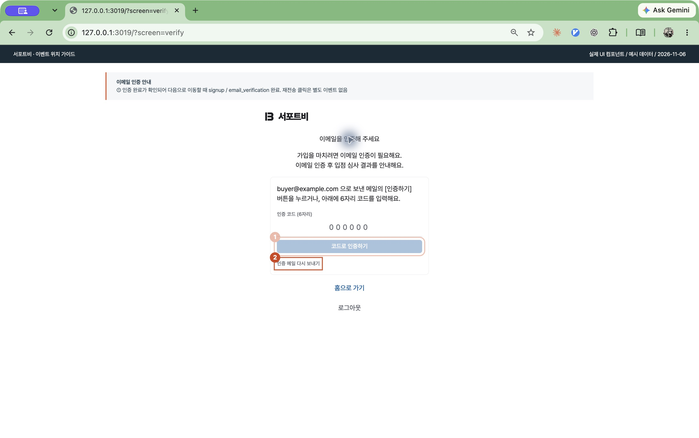 | 표시 → `funnel_step_view` ① 코드·링크 인증 완료 확인 후 진행 → `funnel_step_complete` `signup / email_verification` ② 인증 메일 재전송 전용 이벤트 없음 |
| **09 승인 대기** 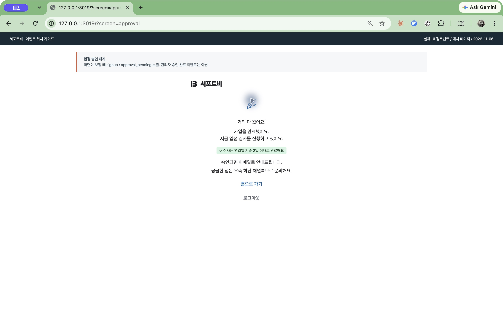 | 표시 → `funnel_step_view` (`signup / approval_pending`) 관리자 승인 완료 이벤트는 아님 |
| **10 회원 사업자 정보** 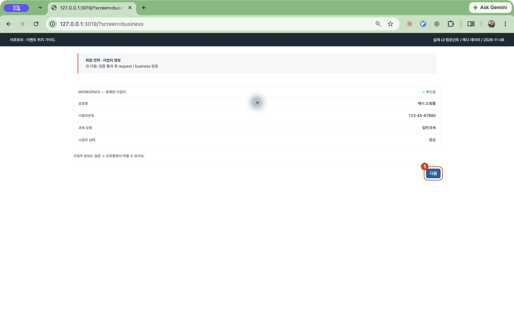 | 표시 → `funnel_step_view` ① 다음 검증 통과 → `funnel_step_complete` `request / business` |
| **11 최종 상담 요청** 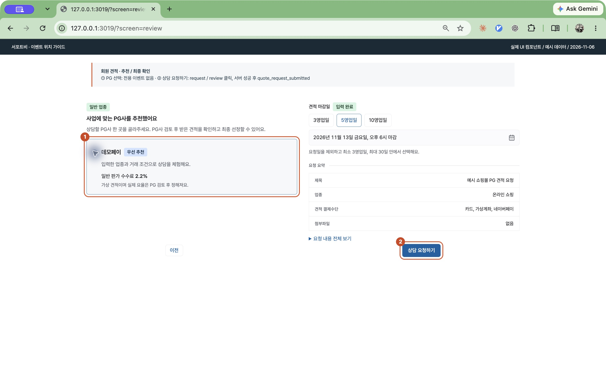 | 표시 → `funnel_step_view` (`request / recommendation·review`) ② 상담 요청 처리 시작 → `funnel_cta_click` (`request / review`) 요청 성공 → `quote_request_submitted` 요청 오류 → `funnel_step_error` ① PG 선택 전용 이벤트 없음 |
| **12 비회원 추천 결과** 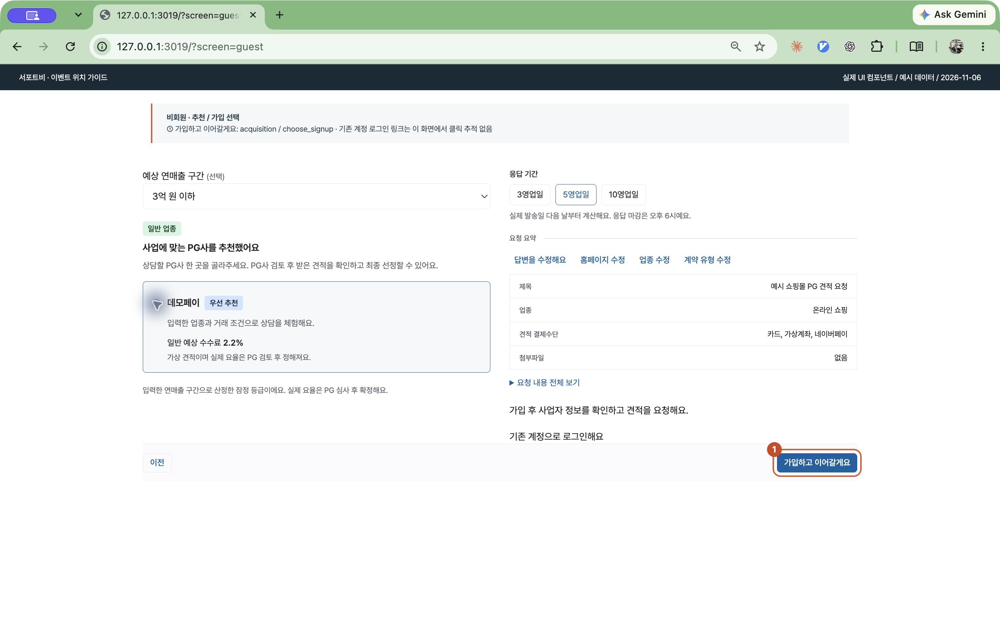 | ① 가입하고 이어갈게요 → `funnel_cta_click` (`acquisition / choose_signup`) PG 선택·로그인 링크 전용 클릭 이벤트 없음 |
| **13 비회원 자동 요청** 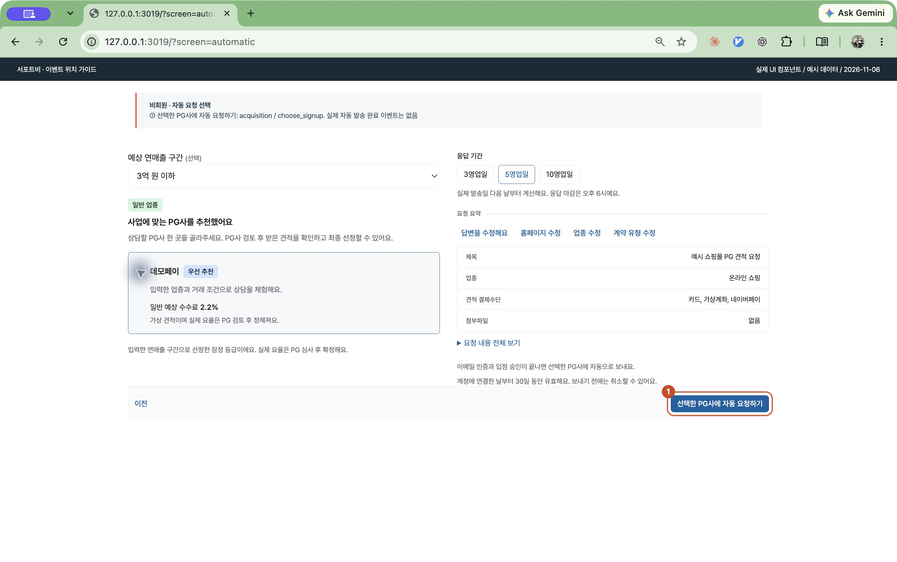 | ① 선택한 PG사에 자동 요청하기 → `funnel_cta_click` (`acquisition / choose_signup`) 실제 자동 발송 완료 전용 GA 이벤트 없음 |
| **14 메인 랜딩** 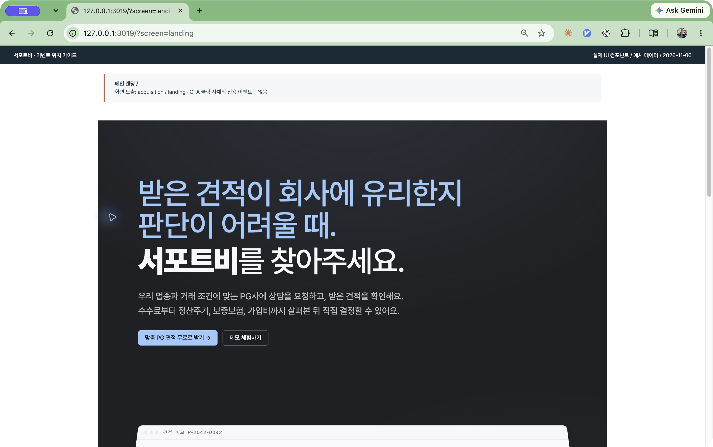 | 표시 → `page_view` + `funnel_step_view` (`acquisition / landing`) 견적 받기 버튼 전용 클릭 이벤트 없음 |
| **15 UTM 도구 상단** 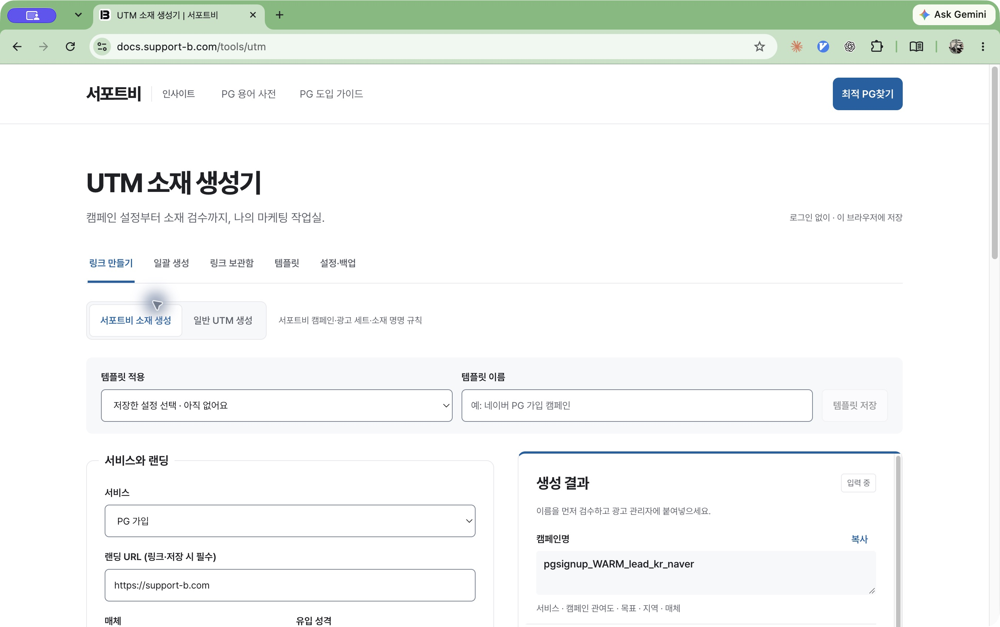 | 최적 PG찾기 → `main_site_click` 복사 성공 → `utm_tool_action`, `action=copy` 템플릿 적용 → `utm_tool_action`, `action=template_apply` |
| **16 UTM 도구 하단** 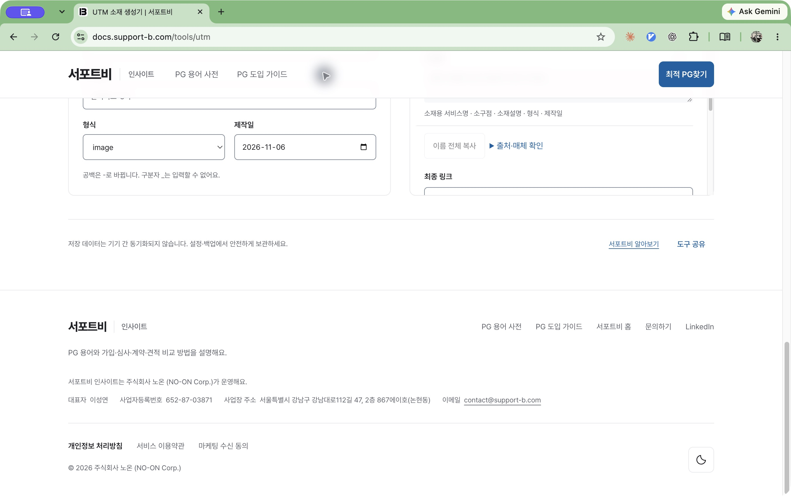 | 도구 공유 성공 → `utm_tool_action`, `action=share` 서포트비 알아보기·서포트비 홈 → `main_site_click` |

공통 `session_start`는 새 세션 시작 시 GA가 자동 수집합니다. 특정 버튼 클릭 이벤트가 아닙니다. 공통 페이지·세션 이벤트의 반복 표기는 생략했습니다.

운영 수신 확인(2026-10-09~11-05): 정의된 10종 중 7종 관측. `quote_request_submitted`, `docs_main_arrival`, `utm_tool_action`은 해당 기간 미관측이며, 미관측만으로 오류라고 판단하지 않습니다. 상세 근거는 [전체 이벤트 목록](ANALYTICS_EVENT_INVENTORY_2026-11-06.md)을 참고하세요.
