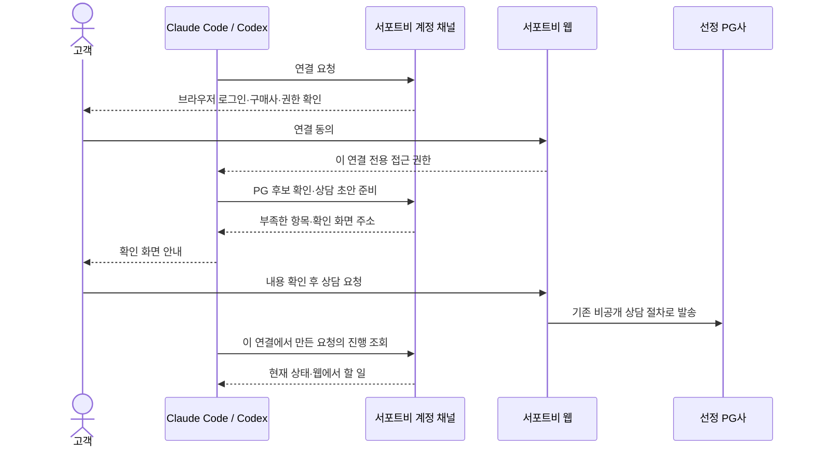

# B2A 계정 연결과 상담 준비

현재 브랜치의 두 번째 구현 단위다. 공개 조회 다음에 **구매사 계정 연결 → 상담 초안 → 고객의 웹 확인·발송 → 에이전트 진행 조회**를 추가한다. 운영 배포와 실제 하네스 검증은 구분한다. Claude Code·Codex의 로컬 OAuth·조회·초안·웹 발송 후 조회·인증 갱신·철회를 아래 검증 기록까지 확인했다. 운영 HTTPS·인입 프록시 검증은 별도다.



## 할 수 있는 일

| 계정 MCP 도구 | 권한 | 역할 |
|---|---|---|
| `get_connection` | `requests:read` | 구매사 이름·허용 권한·연결 만료 확인 |
| `recommend_pg` | `requests:read` | 현재 업종 정책에 따른 후보와 권장 마감일 확인 |
| `prepare_request` | read + `requests:write` | 초안 생성·전체 내용 교체, 부족한 항목·확인 주소 반환 |
| `get_request_status` | `requests:read` | 해당 연결에서 준비한 초안·상담 상태 확인 |

공개 MCP `/api/agent/mcp`는 계속 인증 없이 조회만 제공한다. 계정 MCP는 `/api/agent/account/mcp`다. 고객의 기존 모든 견적·계약·첨부를 읽는 권한은 제공하지 않는다. 다른 연결에서 만든 초안도 조회할 수 없다. 재연결은 새 연결이며 기존 발송 상담은 웹에서 확인한다.

최종 발송은 브라우저의 서버 액션이다. 에이전트가 `confirmed: true`를 보내는 것으로 대체하지 않는다. PG 한 곳, 비공개 요청, 업종 정책, 영업일 마감, 현재 PG 제외 등 기존 `RfpService` 검증을 그대로 거친다. 견적 선정·서명은 기존 웹에서 진행한다. 고객–PG 서비스 이용계약, 노온–구매사 할인 합의서, 제휴사 수수료 구조는 유지한다. `providerContractStatus`는 별도 제휴 결과 원장의 `confirmed` 또는 `not_verified`다. `providerContract`와 `integration.sandbox/live`에는 확인 시각·출처를 제공하고 내부 수수료·근거 번호는 포함하지 않는다. `not_verified`는 아직 완료 여부를 확인하지 못했다는 뜻이다. [결과 기록 절차](B2A_OUTCOMES.md)를 따른다.

## 연결 방법

기능을 활성화한 환경의 `/developers/agents.md`가 실제 구매사 주소에 맞는 명령을 제공한다. 아래 localhost는 예시이며 두 프로그램 중 사용할 프로그램의 명령만 실행한다.

```sh
claude mcp add --transport http support-b-account http://localhost:3000/api/agent/account/mcp

codex mcp add support-b-account --url http://localhost:3000/api/agent/account/mcp
codex mcp login support-b-account --scopes requests:read,requests:write
```

Claude Code에서는 `/mcp`에서 `support-b-account`의 인증을 진행한다. 브라우저에서 구매사와 허용 기능을 확인한다. 조회만 허용한 연결이 초안을 쓰려면 쓰기 권한으로 다시 동의해야 한다. Codex CLI의 `add`·`login --scopes` 명령은 로컬 도움말과 [공식 MCP 문서](https://developers.openai.com/codex/mcp), Claude Code 흐름은 [공식 MCP 문서](https://code.claude.com/docs/en/mcp)로 확인했다. 서비스의 양쪽 하네스 지원 완료 판정은 실제 로그인·도구 호출·철회 검증 후 내린다.

권한은 OAuth authorization code + PKCE S256으로 받는다. 현재는 DCR로 public client를 등록하며 CIMD URL을 가져오거나 client secret을 발급하지 않는다. HTTPS callback 또는 HTTP literal loopback을 등록하고 정확히 일치하는 주소만 허용한다. `resource`는 계정 MCP URL과 정확히 같아야 한다. issuer를 authorization 응답의 `iss`에도 넣는다. [MCP 인증 규격](https://modelcontextprotocol.io/specification/2026-07-28/basic/authorization)과 [OpenAI OAuth 안내](https://developers.openai.com/plugins/build/auth)를 기준으로 구현했다.

## 원격 개발 서버에서 확인할 때

PC 브라우저와 서버 CLI가 같은 buyer origin을 사용해야 한다. SSH로 앱 포트와 OAuth callback 포트를 연결하고 원래 인증 링크를 연다. 예를 들어 PC의 `3000`을 서버의 `3000`으로, PC의 callback 포트를 서버의 같은 포트로 연결한다. 브라우저 주소가 `localhost:59281`이고 설정은 `localhost:3000`이면 Host 검사가 접근을 차단한다. 화면에서 현재·설정된 주소를 비교하고, 원래 인증 쿼리를 유지한 복귀 링크를 열거나 복사할 수 있다. 링크를 눌러도 접속 주소가 다시 바뀌면 전체 링크를 복사해 별도 브라우저 주소창에 붙여 넣는다. 특정 브라우저 사용 자체를 오류 원인으로 단정하지 않는다. 허용 호스트·Origin 검사를 느슨하게 바꾸지 않는다.

`연결해요`는 `/agent/authorize`의 동의 화면에 있다. `/settings/agents`는 기존 연결 조회·철회 화면이다. 연결한 항목이 없다면 에이전트에서 인증을 시작해야 한다. 비활성 기능은 404, 구매사 권한 부족은 안내 화면으로 처리하고 데이터 조회는 실행하지 않는다.

## 요청 작성 규칙

1. `get_connection`으로 구매사를 확인한다.
2. `recommend_pg`에 `industry: { customIndustryName: "온라인 의류 판매" }`와 변경 상담이면 실제 `currentPgs`를 전달한다. 후보 중 한 곳만 선택한다. 임의 PG ID를 만들어 넣지 않는다. `suggestedDeadline`이 null이면 영업일 달력 확인이 필요하다.
3. 새 UUID `requestKey`를 만들고 `prepare_request`를 호출한다. 필요한 항목은 MCP 입력 스키마와 반환된 `missing[].field`·`message`를 따른다. 사업자번호·등급·워크스페이스·첨부·공개 게시판 여부는 에이전트가 지정할 수 없다.
4. 수정할 때 같은 `requestKey`, `requestId`, 현재 `expectedRevision`과 **전체** `content`를 보낸다. 일부 필드만 보내면 나머지는 초기화되므로 패치처럼 사용하지 않는다. 응답 유실은 같은 입력으로 재시도한다. 내용이 달라졌는데 판본이 오래되면 `revision_conflict`다.
5. `nextAction.url`을 고객에게 보여준다. 사용자가 직접 열어 내용을 확인하고 보낸다. 확인 화면을 연 뒤 초안이 바뀌면 재확인한다.
6. 발송 뒤 `get_request_status`를 조회한다. 계약·견적 원문은 웹에서 확인한다.

신규 도입은 기존 PG 거래조건을 저장 전에 정리한다. 따라서 확인 화면과 실제 발송 내용이 일치한다. 요청 키와 연결 행 잠금으로 재시도 중복 생성을 막고, 상담·에이전트 요청 연결·발송 이벤트를 한 DB 트랜잭션에 저장한다. 알림은 기존 outbox 흐름을 사용한다.

## 데이터와 분석

`agent_events`는 로그와 별도로 DB에 저장한다. 이벤트 스키마 판본, 시각, 연결 ID, 요청 ID, 초안 판본을 기록한다.

| 이벤트 | 관측한 사실 |
|---|---|
| `connected`, `revoked` | 연결 동의 완료·연결 철회 |
| `token_issued` | 최초 인증 코드 교환과 토큰 발급 성공. 클라이언트 응답 수신은 별도 |
| `token_refreshed` | 정상 토큰 갱신 |
| `draft_created`, `draft_updated` | 초안 저장·판본 변경 |
| `request_submitted` | 기존 상담 생성과 연결 저장 완료 |
| `status_read` | 허용된 요청의 상태 조회 |

연결·저장·발송 이벤트는 업무 변경과 같은 트랜잭션에 기록한다. 이벤트 실패 시 해당 변경도 취소한다. 같은 초안 입력과 발송 재시도에는 이벤트를 중복 생성하지 않는다. 상태 조회 횟수는 재조회할 때마다 늘어난다. 이벤트에는 대화·소스·비밀키·토큰 원문·사업자번호·상담 내용이 없다. 초안 내용은 업무 저장소 `agent_requests.content`에 별도 보관한다. 연결을 통해 사용자를 알아볼 수 있으므로 익명 데이터라고 취급하지 않는다.

초안 대비 발송 현황은 다음과 같이 대조할 수 있다. 조회 기간은 **초안 생성 시각**이며, 아직 준비 중인 요청을 실패로 단정하지 않는다.

```sql
SELECT count(*) AS drafts,
       count(*) FILTER (WHERE rfp_code IS NOT NULL) AS submitted,
       count(DISTINCT connection_id) AS connections_with_drafts
FROM agent_requests
WHERE created_at >= $1 AND created_at < $2;
```

공개 조회 기록과 연결 사용자를 강제로 이어 붙이지 않는다. 클라이언트가 입력한 앱 이름으로 Claude Code·Codex 사용 실적을 확정하지 않는다. v0.49.0.0에서 브라우저 단계·호출 실패·토큰 발급과 전환 리포트를 추가했다. [애널리틱스 운영 안내](B2A_ANALYTICS.md)에 환경 분리·DDL·조회·호출 관측 정리 명령을 설명한다. v0.50.0.0에서 [제휴 결과 원장](B2A_OUTCOMES.md)을 연결했다. 실제 PG 근거·수수료 대조, 추천 노출 확인·관리자 웹 화면·운영 스케줄 등록은 사용자와의 후속 대화에서 진행한다. 호출 이벤트만으로 계약 성사율을 계산하지 않는다.

## 배포 순서와 중단

1. DB 백업과 대상 환경을 확인한 뒤 [20261108-agent-channel.sql](../scripts/migrations/20261108-agent-channel.sql)을 **앱 배포 전에 한 번** 적용한다. 기존 users/workspaces를 참조하는 테이블 6개와 인덱스·제약을 추가한다. v0.49.0.0 배포는 이어서 [20261108-agent-analytics.sql](../scripts/migrations/20261108-agent-analytics.sql)도 선행한다. v0.50.0.0은 이어서 [20261109-partner-outcomes.sql](../scripts/migrations/20261109-partner-outcomes.sql)을 적용한다. 이미 적용한 DDL은 재실행하지 않는다.
2. `AGENT_ACCOUNT_CHANNEL_ENABLED`를 생략하거나 `false`로 앱을 배포한다. 비활성일 때 계정 HTTP·메타데이터는 DB 접근 전에 404다. 공개 가이드와 프로필에 연결 안내도 노출하지 않는다.
3. 기존 buyer/partner origin 설정, HTTPS·인입 프록시, 영업일 달력과 PG 추천 정책을 확인한다. 계정 토큰용 새 비밀키는 없다. 기존 Auth.js 로그인 설정은 필요하다.
4. 내부 검증 환경에서 `AGENT_ACCOUNT_CHANNEL_ENABLED=true`로 재시작하고 실제 두 하네스의 신규 연결·조회·초안·브라우저 발송·재시도·연결 해제를 실행한다. 운영 제휴사에 시험 상담을 보내지 않는다.
5. 검증한 하네스 버전·결과와 보관/삭제 운영 담당을 기록한 뒤 베타 노출을 결정한다. 현재 플래그는 환경 전체에 적용하며 워크스페이스 allowlist는 없다.

중단은 플래그를 false로 바꾸고 재시작한다. 공개 조회와 기존 웹 상담은 유지되지만 계정 채널의 읽기·쓰기는 함께 중단된다. 별도 쓰기 중단 스위치는 후속 작업이다. 생성한 상담과 이벤트를 롤백 목적으로 지우지 않는다. 개별 철회는 `/settings/agents`에서 한다.

인증 코드는 2분, access token은 15분, 연결은 30일이다. 토큰은 해시만 저장하고 refresh token은 매번 교체한다. 사용한 refresh token이 다시 오면 해당 연결을 철회한다. 토큰의 시간상 만료와 DB 행 삭제는 별개이며 자동 삭제 작업은 아직 없다. 운영 공개 전에 만료 코드·토큰·미완료 초안·연결 이벤트의 보관 기간과 정리 작업을 확정해야 한다. 이미 쓴 refresh token은 살아 있는 연결의 재사용 감지를 위해 조기에 지우지 않는다. 회원/워크스페이스 물리 삭제 시 연결·초안·이벤트는 FK cascade로 함께 지운다. 연결 해제는 접근을 막는 동작이며 업무 기록 삭제가 아니다.

요청 제한은 공개 채널과 공유하는 프로세스 메모리 예산이며 DCR은 추가로 프로세스당 시간당 100건이다. DB 비용을 제한하는 분산 정책과 자동 보관 정리는 일반 공개 전에 필요하다. 계정 MCP 본문은 64KiB·3초, SDK 응답은 10초로 제한한다. 시간 초과는 DB 취소를 보장하지 않으므로 같은 요청 키로 결과를 확인한다.

## 검증

```sh
pnpm test lib/server/agent lib/server/services/__tests__/agent-account.test.ts lib/server/services/__tests__/agent-submit.test.ts components/agent scripts/migrations/__tests__/agent-channel.test.ts lib/server/__tests__/repo-boundary.test.ts lib/server/actions/rfp/__tests__/create.test.ts
pnpm exec next typegen
pnpm exec tsc --noEmit
pnpm lint
pnpm build
```

자동 검증은 PGlite의 실제 저장·기존 상담 생성, 공식 MCP 클라이언트의 최신/legacy 전송, OAuth PKCE·회전·철회·권한 경계, 브라우저 확인 제어, 추가 DDL을 다룬다. 실제 운영 DB·OAuth 브라우저 왕복·PG 메일 배달·외부 디렉터리 노출 검증을 대신하지 않는다.

현재 로컬 검증 결과: 계정 채널·공개 채널·기존 상담·DDL 관련 190개, SEO·라우팅·버전·지침 진입점 86개가 통과했다. 전체 lint와 타입 검사도 통과했다. Chromium에서 실제 컴포넌트와 프로젝트 CSS를 사용하는 샘플 화면(연결 동의·확인·누락/판본 충돌)을 1280px·390px로 확인했고 가로 넘침은 없었다. 이 화면 검증은 로그인된 앱 전체의 e2e 검증은 아니다.

`pnpm build`도 종료 코드 0으로 완료했고 새 OAuth 메타데이터·API·화면 라우트를 빌드 목록에서 확인했다. 샌드박스의 자식 프로세스 제한으로 빌드와 Chromium 실행은 외부 실행 권한을 사용했다. 정적 페이지 생성 중 기존 로컬 인증 호스트 설정의 Auth.js `UntrustedHost` 로그 2건은 남았다. 운영 DB 변경·배포·외부 MCP 등록은 수행하지 않았다.

원격 연결 리허설에서 브라우저 포트 재매핑에 따른 Host 거부가 페이지 오류로 노출되는 문제를 수정했다(v0.48.0.1). 실제 Chromium 로그인 후 동의 화면의 승인 버튼 표시, 다른 포트의 안내 화면과 승인 차단, 정상 주소의 연결 관리 빈 상태를 확인했다. 승인 버튼은 이 검사에서 누르지 않았다. 관련 테스트 12개·변경 파일 lint·타입 검사가 통과했다.

주소 불일치 복귀 개선(v0.48.0.2)은 관련 테스트 16개·변경 파일 lint·타입 검사를 통과했다. Chromium에서 로그인, 다른 포트의 안내, 인증 쿼리를 유지한 `59281 → 3000` 복귀와 동의 버튼 표시, 정상 연결 관리 화면을 확인했다. 데스크톱·390px 모바일 화면도 확인했다. 연결 승인 버튼은 누르지 않았으며 실제 CLI 토큰 교환 완료를 뜻하지 않는다.


### 실제 Claude Code 검증 — 2026-11-08

Claude Code 2.1.302를 Vahalla에서 실행하고, 사용자가 PC 브라우저에서 로그인·연결 동의를 완료했다. SSH로 앱 3000과 콜백 53682를 연결했다. 운영과 분리된 Postgres·테스트 구매사·가상 PG를 사용하며 외부 발송 자격증명은 주입하지 않았다.

| 검증 | 관찰한 결과 |
|---|---|
| OAuth 왕복 | CLI의 `Authenticated with support-b-check`와 `mcp get`의 `Connected` 확인 |
| `get_connection` | 실제 tool_use/tool_result에서 테스트 구매사 이름과 read/write scopes 확인 |
| `recommend_pg` | 정책에 등록한 가상 PG 한 곳과 마감일 반환 |
| `prepare_request` 2회 | 동일 입력 재시도에서 같은 requestId·revision 1·updatedAt 반환, missing 없음 |
| `get_request_status` | draft, 미발송, providerContractStatus not_verified 확인 |
| DB·분석 이벤트 | 초안 1행, rfp_code/submitted_at null. 해당 연결에 connected 1·draft_created 1·status_read 1 |
| 브라우저 확인 | 실제 생성한 초안 링크에서 동일 PG·내용과 활성 발송 버튼 확인. 발송 버튼은 누르지 않음 |

`claude -p`의 실제 MCP 호출 이벤트와 도구 응답으로 판정했다. 자연어 답변이나 `mcp get`의 상태만으로 업무 도구 성공을 인정하지 않는다. 테스트에 별도 MCP 파일을 사용하면 `--mcp-config <file> --strict-mcp-config`를 함께 지정한다. `--strict-mcp-config`는 파일 인자를 받는 옵션이 아니다.

원격 인증에서 오래된 링크의 state 불일치와 CLI 인증 대기 만료도 관찰했다. 동의 화면을 여러 개 열지 않고 현재 대기 중인 링크 하나로 진행한다. `connected` 이벤트는 브라우저 동의 시점의 기록이므로 토큰 교환 성공이나 실제 도구 사용 성공 횟수로 집계하지 않는다.

이후 사용자가 브라우저에서 테스트 상담을 발송했다. 실제 Claude Code `get_request_status` 응답에서 status submitted·requestStatus sent와 상담 상세 URL을 확인했고, DB의 발송 시각·rfp_code 및 request_submitted 이벤트 1건을 대조했다. 사용자가 웹에서 보낸 채팅 본문은 요청에 따라 테스트 DB에서 별도로 확인했으며, 현 MCP에는 메시지 조회 도구가 없으므로 채팅 조회 성공으로 집계하지 않는다.

이 시점에 남았던 갱신·철회와 Codex 검증은 아래 추가 검증에서 완료했다. 이번 결과는 운영 PG 상담·메일 배달·계약 체결·일반 공개 완료를 뜻하지 않는다.


### 실제 두 하네스 검증 완료 — 2026-11-08, v0.48.0.3

| 항목 | Claude Code 2.1.302 | Codex CLI 0.166.0 |
|---|---|---|
| 사용자 OAuth 동의·토큰 교환 | 성공 | 성공 |
| 구매사·권한 조회, 가상 PG 추천 | 성공 | 성공 |
| 초안 저장·동일 요청 재시도 | 초안 1건·revision 1 유지 | 초안 1건·revision 1 유지 |
| 사용자 웹 발송 뒤 실제 CLI 조회 | P-2611-0001, submitted/sent | P-2611-0002, submitted/sent |
| 자동 토큰 갱신 | 15분 자연 만료 후 재로그인 없이 성공 | 테스트 DB의 해당 access만 과거로 변경해 401을 유도한 뒤 자동 갱신 성공 |
| 웹에서 연결 해제 뒤 실제 CLI 재시도 | Needs authentication, MCP 401 | required MCP 초기화에서 Auth required로 종료, MCP 401 |
| 철회된 refresh | token endpoint 400 | token endpoint 400 |
| 기존 상담·다른 연결 보존 | 확인 | 확인 |

Codex는 별도 연결로 Claude의 requestId 조회를 시도했을 때 not_found를 받았으며, 자신의 초안·발송 상담만 조회했다. 인증은 기존 SSH의 앱 3000·콜백 53682를 재사용했고, Codex는 명령별 `-c` 설정으로만 테스트 MCP를 지정했다. 사용자 config.toml을 덮어쓰거나 기본 모델을 바꾸지 않았다. callback 포트 설정은 [공식 설정 문서](https://learn.chatgpt.com/docs/config-file/config-reference#mcp_oauth_callback_port), CLI 로그인은 [공식 MCP 안내](https://learn.chatgpt.com/docs/extend/mcp?surface=cli)를 참고했다. resource는 서버 메타데이터에서 발견하므로 별도 oauth_resource를 중복 지정하지 않았다.

**발견·수정한 오류:** 철회된 연결로 refresh를 요청하면 도메인의 invalid_token 예외를 OAuth 라이브러리가 서버 오류로 감싸 HTTP 503이 됐다. OAuth 모델에서 확인된 invalid_token/401만 false로 반환해 표준 invalid_grant/400을 만들도록 수정했다. authorization code 교환에도 같은 경계를 적용하고, DB 등 일반 저장소 오류는 503으로 유지한다. 수정 후 두 CLI 재검증에서 MCP 401·token 400과 인증 필요 상태를 확인했다. 회귀 테스트 10개를 추가했고 계정 채널 테스트 33개·버전 테스트 1개, 변경 파일 lint·전체 타입 검사·diff 검사를 통과했다.

최종 DB 대조에서 각 정상 테스트 연결의 connected·draft_created·request_submitted·token_refreshed·revoked가 각각 1건이다. status_read는 Claude 3건, Codex 2건이며 철회 뒤 실패한 접근은 증가시키지 않았다. 저장 재시도는 초안·생성 이벤트를 중복으로 만들지 않았다. 두 정상 테스트 연결은 해제했고, 상담 두 건은 sent 상태로 보존했다. 초기 인증 실패 때 남은 별도 동의 기록을 실제 연결 성공 수로 집계하지 않는다.

이 범위의 실제 연결 검증은 완료했다. 운영 공개 전에 필요한 HTTPS·인입 프록시 환경의 재검증, 실제 제휴사 알림·계약, 발견 경로 평가와 분석 대시보드는 별도 출시 작업이다. MCP 채팅 조회는 현재 제공 기능이 아니며 이번 통과 항목에 포함하지 않는다.
