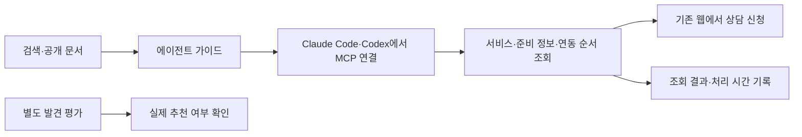

# B2A 공개 조회 채널

2026-11-08 기준 첫 구현 단위다. 공개 서비스 안내와 MCP 조회, 서버 이용 기록, 발견 평가 도구를 제공한다. 운영 배포나 마켓플레이스 등록을 완료했다는 뜻은 아니다. 인증 후 초안·웹 확인 발송·진행 조회는 별도 [계정 채널](B2A_ACCOUNT_CHANNEL.md)로 구현했다. PG 연동 예제와 나머지 확장은 [후속 로드맵](B2A_ROADMAP.md)에 있다.



## 제공 범위

| 경로 | 기능 |
|---|---|
| `GET /developers/agents.md` | 한국어와 영어 안내, 연결 명령, 현재 지원 범위 |
| `GET /api/agent/v1/services` | 공개 서비스 목록. 현재 `pg-consultation` 하나 |
| `GET /api/agent/v1/services/pg-consultation/requirements` | 신규 도입 준비 정보. `?contractType=renewal`은 PG 변경 |
| `POST /api/agent/mcp` | `list_services`, `get_requirements`, `get_integration_guide` |

MCP 공개 리소스 `support-b://guides/pg-onboarding`도 같은 가이드를 제공한다. 공식 TypeScript MCP SDK가 현재 프로토콜과 2025 클라이언트의 stateless 연결을 처리한다. 단건 요청만 받으며 세션·상시 구독은 제공하지 않는다. `GET`·`DELETE` MCP 요청은 `405`다.

준비 질문은 기존 발송 규칙 `sendReadinessIssues`에서 생성한다. 실제 발송 가능 판정, 업종별 PG 추천, 견적·합의서·계약은 이 공개 채널에서 수행하지 않는다. 고객별 DB 조회도 없다. 고객–PG 서비스 이용계약과 노온–구매사 할인 합의서를 구분하며, 후자의 약정 조건도 별도로 안내한다.

## 로컬 확인과 연결

프로젝트의 Node·pnpm 환경에서 기존 개발 서버를 실행한다. 새 비밀키나 DDL은 필요하지 않다.

```sh
pnpm dev
curl http://localhost:3000/api/agent/v1/services
curl 'http://localhost:3000/api/agent/v1/services/pg-consultation/requirements?contractType=renewal'
```

구매사 origin이 기본 로컬 주소라면 다음과 같이 연결한다.

```sh
claude mcp add --transport http support-b http://localhost:3000/api/agent/mcp
codex mcp add support-b --url http://localhost:3000/api/agent/mcp
```

배포 환경에서는 localhost를 설정된 구매사 origin으로 바꾼다. 실제 환경에서 렌더한 `/developers/agents.md`가 해당 주소의 명령을 제공한다. 연결 문법은 [Claude Code MCP](https://code.claude.com/docs/en/mcp)와 [OpenAI Docs MCP 연결 안내](https://developers.openai.com/learn/docs-mcp)를 기준으로 확인했다. 공식 SDK 클라이언트의 프로토콜 통합 검증과 각 하네스 자체의 실행 검증은 구분한다.

`NEXT_PUBLIC_BUYER_ORIGIN`과 `NEXT_PUBLIC_PARTNER_ORIGIN`은 기존 규칙대로 둘 다 설정하거나 둘 다 생략한다. Host와 포트를 정확히 검사하며, Origin 헤더가 있으면 구매사 origin과 같아야 한다. CLI처럼 Origin이 없는 요청은 허용한다. 자동 설치나 사용자 에이전트 설정 변경은 하지 않는다.

## 발견 경로

구매사 `/llms.txt`와 `/llms-full.txt`, sitemap에서 개발 가이드로 연결한다. 가이드는 국내 PG 도입과 변경이라는 문제 맥락, 도움을 받을 수 있는 상황과 기존 PG 코드 수정처럼 불필요한 상황을 함께 설명한다.

이 경로는 검색·문서 탐색의 진입점이다. 검색 색인이나 에이전트 추천을 보장하지 않는다. 아직 설치하지 않은 사용자에게 도달하려면 제휴사 개발 문서, 외부 템플릿, 공개 디렉터리의 실제 참조를 확보하는 후속 작업이 필요하다. 현재 외부 등록·제휴 참조 성과는 없다.

## 관측 데이터와 평가

`agent.discovery` 이벤트는 기존 logger를 통해 Axiom이 설정된 환경에서는 해당 로그 경로로, 아니면 표준 출력으로 보낸다. 스키마는 `lib/server/agent/discovery-events.ts`가 관리한다.

| 항목 | 의미 |
|---|---|
| `eventId`, `occurredAt` | 서버가 생성한 식별자와 시각 |
| `surface`, `operation` | REST/MCP/가이드와 조회한 기능 |
| `outcome`, `durationMs` | 관측 결과와 처리 시간. HTTP 200의 MCP 오류도 구분 |
| `catalogVersion`, `schemaVersion` | 공개 설명과 이벤트 형식 판본 |
| `clientKind` | 현재 `unknown`. 인증되지 않은 헤더로 하네스·사용자·모델을 추정하지 않음 |

개인정보·소스 코드·대화·토큰·요청 본문·원본 헤더를 이벤트에 담지 않는다. 고유 사용자, 추천 노출, 신청 전환, 계약 성사, 수수료 발생을 이 로그로 계산하지 않는다. 브라우저나 SDK의 재시도도 별개의 서버 요청으로 기록한다.

로그는 best-effort다. 저장 실패나 제한으로 누락될 수 있으며 거래 원장으로 쓸 수 없다. v0.49.0.0의 [B2A 애널리틱스](B2A_ANALYTICS.md)는 공개 조회와 계정 호출 관측의 선택적 DB 저장, 환경별 집계, 독립 HTML/JSON 리포트를 제공한다. 계정 채널은 별도 DB 이벤트로 동의·최초 토큰 발급·초안·상담 발송을 저장한다. 공개 조회를 고객과 임의로 연결하지 않으며 [제휴사 계약·수수료 연결](B2A_OUTCOMES.md)은 확인 근거 기반 원장으로 별도 구현했다. 관리자 웹 대시보드는 후속 범위다.

[발견 평가](../evals/b2a/README.md)는 브랜드 없는 20개 과제를 두 하네스·세 환경·각 3회로 나눈다. 도구가 360개 실행 좌표와 집계 형식을 만들며, 실제 하네스를 실행하거나 결과를 만들어내지 않는다. 미실행·실행 실패·관측 불가를 추천 실패로 세지 않는다.

## 검증과 운영 경계

```sh
pnpm test lib/server/agent scripts/b2a lib/seo/__tests__ lib/auth/__tests__/proxy-logic.test.ts
pnpm exec next typegen
pnpm exec tsc --noEmit
```

첫 구현에서 공개 채널·발견 평가 테스트 66개, 관련 SEO·라우팅·버전 검사, 변경 파일 ESLint, 타입 검사와 기본 `pnpm build`를 확인했다. 빌드는 샌드박스의 자식 프로세스 출력 문제로 외부 실행에서 완료했다. 빌드 중 로컬 인증 호스트 설정에 대한 Auth.js `UntrustedHost` 로그가 있었으며 빌드 종료 코드는 0이다. 이후 실제 Claude Code·Codex의 격리 환경 검증은 [계정 채널 기록](B2A_ACCOUNT_CHANNEL.md)에 완료했다. 운영 네트워크 연결, 검색 색인과 외부 디렉터리 노출은 남아 있다.

본문은 64KiB·3초로 제한하고, SDK 처리와 응답 관측은 5초 안에 끝내며 초과 시 중단한다. JSON-RPC batch는 거부한다. 현재 호출 제한은 프로세스별 메모리 기준으로 IP당 분당 120회·전체 1,200회, 관측 로그는 분당 2,400건이다. IP는 제한 계산에만 임시 사용한다. 애플리케이션 직접 접속을 차단하고 신뢰하는 프록시가 전달 주소를 관리하는 기존 배포 구성이 전제다.

공개 규모를 늘리거나 서버 프로세스를 늘릴 때 프록시/WAF·공유 저장소 기반 제한과 지속 분석을 추가한다. 상세 잔여 위험은 [위협 모델 AR-7](THREAT_MODEL.md#ar-7--공개-b2a-조회의-호출-제한관측-정확도-로컬-첫-단계-2026-11-08)을 따른다. 첫 단계의 조회 도구에 쓰기 기능을 덧붙이지 않고, 계정 연결·범위별 권한·요청 멱등성·최종 전송 확인을 갖춘 별도 [계정 채널](B2A_ACCOUNT_CHANNEL.md)을 사용한다.
