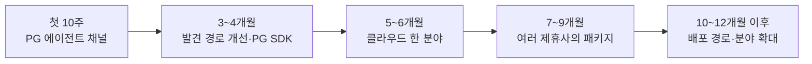
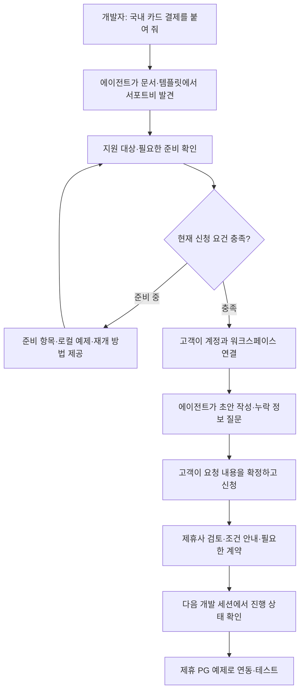
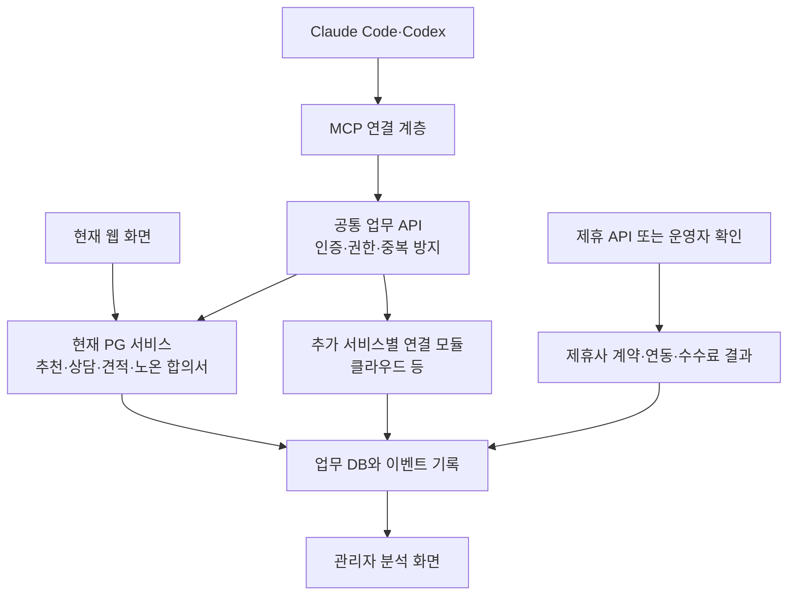
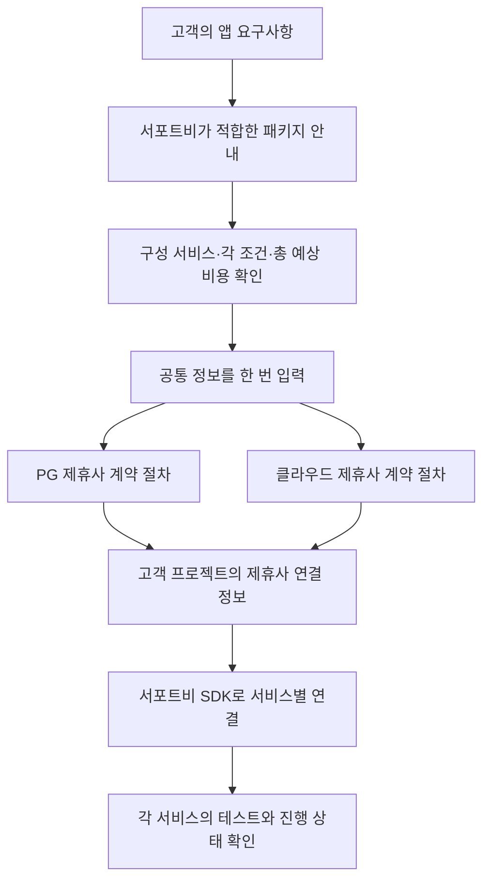

# 서포트비 B2A 첫 출시와 장기 확장 계획

> 구현 현황 (2026-11-09): [공개 조회·발견 평가](B2A_DISCOVERY.md), [계정 연결·상담 준비·웹 확인 발송](B2A_ACCOUNT_CHANNEL.md), [B2A 계측·집계 리포트](B2A_ANALYTICS.md), [계약·연동·수수료 결과 연결](B2A_OUTCOMES.md)을 로컬에서 구현했다. Claude Code·Codex 실제 연결·업무 흐름·갱신·철회는 격리 환경에서 검증했다. 운영 활성화·관리자 대시보드·외부 등록·SDK는 남아 있다.

**현재 후속 구현 순서** — 아래 최초 일정표보다 이 순서를 우선한다. 애널리틱스 이후 계약·수수료 결과 연결을 2순위로 올려, 발견 경로 확대 전에 실제 사업 성과를 확인할 기반을 갖춘다.

| 순서 | 작업 | 현재 상태 |
|---|---|---|
| 1 | 기존 GA4·Axiom 재사용, B2A 호출/실패·전환 집계 | 수집·집계·운영자 리포트 로컬 구현. 운영 적용·실수신 확인·관리자 화면 연결 필요 |
| 2 | 제휴사 계약·연동·수수료 산정/지급 결과 연결 | 원장·운영자 미리보기/기록 CLI·분석 집계·에이전트 안전 상태 조회 구현. 실제 근거 입력·운영 반영은 후속 대화 |
| 3 | 발견 경로 확보·실제 평가 | 외부 문서·템플릿·설치 배포·등록·브랜드 없는 평가 |
| 4 | 다음 세션 이어하기·PG 실행 예제 | 요청 목록·재연결 접근 범위·연동 키트 |
| 5 | 운영 통제·스테이징·베타 | 환경별 단계 노출·호출 제한·실제 PG와 고객 검증 |

현재 승인 범위는 1·2번 구현과 검증·커밋·푸시까지다. 이후 작업은 사용자와 대화해 범위를 정한 뒤 진행한다.

그 이후 PG SDK → 클라우드 한 분야 → 검증된 제휴 서비스 패키지 → 분야·유통 확대로 이어간다.

2026-11-08 · 검토용 제안 · 일정과 수치는 계획 가정이며 현재 성과나 확정 약속이 아니다.

착수 현황: 공개 서비스 목록·준비 정보·조회 MCP·발견 관측과 평가 도구를 로컬 구현했다. 아래 계획 전체의 출시 완료를 뜻하지 않는다. 구현 범위와 남은 단계는 [B2A 개발 안내](B2A_DISCOVERY.md)를 따른다.

첫 출시는 국내 PG 도입을 진행하는 개발자가 Claude Code·Codex에서 서포트비를 발견하고, 요구사항 정리부터 신청·진행 확인·연동 안내까지 이어갈 수 있게 한다. 이후 반복되는 도입 과정을 SDK로 묶고, 클라우드 등 다른 분야와 사전 구성 패키지로 확장한다. 발견 가능성과 애널리틱스는 첫 출시부터 제품 범위에 포함한다.

**1. 유지할 사업 구조와 출시 가정**

- 서비스 이용계약은 고객과 해당 제휴사가 체결한다. 이용료·사용량·초과 과금·해지·환불은 각 제휴사의 조건을 따른다.
- 서포트비는 요구사항 정리, 적합한 제휴 서비스 안내, 신청·계약 절차 연결, 개발 연동을 지원하고 제휴 계약에 따른 수수료를 받는다. 수수료 산정 기준과 지급 주기는 제휴사별로 기록한다.
- 패키지는 서포트비가 선정한 제휴 서비스와 연동 도구의 조합이다. 사전 조건이 확정되면 개별 견적 협의를 줄이지만 필요한 제휴사 계약·심사는 유지한다.
- 현재 코드의 노온–구매사 장기이용 할인 합의서와 PG 서비스 이용계약은 별개다. 기존 합의서를 PG 계약 완료로 계산하지 않는다. 기존 합의서의 다른 분야·패키지 적용 여부는 해당 상품 설계 때 검토한다.
- 신규 PG 요청은 현재의 업종별 추천 정책과 한 PG에 상담을 보내는 흐름을 사용한다. 과거 1:N 견적은 그대로 보존한다.
- 일정은 전담 개발자 2명, 제품·제휴·운영 담당 1명, 디자인·QA 일부 지원을 가정한다. 개발 착수 시점을 1주차로 잡는다. 제휴사 심사·응답과 외부 디렉터리 심사 기간은 개발 일정과 분리한다.
- 첫 기술 검증은 6주차, 비공개 베타는 7~8주차, 일반 공개 판단은 9~10주차를 목표로 한다. 아래 출시 기준을 만족할 때 다음 단계로 넘어간다.

**2. 첫 출시에서 고객이 실제로 할 수 있는 일**

주요 고객은 국내 고객에게 결제를 제공하려는 개발팀이다. 우선 지원할 개발 예제는 Next.js·TypeScript이며, 상담 신청 자체를 이 기술 스택으로 제한하지 않는다. 신규 PG 도입을 대표 시나리오로 삼고, PG 변경은 기존 정책에 맞춰 지원한다.

| 영역 | 첫 출시 산출물 | 고객이 얻는 결과 |
|---|---|---|
| 공개 정보 | 실제 지원 서비스·대상·준비물·정책 출처·갱신일·연동 예제 | 가입 전에 적합성을 판단 |
| 발견 경로 | 개발 문서 6편, 핵심 문서 영어판 2편, Next.js 예제 1개, 외부 참조 협력 | 이름을 몰라도 개발 문제에서 접근할 경로 |
| 에이전트 연결 | 공통 원격 MCP, Claude Code·Codex 설치 안내와 배포 패키지 | 사용하는 에이전트에서 기능 호출 |
| 신청 | 조건 확인, 초안 저장·수정, 누락 질문, 전송, 기존 요청 재개 | 같은 정보를 반복 입력하지 않음 |
| 상태 | 현재 단계, 다음 행동, 담당 주체, 마지막 확인 시각 | 무엇을 기다리고 무엇을 해야 하는지 파악 |
| 계약 연결 | 현재 합의서 화면·제휴사 계약 절차로 연결 | 담당자가 실제 본인인증·서명 수행 |
| 연동 | 제휴 PG 1곳 이상의 검증된 개발 예제·환경 설정 점검 | 계약·필수 정보 확보 후 구현 진행 |
| 운영 | 미처리·오류·추가 정보 요청 목록과 제휴사 결과 입력 | API가 없는 제휴사도 운영 가능 |
| 분석 | 유입부터 신청·계약 확인·연동·수수료까지 연결 | 채널별 가치와 실패 원인 파악 |

현재 발송 가능 판정에는 홈페이지 주소가 필요하고, 가입·업무 접근에는 기존 사업자·승인 절차가 적용된다. 미등록 사업자나 미배포 프로젝트에는 공개 가이드와 로컬 준비 결과를 제공한다. 허위 사업자번호·임시 URL로 기존 검증을 통과시키지 않는다. 요건이 갖춰지기 전 상담을 실제로 접수할 수 있는지는 제휴사와 확인하고 별도 정책으로 추가한다. 로컬 준비 결과에는 비밀값을 넣지 않으며 저장은 사용자가 선택한다.

첫 출시의 연동 키트는 제휴 PG의 공식 SDK/API를 이용하는 실행 가능한 예제다. 여러 PG와 분야를 공통 인터페이스로 감싸는 SDK는 3~4개월 단계에서 실제 사례를 토대로 만든다. 제휴 API가 없는 단계는 운영자가 상태와 증빙을 확인하며, 확인되지 않은 상태는 확인 대기로 표시한다.

**3. 첫 10주의 실행 순서**

| 기간 | 개발 A — 서버·인증 | 개발 B — MCP·개발 경험·분석 | 제품·제휴·운영 | 주차 종료 산출물 |
|---|---|---|---|---|
| 1주 | 기존 규칙·재사용 경계, 인증 방식 검증 | 두 에이전트 연결 실험, 평가 시나리오·이벤트 설계 | 참여 PG와 개발팀 후보, 계약·수수료 확인 방식 정리 | 범위표·호환성 결과·작업 목록 |
| 2주 | 워크스페이스 권한·연결 해제, 공개 목록 | 공개 문서 원문 정리, 빈 계정 설치·인증 | PG 1곳 이상의 파일럿 협의, 외부 문서·템플릿 협력 시작 | 두 에이전트에서 공개 조회·계정 연결 |
| 3~4주 | 초안·발송 가능 판정·전송·중복 방지·상태 API | MCP 도구, 누락 질문·재개, 이벤트 저장과 기본 집계 | 문서 공개, 파일럿 고객 온보딩, 미배포 고객 조건 확인 | 개발 환경에서 신청과 재개 전 과정 |
| 5~6주 | 제휴 결과·수수료 기록, 계약 링크·권한 검증 | Next.js 예제, 패키징, 분석 화면, 호환·실패 테스트 | 운영 절차 리허설, 제휴사 문서 또는 템플릿 참조 확보 | 스테이징에서 전체 흐름·베타 준비 |
| 7~8주 | 실제 오류·권한·상태 불일치 수정 | 브랜드 없는 평가, 두 에이전트 회귀·문서 개선 | 개발팀 5~10곳 목표의 비공개 베타, 실제 신청·결과 확인 | 실제 이용 사례와 실패 원인 보고서 |
| 9~10주 | 운영 용량·관측·부분 차단·복구 점검 | 직접 설치 배포, 디렉터리 신청, 공개 지표 점검 | 공개 여부 판단, 고객 대응·수수료 대조 | 출시 기준 충족 시 일반 공개 |

필수 의존 순서는 인증·권한 → 신청 API → MCP 연결 → 실제 파일럿이다. 문서·발견 경로 확보와 분석 설계는 1주차부터 병행한다. 2주차에 인증 상호운용이 해결되지 않으면 기능을 더 쌓기 전에 인증 방식을 정리한다. 제휴사 계약·디렉터리 승인 지연은 별도로 표시하고, 직접 MCP 연결 경로는 준비한다.

**4. 발견 가능성의 출시 작업**

| 경로 | 첫 출시 작업 | 검증 방법 |
|---|---|---|
| 문제별 공개 문서 | 국내 PG 도입, 계약 준비, Next.js 연결, 기존 PG 변경, 연동 오류, 에이전트 설치·권한의 6개 주제 | 로그인 없이 읽기, 실제 제공 기능과 내용 일치, 예제 재현 |
| 제휴사 개발 문서 | 신규 도입 안내에서 서포트비를 설명하는 참조 협의 | 링크 접근과 유입 연결 확인 |
| 외부 개발 템플릿 | 유지관리자와 협의해 실제 결제 도입 가이드·예제 제공 | 해당 템플릿으로 브랜드 없는 개발 과제 수행 |
| 플러그인·Skill 목록 | Claude Code·Codex 패키지와 작업 중심 설명 제공·등록 신청 | 새 환경 설치·업데이트·제거 검증 |
| SDK 문서 검색 | 실제 공개 SDK가 생기면 Context7에 등록 | 정확한 버전의 API·예제 조회 |
| 개발 플랫폼 목록 | 초기 유입과 사용 사례를 확보한 뒤 입점 검토 | 입점 가능성·계약 구조·실제 노출 범위 확인 |

외부 참조는 첫 출시 목표 2곳으로 잡는다. PG 문서와 제3자 템플릿처럼 서로 다른 출처를 우선하며, 자체 사이트끼리의 링크는 외부 참조로 세지 않는다. 협력사의 게시 여부는 확정 전까지 예정으로 표시한다. 공개 정보에 지원하지 않는 클라우드 상품을 판매 가능한 것처럼 올리지 않는다.

Vercel은 CLI로 서비스 목록과 프레임워크별 가이드를 제공한다. 이 구조를 장기 유통 모델로 참고하되 입점과 노출을 기정사실화하지 않는다. [에이전트 이용 사례](https://vercel.com/kb/guide/using-coding-agents-to-procure-vercel-marketplace-integrations), [통합 등재 조건](https://vercel.com/docs/integrations/create-integration).

Claude Code의 작업 맥락 기반 플러그인 추천은 조직 관리자의 marketplace 허용이 전제다. 개발 대행사·기업 개발팀과의 배포 경로로 검토한다. Context7 등록은 문서 조회 경로이며 일반 개발 질문에서의 추천을 보장하지 않는다. [Claude 추천 조건](https://code.claude.com/docs/en/plugins/relevance), [Context7 등록](https://context7.com/docs/adding-libraries).

**5. 출시와 확장 판단 기준**

다음 기준은 제안한 내부 출시 기준이다. 표본 수·분모를 함께 보고하며 실제 이용에서의 무오류를 보장하는 표현으로 사용하지 않는다.

| 단계 | 필수 기준 |
|---|---|
| 비공개 베타 | Claude Code·Codex 각각 설치→인증→신청→상태 재개 시나리오 통과. 권한·중복·비공개 정보 테스트 통과. 실제 참여 PG와 운영 담당 확보. 주요 이벤트 저장 |
| 일반 공개 | 두 에이전트에서 각각 5회 연속 핵심 E2E 통과. 실제 PG 신청 5건 이상, 최소 1건의 제휴사 계약 확인과 연동 성공, 해당 수수료 산정 근거 기록. 최소 1곳의 외부 개발 문서·템플릿 참조 실제 공개. 고객 대응·장애 차단 절차 확인 |
| 다음 분야 확대 | 최소 4주 실제 운영 데이터, 주요 이탈 원인 설명 가능, 중대한 권한·중복 신청 오류 해소, 현재 유입 경로 중 하나에서 반복 가능한 적합 고객 유입 확인, 신규 제휴사의 조건·상태 확인·수수료 정산 방식 확보 |

제휴사 계약 기간 때문에 실제 계약 확인이 늦어지면 베타를 이어간다. 수수료 지급일이 아직 오지 않았다면 발생 근거만 기록하고 지급 완료로 표시하지 않는다. 디렉터리 심사 통과는 직접 연결 방식의 기술 출시 조건에 넣지 않는다. 브랜드 없는 발견이 계속 0이면 원인을 검색·참조·추천 단계로 나눠 개선하고 분야 확대 투자를 늦춘다.

**6. 구현 구조와 작업 단위**

첫 버전은 현재 Next.js 애플리케이션과 Postgres를 활용한다. MCP에는 입력·출력 변환과 프로토콜 처리를 두고, 업무 규칙은 서비스 계층에서 실행한다. 긴 제휴사 심사를 도구 호출 하나로 기다리지 않는다. 요청 ID와 다음 행동을 반환하고, 다음 세션의 상태 조회로 이어간다. 에이전트 채널은 제휴사별 최대 호출 빈도와 재조회 시각을 안내한다.

| 작업 | 재사용할 구현 | 추가할 것과 완료 기준 |
|---|---|---|
| 서비스 설명 | lib/seo/product-facts.ts, lib/seo/llms.ts | 실제 지원 범위·정책 출처·문서 버전을 한 원본에서 공개 문서와 목록에 반영 |
| 입력·발송 준비 | lib/rfp/intake/schema.ts, lib/rfp/send-readiness.ts | 웹과 같은 입력 검증을 사용하고 누락 항목을 구조화해 반환 |
| PG 추천 | lib/server/services/pg-recommendation.ts | 같은 관리자 정책 적용. 공개 목록과 고객별 추천 응답을 분리 |
| 신청 | lib/server/services/rfp.ts의 createRfp | 기존 requestKey·본문 해시를 활용하고 에이전트 요청·이벤트와 원자적으로 연결 |
| 조회 | lib/server/rfp-detail-loader.ts | 구매사 권한으로 필요한 필드만 제공하는 API 응답 구성. 화면용 전체 응답 직접 노출 금지 |
| 계약 연결 | lib/server/services/platform-agreement.ts | 기존 노온 합의서 흐름으로 연결. 외부 PG 계약 상태는 별도 기록 |
| 분석 | lib/analytics/funnel-definitions.ts, 기존 고객 여정 이벤트 | 브라우저 없이도 서버에서 생성하는 B2A 업무 이벤트와 유입 연결 |
| 운영 | 별도 admin-supporter-b 저장소 | 연결 현황·실패 요청·제휴사 결과·수수료 대조·분석 화면 |
| 문서·배포 | 별도 docs-supporter-b 저장소 | 개발 문서·예제·설치 안내. 공개 배포용 저장소·패키지 이름은 배포 전에 확보 |

새 모듈의 제안 위치는 app/api/agent/v1, app/mcp, lib/server/agent, lib/server/services/agent-request, lib/server/repositories 아래의 대응 저장소다. 공개 목록·문서와 인증된 API의 라우트 규칙을 분리한다. 정확한 파일 분할은 첫 구현에서 기존 구조에 맞춘다. 공개 SDK·예제·플러그인은 공개 가능한 전용 배포 저장소에 두어 내부 제품 코드를 노출하지 않는다.

에이전트의 연결은 OAuth 기반 위임 인증을 사용한다. 기존 웹 로그인으로 본인을 확인하고, 접근할 워크스페이스와 허용 기능을 선택하게 한다. 기존 로그인 구현 자체를 MCP용 토큰 발급 서버로 간주하지 않는다. 1주차에 유지보수되는 표준 구현을 선정하고 두 클라이언트의 등록·콜백·토큰 갱신·철회를 검증한다. MCP의 HTTP 인증 규격과 두 하네스의 지원 범위를 기준으로 구현한다. [MCP 인증](https://modelcontextprotocol.io/specification/latest/basic/authorization), [Claude Code MCP](https://code.claude.com/docs/en/mcp), [Codex MCP](https://learn.chatgpt.com/docs/extend/mcp?surface=cli).

접근 권한은 공개 정보 조회, 내 요청 조회, 초안·상담 신청처럼 나눈다. 토큰의 워크스페이스·유효기간·권한과 현재 DB의 멤버십·승인 상태를 매번 검증한다. 연결 해제 후에는 다음 호출부터 차단한다. 에이전트가 임의의 workspaceId나 includeTestPg를 지정해 권한·추천 정책을 바꾸지 못하게 한다.

첫 도구 목록은 다음을 제안한다. 이름은 구현 시 확정한다.

| 도구 | 권한·동작 | 결과 |
|---|---|---|
| list_services | 공개 조회 | 지원 분야·제휴 서비스·조건과 출처 |
| get_requirements | 공개 조회 | 신청 전 준비 사항과 개발 예제 |
| recommend_pg | 인증된 구매사의 조건 조회 | 현재 정책에 맞는 상담 후보와 이유 |
| prepare_request | 인증된 초안 작성·수정 | 요청 ID, revision, 누락 정보, 전송 전 요약 |
| submit_request | 상담 신청 권한과 고객이 확정한 요청 | 기존 PG 상담 생성, 중복 시 같은 요청 반환 |
| get_request_status | 본인 워크스페이스 조회 | 단계·다음 행동·확인 주체·확인 시각 |
| get_integration_guide | 공개 가이드 또는 권한 있는 고객별 안내 | 지원 버전·설정 항목·공식 문서·테스트 절차 |

인증 동의와 실제 신청 의사를 구분한다. 고객이 허용한 상담 신청 범위에서 확정된 내용으로 전송하고, 정보가 달라진 재시도는 거부한다. 허용 범위 안의 반복 조회·초안 수정마다 추가 승인을 요구하지 않는다. 견적 조건 선택, 노온 합의서 발송, 제휴사 약관 수락·서명은 첫 출시에서는 기존의 명시적인 사용자 절차로 연결한다. 사용자가 서명해야 할 문서를 에이전트가 대신 서명하는 기능은 제공하지 않는다.

새 데이터의 최소 논리 단위는 다음 여섯 가지다. 초기에는 기존 PG 테이블을 범용 테이블로 일괄 변경하지 않는다.

| 데이터 | 보관 내용 |
|---|---|
| 서비스 목록 | 제휴사가 공개를 허용한 서비스·지원 상태·신청 조건·문서/정책 출처·판본. 고객 견적·비공개 제안과 분리 |
| 에이전트 연결 | 고객·워크스페이스·클라이언트·위임 권한·만료·철회 |
| 에이전트 요청 | 초안·revision·확정 내용·중복 방지 키·기존 RFP 연결 |
| 유입 접점 | 문서·템플릿·캠페인·첫/최근 접점과 연결 가능한 식별자 |
| 업무 이벤트 | 사건 ID·스키마 버전·요청·도구·결과·시각·관측 출처 |
| 제휴사 결과 | 외부 계약 참조·확인 근거·확인자·연동 상태·수수료 산정/지급 상태 |

**7. 애널리틱스 설계와 실험 계획**

발견 → 적합성 확인 → 연결 → 신청 → 제휴사 계약 확인 → 연동 성공 → 수수료 지급을 추적한다. 노온 합의서 완료, 제휴사 계약 완료, 테스트 결제 성공은 서로 다른 사건이다. 에이전트의 성공 보고만으로 제휴사 계약·수수료를 확정하지 않는다.

| 질문 | 이벤트 예시 | 신뢰할 근거 |
|---|---|---|
| 어디에서 들어왔나 | discovery_touch, catalog_read | 실제 요청·유입 표식. 봇 조회와 사람 이용을 구분하고 모르면 unknown |
| 어떤 작업에 필요했나 | requirement_checked, unsupported_need | 고객이 제공한 구조화 요구. 소스 코드·전체 대화는 수집하지 않음 |
| 연결에 성공했나 | connection_completed, connection_failed | 인증 서버 결과 |
| 어디서 막혔나 | request_prepared, request_blocked | 검증 실패·준비 부족·권한·제휴사 대기 등 표준 이유 |
| 실제 신청했나 | request_submitted | 상담 생성 트랜잭션의 서버 기록 |
| 실제 계약했나 | partner_contract_confirmed | 검증한 제휴 API·제휴사 확인·운영자가 확인한 증빙 |
| 연동됐나 | integration_test_passed | 테스트 결과와 출처. 고객 보고·제휴사 확인을 구분 |
| 수익이 생겼나 | commission_confirmed, commission_paid | 제휴 계약 산정 근거와 지급 대조 |

공통 필드는 event_id, schema_version, occurred_at, received_at, journey_id, request_id, service_id, 문서·정책·도구 버전, 결과 코드, 소요 시간, 근거 출처다. 인증 후 고객·워크스페이스를 연결한다. 하네스·모델·버전은 제공받거나 검증 가능한 범위에서만 저장하고 누락은 unknown으로 남긴다. 같은 요청의 재시도 횟수는 운영 지표에 기록하되 신청·계약 수는 중복 제거한다.

추천을 사용자에게 실제로 보여줬는지는 일반 MCP 응답 로그만으로 알 수 없다. 공개 문서 조회를 추천 노출로 계산하지 않는다. 실제 추천은 평가 실행의 관측 가능한 응답 또는 동의한 파일럿 기록에서 확인하고, 운영 전환과 분리한다. 최초 유입을 확인할 수 없는 고객도 unknown으로 보존하며 임의로 마지막 에이전트에 성과를 귀속하지 않는다.

초기 평가는 브랜드 없는 질문 20개로 시작한다. 도입 지원이 적합한 12개, 기존 계약·코드 수정 등 부적합한 8개를 포함한다. 두 하네스 × 세 환경 × 각 질문 3회로 360회가 한 회차다. 환경은 ①서포트비 설정 없는 일반 프로젝트 ②외부 제휴 문서·템플릿을 쓰는 프로젝트 ③서포트비가 설치된 프로젝트다. 세 결과를 합쳐 자연 발견률로 보고하지 않는다. 실행 비용을 먼저 소량 측정하고 전체 평가 비용을 산정한다.

웹 검색 사용 여부, 실제 참고 자료, 발견/추천 여부, 추천 이유, 정확성, 연결·신청 성공을 기록한다. 모델·하네스 버전, 실행일, 문서 버전, 프로젝트 조건을 고정·기록한다. 1주차 기준선과 베타 종료 시 전체 평가를 비교하고, 이후 매주 대표 6개 질문을 실행한다. 큰 변경 시 전체 평가를 다시 실행한다. 평가 입력에는 내부 정답을 주입하지 않으며 테스트·시드 트래픽은 운영 성과에서 제외한다. [브랜드 없는 요청과 부적합 요청 평가 방법](https://developers.openai.com/plugins/guides/optimize-metadata).

첫 대시보드는 네 화면으로 구성한다. 발견 화면은 출처별 조회·연결과 별도 실험 추천률을, 전환 화면은 신청·계약·연동·수수료를, 실패 화면은 중단 이유·복구 시간·수동 개입을, 수요 화면은 미지원 분야·기술 스택·패키지 요구를 보여준다. 세그먼트는 유입 경로·하네스·서비스·신규/변경·문서 버전으로 나눈다.

초기 원장은 Postgres의 서버 이벤트와 일별 집계로 운영하고, 웹 분석은 기존 GA4와 연결한다. 이벤트 전달 실패가 신청을 중복 실행시키지 않도록 업무와 사건을 함께 기록한 뒤 비동기로 집계한다. 업무 DB 부하나 분석 지연이 문제가 되면 별도 분석 저장소로 옮긴다. 계약 원문·결제정보·비밀키는 분석 이벤트에 포함하지 않는다. 원문 오류 로그 30일, 가명 이벤트 12개월, 월별 집계 24개월을 초기 보존안으로 두고 출시 전 수집 고지·삭제 처리·용량을 검토한다. 계약 증빙의 보존은 기존 업무 정책과 별개로 관리한다.

**8. 3~4개월 — PG 채널을 반복해서 사용할 수 있게 만들기**

목표는 실제 유입·계약·연동의 실패를 줄이고 첫 SDK의 공통 범위를 확인하는 것이다. 동시에 다음 분야의 제휴 협의를 시작한다.

- 발견 실험에서 자주 나타나는 3개 개발 문제에 문서·예제를 집중한다. 제휴사 개발 문서, 외부 템플릿, 개발 대행사 중 성과가 확인된 경로를 확대한다.
- 신청 후 다시 접속했을 때 필요한 행동을 바로 안내하고, 제휴사 답변·추가 자료 요청을 기존 알림과 연결한다. 에이전트가 꺼진 동안에도 서버가 진행 기록을 유지한다.
- PG 1곳의 TypeScript SDK 실험판을 만든다. 설정 검증·공식 SDK 연결·테스트 절차를 제공하고, 결제 요청은 정해진 제휴사 경로로 전달한다. 비밀키는 고객의 실행 환경에서 관리한다.
- 두 번째 PG에서 같은 방식이 성립하는지 확인한 뒤 공통 API의 안정 버전을 정한다. 결제수단·취소·웹훅처럼 PG별 차이를 공통화할지 그대로 노출할지 실제 계약 테스트로 결정한다.
- 제휴사별 확인·수수료 대조를 자동화할 수 있는 구간을 찾아 운영자의 반복 입력을 줄인다.
- 고정 조건을 제공할 수 있는 PG가 있으면 단일 분야 패키지를 3~5개 프로젝트에 제안해 본다. 개별 견적 생략 가능성과 SDK 준비 효과를 확인하고, 별도 패키지 수요가 없으면 일반 상담 흐름을 개선한다.

완료 기준은 SDK를 이용한 제휴 PG별 테스트 시나리오 통과, 실제 이용 프로젝트 3곳 이상의 설정·연동 피드백, 최소 4주의 채널별 전환·지원 비용 데이터다. 파트너가 공개 SDK 사용·고객 연결 방식·수수료 귀속을 확인해야 해당 연동을 출시한다.

**9. 5~6개월 — PG 밖의 한 분야 검증**

기본 후보는 관리형 PostgreSQL이다. 앱에서 연결 확인과 간단한 데이터 저장으로 개발 결과를 검증하기 쉽다는 설계 판단이다. 3~4개월의 미지원 수요에서 앱 호스팅 등 다른 분야가 더 필요하고 제휴 조건도 갖춰진다면 그 분야를 우선한다. 선택 기준은 실제 요청 수, 제휴 가능성, 고객 계정 소유, 계약·상태 확인 방법, 수수료 지급 구조, 연동 품질이다.

- 제휴사 한 곳, 대표 서비스 한 개, 명확한 고객 유형으로 시작한다. 무료 플랜이 수수료 대상인지도 제휴 조건에서 확인한다.
- 서비스별 신청 항목·지원 여부·가격 출처·정책·다음 행동을 목록에 추가한다. 사용료를 추정할 경우 추정 시각·가정을 표시하고 실제 청구는 제휴사 조건을 따른다고 안내한다.
- 제휴사 API가 있으면 계정 연결·신청·진행 조회를 연결하고, 없으면 명시적인 운영자 처리 경로를 둔다. 호출로 가능한 행동과 사람에게 필요한 행동을 기능 목록으로 구분한다.
- PG 신청 데이터에 클라우드 항목을 억지로 저장하지 않고 공통 신청의 서비스별 상세를 둔다. 기존 PG 요청은 연결 모듈로 연결한다.
- SDK에 해당 서비스의 설정·연결 검증 모듈을 추가한다. PG와 DB에 같은 호출 형태를 강제하지 않는다.

완료 기준은 해당 분야의 계약·계정 연결·고객 프로젝트 연결·수수료 귀속을 확인한 사례 3건 목표, 조건과 진행 상태의 정확성, PG 기능 회귀 없음이다. 제휴사 선정이나 수수료 구조가 해결되지 않으면 이 단계의 거래 기능을 공개하지 않고 PG 채널 개선을 계속한다.

**10. 7~9개월 — 여러 제휴사의 패키지**

첫 패키지는 실제로 검증한 PG와 클라우드 서비스만 조합한다. 예시는 국내 판매용 Next.js 앱을 위한 PG·관리형 DB·연동 SDK 묶음이다. 단건 결제, 정기 결제 등 기능은 제휴사가 실제로 지원하는 범위로 제한한다.

| 기능 | 구현 내용 |
|---|---|
| 패키지 정의 | 구성 서비스·선정 이유·신청 요건·조건 판본·호환 SDK 버전 |
| 추천 | 요구사항과 호환성 중심의 규칙. 추천 근거와 충족하지 못한 요구도 표시 |
| 신청 묶음 | 공통 정보 재사용, 제휴사별로 필요한 정보만 전달, 중복 신청 방지 |
| 계약 | 제휴사별 필요한 약관·본인인증·서명으로 연결. 기존 노온 합의서의 적용 여부는 별도 검토 |
| 상태 | 예: PG 계약 확인 완료, DB 계정 확인 대기. 각 서비스의 다음 행동 표시 |
| SDK | payments·database 등 기능별 모듈과 설정·예제·진단. 비밀값은 고객 환경에서 관리 |
| 변경·해지 | 제휴사별 절차와 결과 추적. 패키지 전체를 동일 정책으로 자동 취소·환불하지 않음 |
| 분석 | 패키지 선택 이유, 구성별 신청·계약·연동, 제휴사별 수수료와 운영 비용 |

패키지를 골라도 제휴사가 최종 심사에서 조건을 확정해야 한다면 확정 전 상태를 표시한다. 고객이 동의한 뒤 조건이 달라지면 새 판본의 차이를 보여주고 영향을 받는 신청을 다시 확인한다. 기존 계약의 조건 판본은 보존한다. 기존 이용 서비스가 있는 고객에게는 중복 도입하지 않도록 이미 쓰는 항목과 새로 필요한 항목을 구분한다.

먼저 패키지 하나를 고객 프로젝트 5곳 목표로 운영한다. 일반 신청과 고객 준비도·서비스 구성이 비슷한 사례에서 반복 입력 수, 개발자 작업 시간, 연동 완료율, 운영 개입 비용을 비교한다. 표본이 작을 때 단순 전환율 차이를 인과 효과로 단정하지 않는다. 다음 패키지는 공통 준비·SDK가 반복 작업을 줄였다는 근거와 실제 수요를 확보한 뒤 추가한다.

**11. 10~12개월 이후 — 배포 경로와 분야 확대**

- 성과가 확인된 제휴사·템플릿 경로를 늘리고, 개발 대행사에는 여러 고객 프로젝트의 연결·권한을 구분하는 기능을 제공한다.
- 제휴사가 서비스 조건·지원 범위·문서·계약 상태·수수료 내역을 직접 갱신할 수 있는 관리 기능을 만든다. 정보 판본과 수정 이력을 보존한다.
- 개발 플랫폼 marketplace 입점을 추진한다. 직접 계약 구조, 공급자 계정 연결, 수수료 귀속, 목록 노출 조건이 맞는 플랫폼만 선택한다.
- SDK의 지원 버전·변경 이력·폐기 일정·제휴사 호환성 테스트를 정례화한다. 기존 프로젝트를 깨뜨리는 자동 교체는 하지 않는다.
- 기업 고객은 허용 서비스·제휴사·지역·승인 담당을 설정하고, 에이전트가 이 범위에서 반복 신청 준비를 자동화하게 한다. 계약 조건 변경과 서명은 해당 고객·제휴사의 절차로 연결한다.
- 신규 분야는 미지원 요구가 반복되고 제휴 조건이 확보된 순서로 늘린다. 저장소·메일·인증·관측 서비스는 후보이며 첫 출시 때 제공 가능하다고 표시하지 않는다.
- 추천 개선에는 요구사항 적합성, 연동 성공, 고객 피드백, 운영 부담을 사용한다. 초기에는 설명 가능한 규칙을 유지하고 데이터가 충분해지면 과거 사례로 검증한 뒤 점진적으로 개선한다.

이 단계의 목표는 공급자를 늘리는 개수보다 고객이 새 프로젝트에서도 다시 사용하는 비율, 적합한 프로젝트의 계약·연동 성공, 프로젝트당 실제 수수료와 지원 비용의 개선이다. 직접 MCP·문서 연결은 유지해 특정 marketplace 정책 변화에 대응한다.

**12. 지표·운영·검증의 구체적인 기준**

| 지표 | 초기 목표 또는 운영 방식 |
|---|---|
| 설치·연결 성공 | 두 하네스에서 각각 정상 조건 30회 중 95% 이상 목표. 실패 원인과 버전 기록 |
| 설치 후 적절한 추천 | 적합 질문의 80% 이상 목표, 부적합 질문의 불필요한 추천 5% 이하 목표. 환경별 n/N 함께 표시 |
| 설치 전 발견 | 기준선부터 측정. 외부 템플릿 경유와 일반 검색을 분리하고 반복 실행의 발견 수·출처를 비교 |
| 신청 성공 | 신청 요건을 갖추고 제출을 시도한 요청을 분모로 사용. 검증 거절·기술 실패·고객 중단 구분 |
| 실제 전환 | 같은 신청 월의 고객을 묶어 제휴사 계약·연동·수수료를 추적. 아직 대기 중인 건을 실패로 확정하지 않음 |
| 개발자 효용 | 연결부터 신청까지의 고객 작업 시간, 연동 작업 시간, 반복 질문 수 |
| 운영 효율 | 신청당 운영자 개입 횟수·시간, 제휴사 상태 확인 지연, 복구 시간 |
| 수익 | 제휴사별 확정 수수료와 실제 지급 수수료를 구분. 고객의 PG 거래액·클라우드 사용료를 서포트비 매출로 계산하지 않음 |

사업성은 실제 지급 수수료에서 유입 비용, 에이전트/API·저장소 비용, 고객 지원·제휴 확인 작업 비용을 차감해 본다. 가격과 수수료율은 제휴 조건 확인 후 채운다. 분석·평가 실행 비용에는 월별 한도를 두고 1주차 소량 실행 결과로 예산을 산정한다.

출시 전 검증은 기능의 경계에 맞춘다.

- 인증·권한: 타 워크스페이스 접근, 철회·만료 토큰, 정지 계정, 승인 취소, 변경된 멤버십, 권한 부족 호출을 거부한다.
- 정확한 업무 실행: 동일 신청 재전송·응답 유실·동시 제출에도 상담과 알림은 한 번이다. 같은 키로 내용 변경 시 충돌을 반환한다. 기존 추천 정책·한국 영업일 마감·봉인 입찰 비공개 경계를 지킨다.
- 비동기 상태: 제휴사 응답 지연·중복·역순 도착·연결 실패가 완료 상태를 잘못 만들지 않는다. 출처·마지막 확인 시각과 수동 대조 기록을 남긴다.
- 에이전트 호환: 두 하네스에서 새 설치, 로그인, 누락 정보 질문, 전송, 세션 종료 후 재개, 연결 해제를 실행한다. 지원 버전을 기록한다.
- 분석: 중복 이벤트와 지연 이벤트가 전환 수를 바꾸지 않고, 시험·봇 트래픽이 실제 계약 지표에 섞이지 않는다. 삭제·보존 처리와 민감정보 제외를 확인한다.
- SDK: 공식 테스트 환경에서 성공·실패·재시도·웹훅 검증 등 실제 제공하는 기능을 검증하고, 고객 비밀값을 패키지·저장소·분석 로그에 넣지 않는다.

운영 배포는 DDL 선행 → 기능 비활성 배포 → 내부 워크스페이스 → 비공개 베타 → 일반 공개 순서다. 공개 조회와 쓰기 기능의 차단 스위치를 구분하고, 쓰기를 중단해도 진행 중인 요청을 조회할 수 있게 한다. 자동 재전송보다 미확정 결과 대조를 우선하며 이미 접수된 업무 데이터는 보존한다. 구현 때 THREAT_MODEL.md와 해당 AR-N, 라우트·화면 문서, 배포 절차를 함께 갱신한다.

**13. 담당과 첫 착수 작업**

개발 A는 인증·권한·업무 API·데이터 무결성을, 개발 B는 MCP·개발 문서·예제·분석·클라이언트 호환을 맡는 가정이다. 공동 검토 항목은 서비스 경계와 이벤트 계약이다. 제품·제휴 담당은 제공 조건·계약 귀속·수수료 대조·배포 협력을, 운영 담당은 미처리 요청·고객 지원·실제 상태 확인을 책임진다. 1인이 여러 역할을 맡으면 일정은 이 가정에 맞춰 다시 산정한다.

| 순서 | 바로 착수할 작업 | 완료 결과 |
|---|---|---|
| 1 | 현재 PG 상담·노온 합의서·외부 PG 계약·수수료를 구분해 기록 | 서비스/상태 정의와 제휴사 확인 항목 |
| 2 | 현재 공개 설명의 과거 비교·게시판 표현 점검 | 실제 기능과 일치하는 공개 원문 수정안 |
| 3 | Claude Code·Codex 공통 MCP와 인증 실험 | 두 환경의 조회·인증·철회 확인 |
| 4 | 20개 평가 질문과 360회 평가 매트릭스 정의 | 설치 전 기준선, 평가 비용, 회귀 기준 |
| 5 | 최소 이벤트·요청 식별·권한 모델 설계 | 신청과 분석을 연결하는 구현 명세 |
| 6 | 제휴 PG·개발팀·문서/템플릿 협력 후보 선정 | 파일럿·상태 확인·외부 참조 확보 계획 |

외부 연락·게시·설치·운영 배포는 이 계획 작성에 포함하지 않는다. 제휴 가능성이나 플랫폼 노출은 확인된 결과가 생길 때 계획의 상태를 갱신한다.

### 2026-11-08 실제 하네스 검증 진척

Claude Code 2.1.302의 사용자 OAuth 동의·토큰 교환, 구매사 조회, 가상 PG 추천, 상담 초안 생성·같은 입력 재시도·상태 조회를 격리 환경에서 확인했다. 초안과 분석 이벤트의 DB 기록, 실제 브라우저 확인 화면도 확인했다. 사람이 웹에서 보낸 뒤 Claude Code가 submitted·sent 상태를 조회하는 흐름도 확인했다. 추가 검증에서 Claude Code의 자연 만료 후 갱신·철회, Codex CLI 0.166.0의 OAuth·동일 업무 흐름·만료401 후 갱신·철회도 통과했다. 철회된 refresh가 503으로 잘못 반환되던 오류는 v0.48.0.3에서 400 invalid_grant로 수정했다. 운영 환경 검증과 공개 준비는 별도다. 상세 근거와 범위는 [계정 채널 검증](B2A_ACCOUNT_CHANNEL.md#실제-claude-code-검증--2026-11-08)에 기록한다.
