# GA 트래킹 플랜

> **화면 16개 · 정의 이벤트 10종 · 운영 관측 7종 · 기간 내 미관측 3종**
> 확인일 2026-11-06 | GA4 supporter-b · 540469131 | 조회 기간 2026-10-09~11-05

## 목적

각 화면에서 어디를 클릭하거나 어떤 처리가 끝났을 때 이벤트가 발생하는지 확인하고, 추가 추적이 필요한 지점을 찾는다.

## 화면별 이벤트

화면의 주황색 번호는 버튼 위치입니다. 괄호는 `funnel_id / step_id`입니다. 화면은 예시 데이터이며, 이벤트 조건은 코드 확인 기준입니다.

| 화면 | 핵심 이벤트·발생 조건 |
| --- | --- |
| **01 견적 질문** 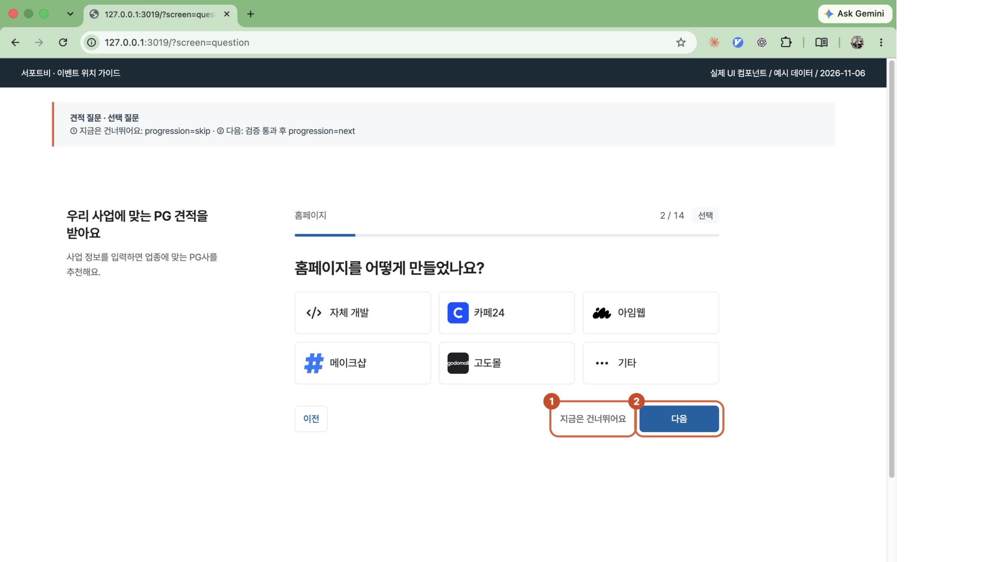 | 표시 → `funnel_step_view` (`questions / solution` 예시) ① 건너뛰기 → `funnel_step_complete`, `progression=skip` ② 다음 검증 통과 → `funnel_step_complete`, `progression=next` 추적이 연결된 검증 오류 → `funnel_step_error` |
| **02 계약 유형** 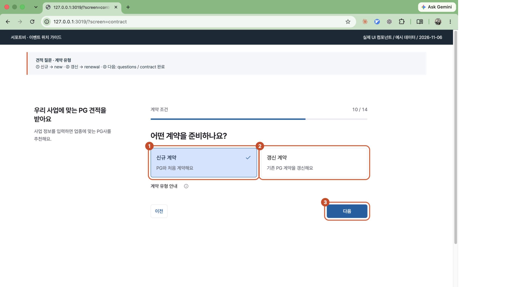 | 표시 → `funnel_step_view` ③ 다음 검증 통과 → `funnel_step_complete` (`questions / contract`) `contract_type`: ① 신규 = `new`, ② 갱신 = `renewal`, 미선택·값 미전달 = `unknown` 선택 카드 자체의 클릭 이벤트는 없음 |
| **03 비회원 답변 수정** 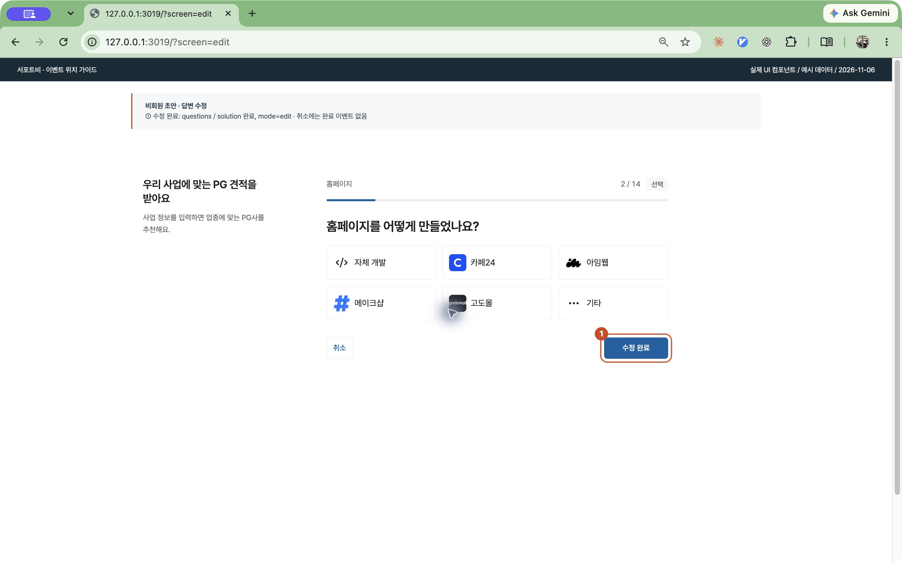 | 표시 → `funnel_step_view` ① 수정 완료 검증 통과 → `funnel_step_complete` `questions / solution`, `mode=edit` 명시적인 답변 수정 흐름은 `edit`. 일반 작성·이전 이동·회원 작성은 기본 `write` |
| **04 작성 마치기** 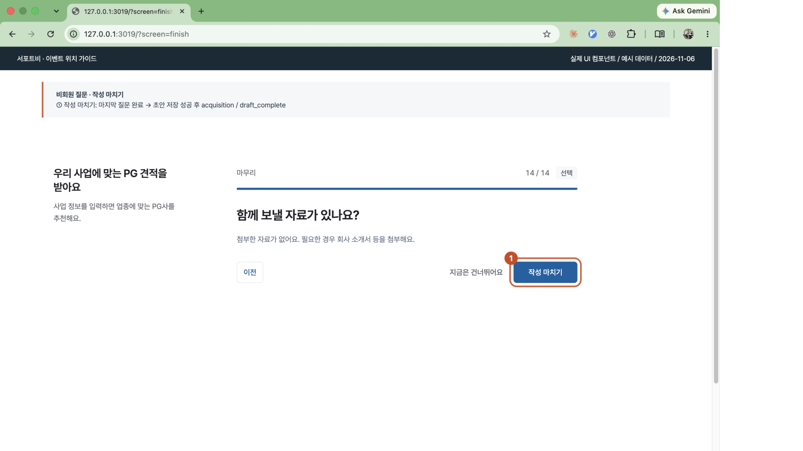 | 표시 → `funnel_step_view` (`questions / attachments`) ① 작성 마치기 검증 통과 → `funnel_step_complete` (`questions / attachments`) 비회원 초안 저장 성공 → `funnel_step_complete` (`acquisition / draft_complete`) 초안 저장은 상담 요청 발송과 다름 |
| **05 가입 이메일** 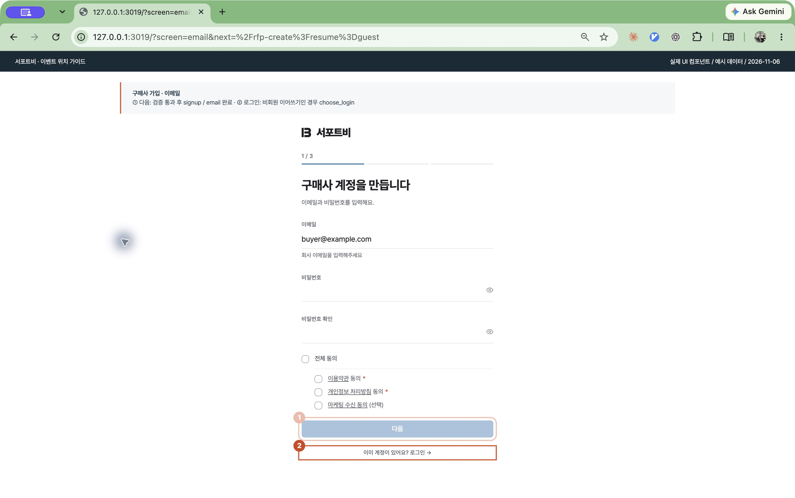 | 표시 → `funnel_step_view` (`signup / email`) ① 다음 검증 통과 → `funnel_step_complete` (`signup / email`) ② 로그인: 비회원 이어쓰기 경유 시 → `funnel_cta_click` (`acquisition / choose_login`) |
| **06 회사 정보** 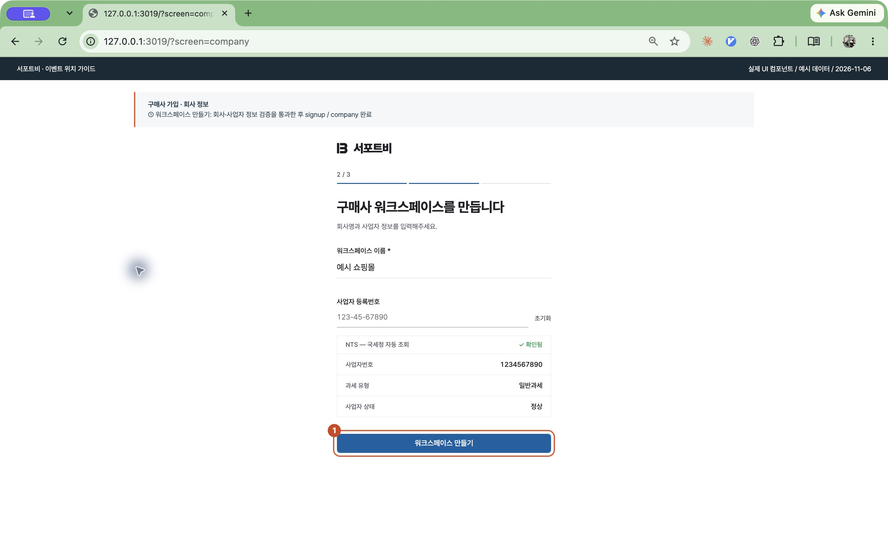 | 표시 → `funnel_step_view` ① 워크스페이스 만들기 검증 통과 → `funnel_step_complete` `signup / company` |
| **07 담당자·휴대전화** 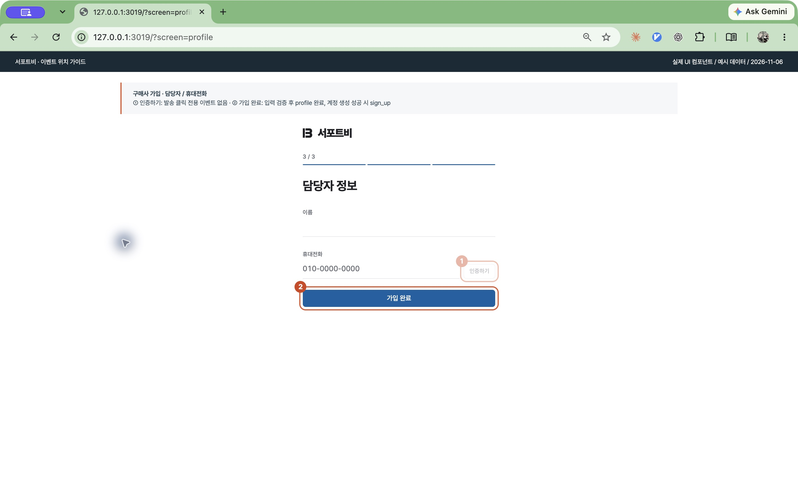 | 표시 → `funnel_step_view` (`signup / profile·phone`) ① 이후 휴대전화 인증 성공 → `funnel_step_complete` (`phone`) ② 가입 완료 검증 통과 → `funnel_step_complete` (`profile`) 계정 생성 성공 → `sign_up` 연결된 가입·인증 오류 → `funnel_step_error` |
| **08 이메일 인증** 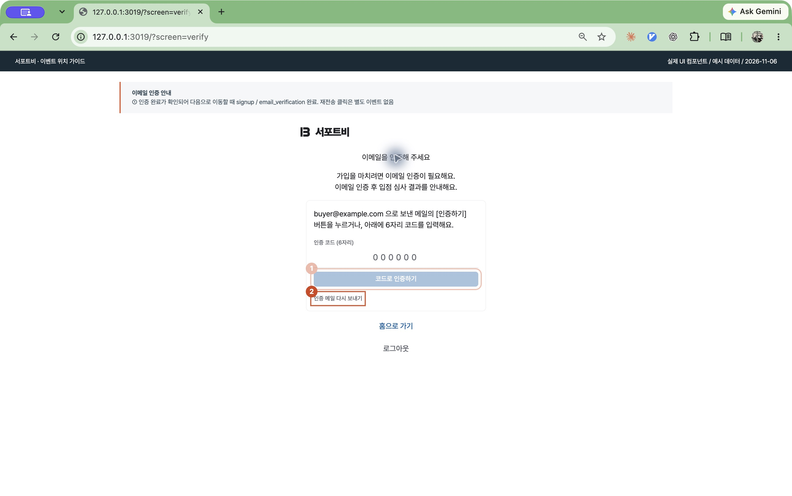 | 표시 → `funnel_step_view` ① 코드·링크 인증 완료 확인 후 진행 → `funnel_step_complete` `signup / email_verification` ② 인증 메일 재전송 전용 이벤트 없음 |
| **09 승인 대기** 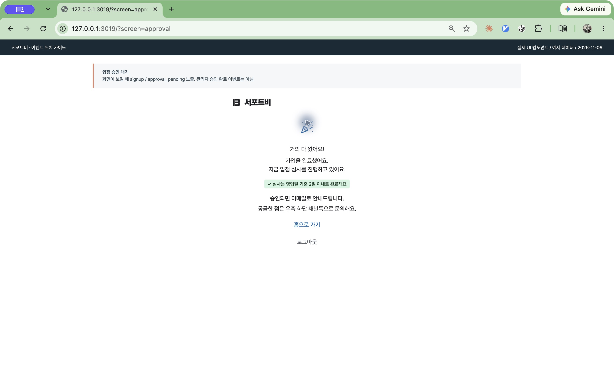 | 표시 → `funnel_step_view` (`signup / approval_pending`) 관리자 승인 완료 이벤트는 아님 |
| **10 회원 사업자 정보** 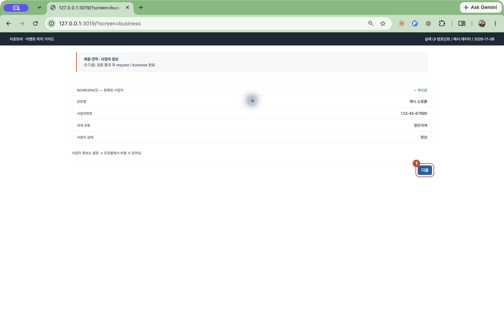 | 표시 → `funnel_step_view` ① 다음 검증 통과 → `funnel_step_complete` `request / business` |
| **11 최종 상담 요청** 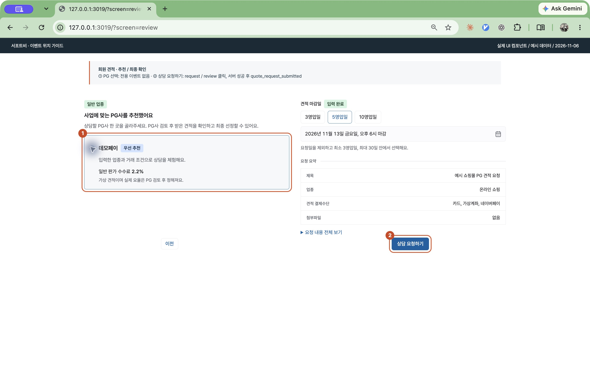 | 표시 → `funnel_step_view` (`request / recommendation·review`) ② 상담 요청 처리 시작 → `funnel_cta_click` (`request / review`) 요청 성공 → `quote_request_submitted` 요청 오류 → `funnel_step_error` ① PG 선택 전용 이벤트 없음 |
| **12 비회원 추천 결과** 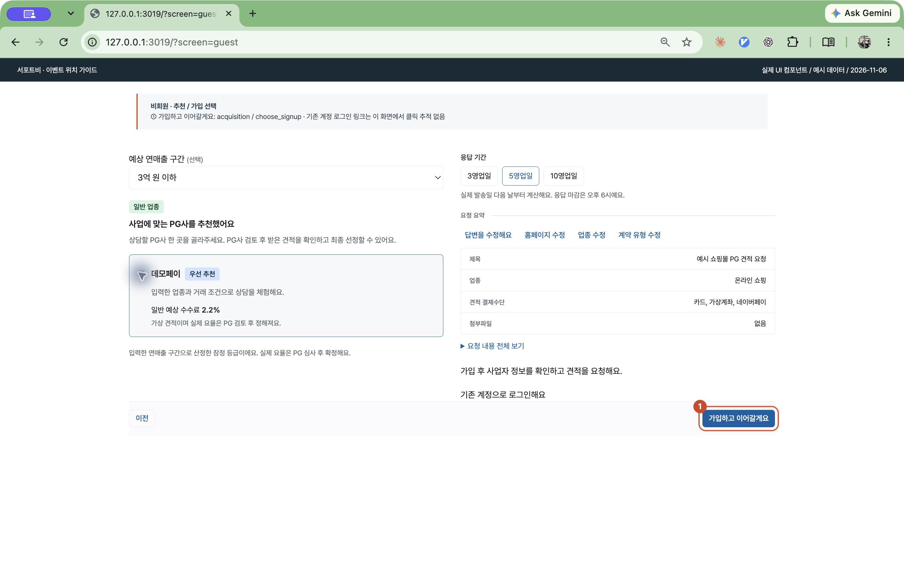 | ① 가입하고 이어갈게요 → `funnel_cta_click` (`acquisition / choose_signup`) PG 선택·로그인 링크 전용 클릭 이벤트 없음 |
| **13 비회원 자동 요청** 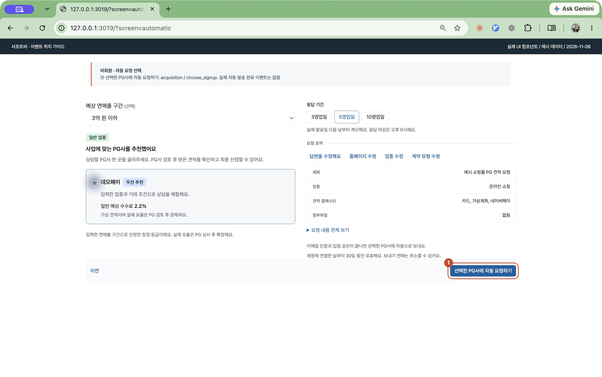 | ① 선택한 PG사에 자동 요청하기 → `funnel_cta_click` (`acquisition / choose_signup`) 실제 자동 발송 완료 전용 GA 이벤트 없음 |
| **14 메인 랜딩** 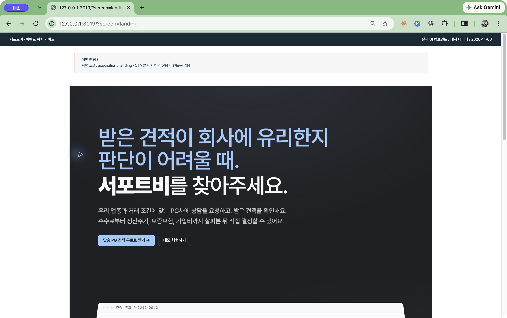 | 표시 → `page_view` + `funnel_step_view` (`acquisition / landing`) 견적 받기 버튼 전용 클릭 이벤트 없음 |
| **15 UTM 도구 상단** 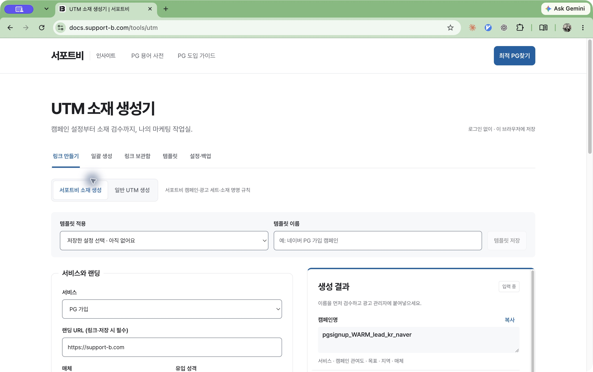 | 최적 PG찾기 → `main_site_click` 복사 성공 → `utm_tool_action`, `action=copy` 템플릿 적용 → `utm_tool_action`, `action=template_apply` |
| **16 UTM 도구 하단** 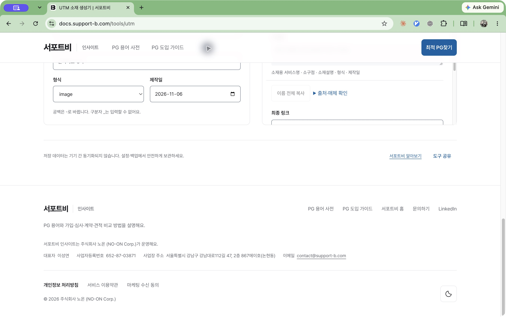 | 도구 공유 성공 → `utm_tool_action`, `action=share` 서포트비 알아보기·서포트비 홈 → `main_site_click` |

## 이벤트 목록

코드 연결과 운영 수신은 별도로 표시한다. 아래 수신 건수는 속성 전체·전체 사용자 기준이며, 개별 화면마다 전송을 재현한 결과는 아니다.

| 이벤트명 | 발생 조건 | 운영 수신 | 건수 |
| --- | --- | --- | ---: |
| `page_view` | 수집 대상 페이지 진입·경로 변경 | 관측 | 1587 |
| `funnel_step_view` | 가입·견적 단계 표시 | 관측 | 315 |
| `funnel_step_complete` | 단계 검증 통과·건너뛰기·인증 성공·초안 저장 성공 | 관측 | 105 |
| `funnel_step_error` | 추적이 연결된 검증·서버·네트워크 오류 | 관측 | 20 |
| `funnel_cta_click` | 연결된 로그인·가입 버튼 클릭, 상담 요청 처리 시작 | 관측 | 9 |
| `sign_up` | 구매사 계정 생성 성공 응답 | 관측 | 1 |
| `quote_request_submitted` | 회원 견적 작성의 최종 상담 요청 성공 | 기간 내 미관측 | — |
| `docs_main_arrival` | 유효한 인사이트 경유 정보를 포함한 메인 도착 | 기간 내 미관측 | — |
| `main_site_click` | 메인 사이트로 연결된 링크 클릭 | 관측 | 23 |
| `utm_tool_action` | UTM 도구의 복사·저장·불러오기·템플릿 적용·CSV 내보내기·공유 | 기간 내 미관측 | — |

공통 `session_start`는 새 세션 시작 시 GA가 자동 수집한다. 특정 버튼 클릭에 연결된 이벤트가 아니다. 기간 내 미관측은 0건 확정이나 구현 오류 판정이 아니다. GA 핵심 이벤트 지정 여부는 확인하지 않았다.

## 매개변수

가입·견적 퍼널에 적용하는 값이다. 모든 GA 이벤트에 공통으로 붙는 것은 아니다.

| 매개변수 | 의미 | 판정·값 |
| --- | --- | --- |
| `funnel_id` | 흐름 | acquisition / signup / questions / request |
| `step_id` | 흐름 안의 단계 | 이메일: email, 계약 유형: contract, 최종 요청: submitted 등 |
| `entry_path` | 진입 경로 | guest / member / direct |
| `contract_type` | 계약 유형 | 초안의 신규 선택: new / 갱신 선택: renewal / 미선택·값 미전달: unknown |
| `mode` | 작성·수정 구분 | 명시적인 비회원 수정 흐름: edit / 그 외 기본값: write |
| `progression` | 질문 진행 | 다음: next / 건너뛰기: skip |
| `error_code` | 오류 종류 | 허용된 고정 코드 / 허용 목록 밖: UNKNOWN |

`contract_type`은 회원 여부가 아니라 이벤트 발생 당시 전달된 계약 유형으로 구분한다. 나중에 선택해도 과거 이벤트 값은 바뀌지 않는다. `mode=edit`은 모든 입력 변경을 뜻하지 않는다. 작성 중 이전 질문으로 돌아가는 경우나 회원 작성은 기본 `write`이며, UTM 도구의 `mode=internal/general`과는 별개다.

## 추가 확인

| 항목 | 남은 확인 |
| --- | --- |
| `quote_request_submitted` | 회원 최종 상담 요청 성공 경로의 실시간 수신 |
| `docs_main_arrival` | 유효한 인사이트 경유 링크의 메인 도착 수신 |
| `utm_tool_action` | 실제 운영 도구 행동별 수신 |

현재 운영 배포 버전과 모든 화면·매개변수의 실시간 전송을 검증한 것은 아니다. 코드 근거와 전체 단계는 [전체 이벤트 목록](ANALYTICS_EVENT_INVENTORY_2026-11-06.md)을 참고한다.

## 참고한 템플릿

[Kevin McLaughlin · Google Analytics 4 Tracking Plan](https://www.notion.com/templates/google-analytics-4-tracking-plan)의 목표 → 이벤트 목록 → 매개변수 → 구현 확인 구조를 적용했다. 화면별 확인이 우선인 요청에 맞춰 화면을 앞에 배치했다. 원본의 예시 이벤트·전환 플래그는 가져오지 않았다.

공개 사용량 순위는 제공되지 않는다. 선정 근거는 GA4 이벤트 설계에 맞는 구조와 Notion 마켓플레이스의 관련 Top 10 컬렉션 등재다. 보고서 중심인 [GA4 Tracker](https://www.notion.com/templates/google-analytics-4-tracker), [One Page Tracking Plan](https://www.notion.com/templates/the-one-page-tracking-plan)도 비교했다.
