# PG사 선정 완료 화면 증빙

사용자가 임시 시안을 확인한 뒤 제품을 구현했다. 아래 before/after는 Playwright로 실제 앱에서 테스트 DB의 동일 구매사·견적(`P-2604-0001`)·PG(서포터 B 페이)를 사용해 촬영했다. 라이트 테마와 모션 감소 설정을 공유한다. 데스크톱은 1440×900, 모바일은 390×844다.

- Before: 작업 시작 기준 `896d6b585`의 실제 앱. 선정 직후와 새로 방문한 상세를 각각 촬영했다.
- After: 최신 `dev`의 노온 합의서 변경을 병합한 `ecc8cba02`의 실제 앱. 재방문의 계약 탭 변경에는 이 선행 변경도 포함된다.
- `proposal-*.png`: 구현 전 승인받은 임시 시안이며 실제 after가 아니다.
- `component-*.png`: 실제 컴포넌트의 격리 렌더. 라우터·대화 훅은 스텁이며 전체 앱 증빙과 구분한다. 다크 모드·짧은 화면·긴 PG사명 확인에 사용했다.

## 선정 직후

| 화면 | Before | After |
| --- | --- | --- |
| 데스크톱 | 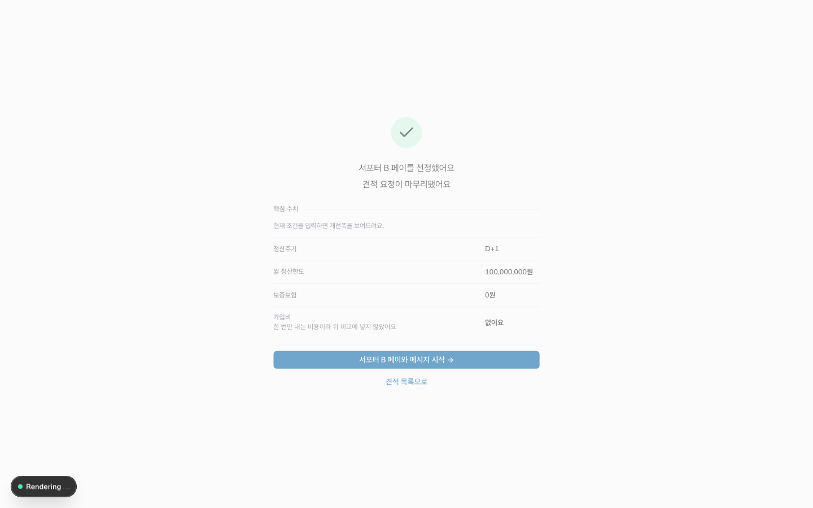 | 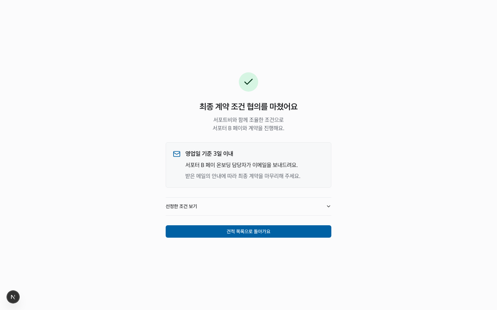 |
| 모바일 | 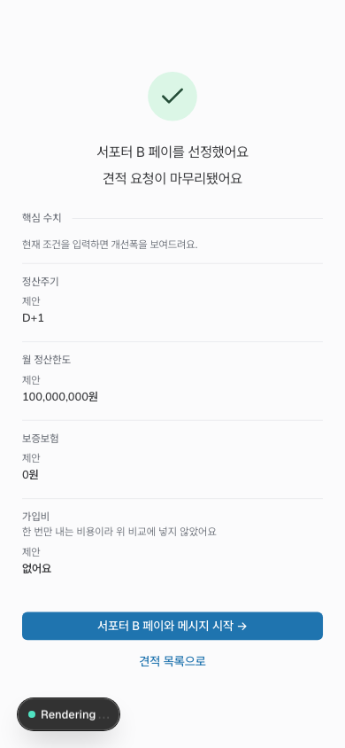 | 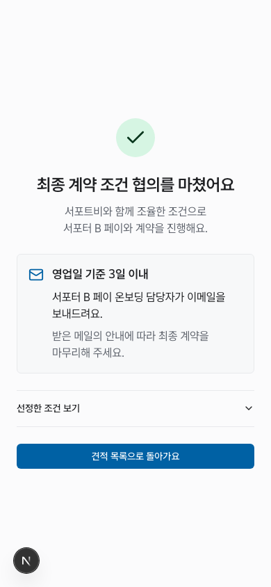 |

## 재방문

| 화면 | Before | After |
| --- | --- | --- |
| 데스크톱 | 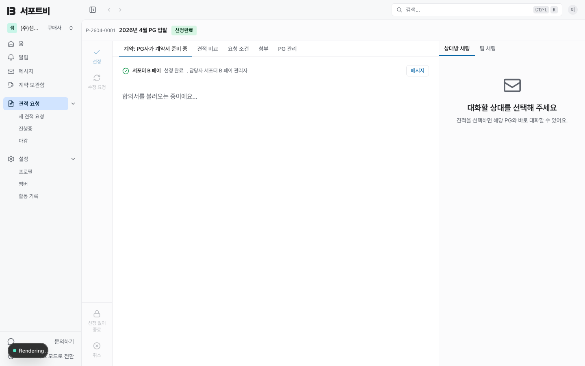 | 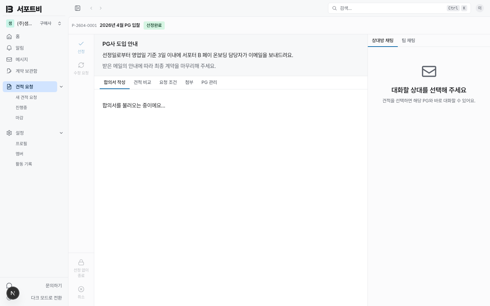 |
| 모바일 | 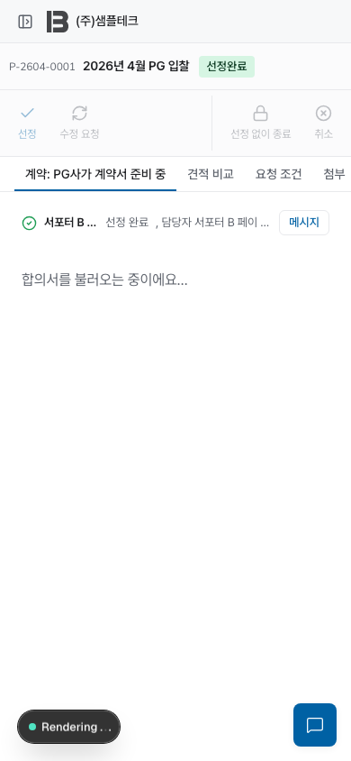 | 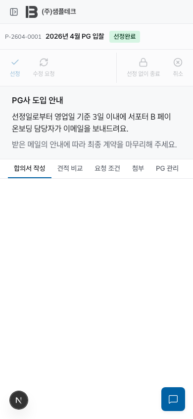 |

## 선정 조건 펼침

| 데스크톱 | 모바일 |
| --- | --- |
| 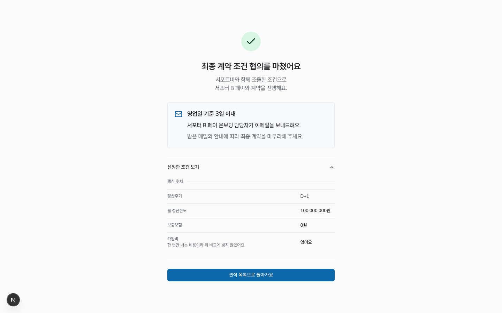 | 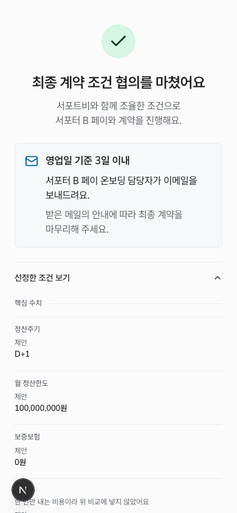 |

## 추가 확인

| 다크 모드 | 긴 PG사명 | 짧은 화면 |
| --- | --- | --- |
| 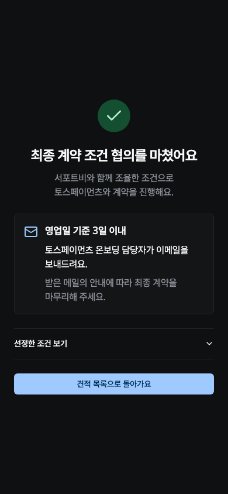 | 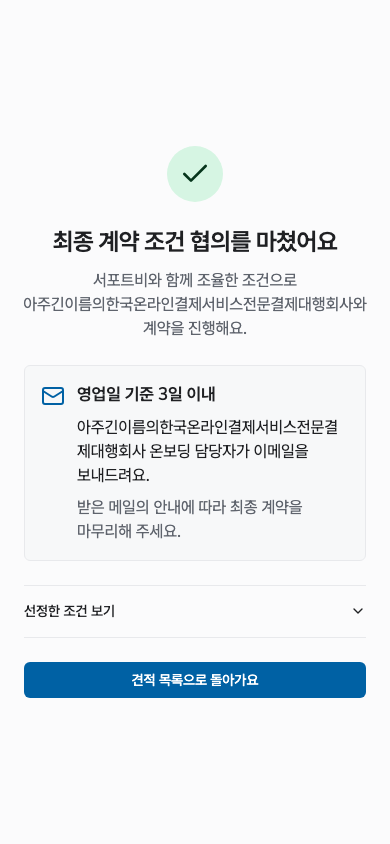 | 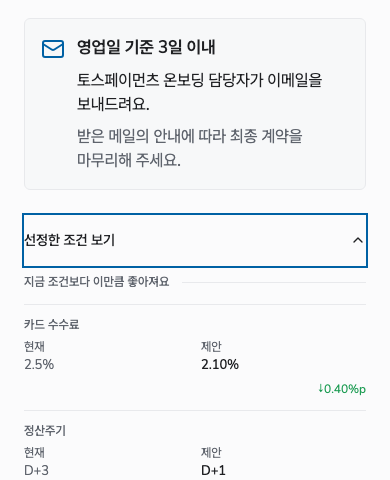 |

격리 브라우저에서 390×480 화면의 세로 스크롤과 가로 넘침 없음, 긴 이름의 가로 넘침 없음, 모달 안 Tab 순환을 확인했다. 실제 앱 E2E는 선정 확정·조건 펼침·Escape 후 유지·목록 이동·재방문 안내·성공 화면 재노출 없음과 DB 선정 결과를 검증한다. 운영 이메일 발송·실제 모바일 키보드는 검증 범위에 포함하지 않는다.

실제 after 재촬영 명령:

```sh
rtk proxy env E2E_WEBPACK=1 AWARD_EVIDENCE_DIR=docs/evidence/award-result pnpm e2e e2e/scenario-c-buyer-award.spec.ts --timeout=180000
```

테스트 DB(5433)와 Playwright Chromium이 필요하다. `E2E_WEBPACK=1`은 이 환경의 worktree 심링크를 Turbopack이 거부하는 문제를 피하는 기존 설정이다.
