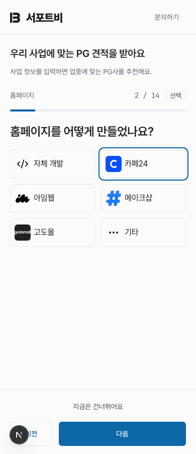
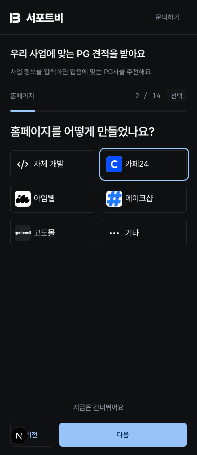
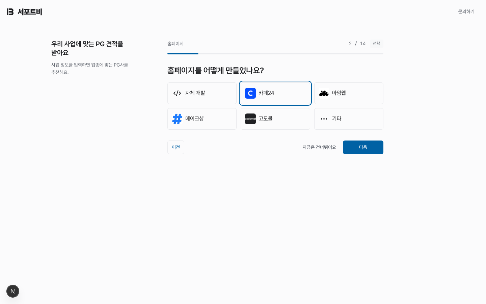
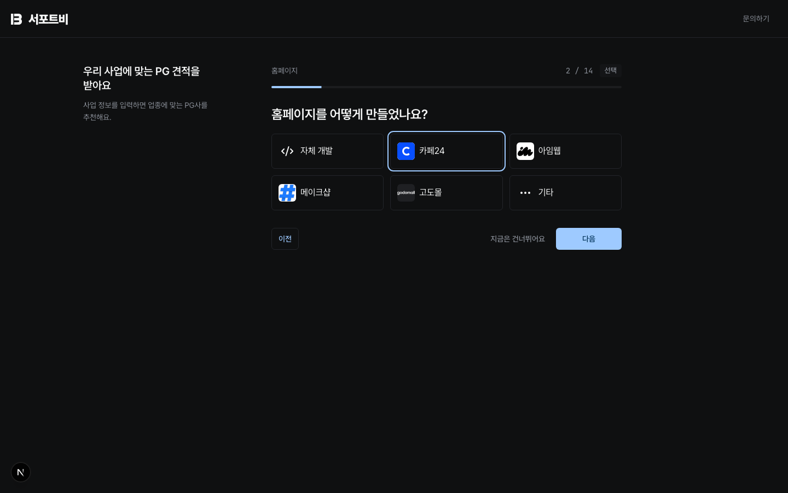

# 공개 견적 작성 미리보기

`/quote-start`의 운영 솔루션 질문. Chromium에서 320·390·768·1440px의 라이트·다크 화면을 확인한 PNG다. 2026-10-15 실행한 `e2e/guest-rfp-layout.spec.ts`에서 생성했다. 실제 서비스에는 없는 Next.js 개발 도구 버튼이 좌측 하단에 함께 찍혀 있다.

| 너비 | 라이트 | 다크 |
|---|---|---|
| 320px | [PNG](./solution-320-light.png) | [PNG](./solution-320-dark.png) |
| 390px | [PNG](./solution-390-light.png) | [PNG](./solution-390-dark.png) |
| 768px | [PNG](./solution-768-light.png) | [PNG](./solution-768-dark.png) |
| 1440px | [PNG](./solution-1440-light.png) | [PNG](./solution-1440-dark.png) |

## 모바일

## PC

