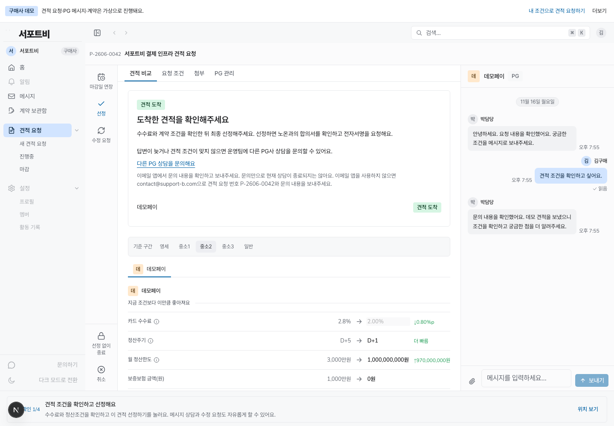
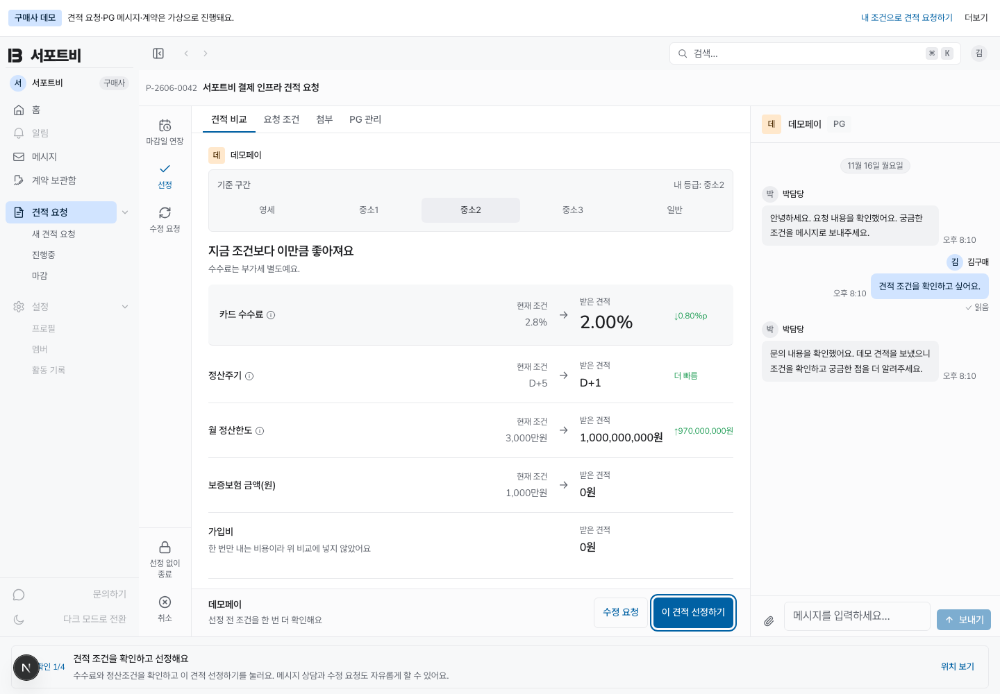
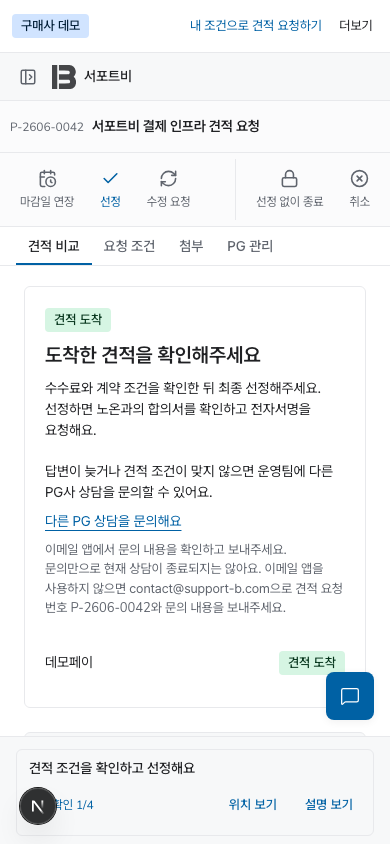
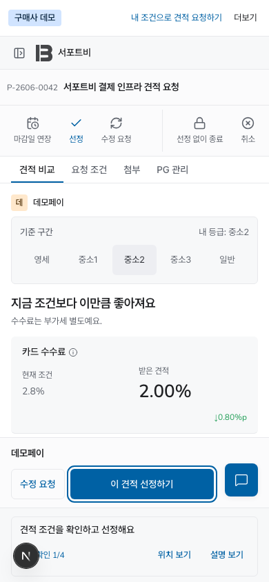
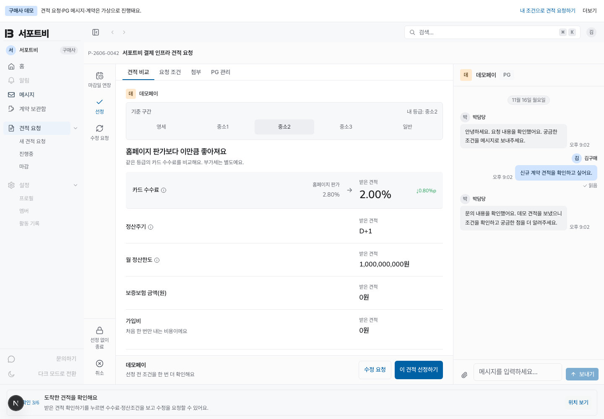
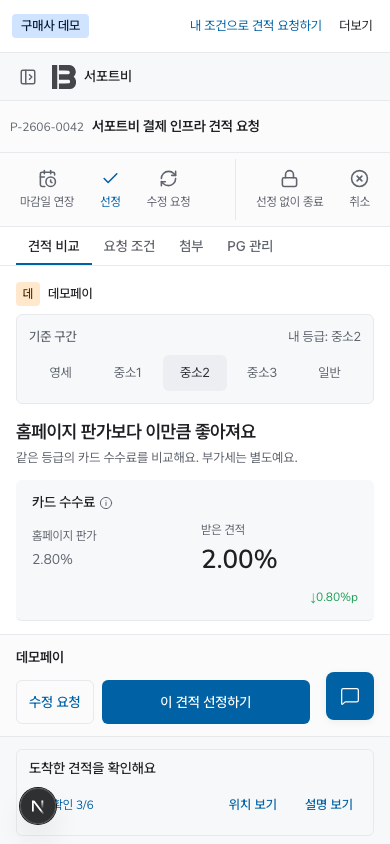

# 구매사 견적 검토·PG 선정 UI

2026-11-16 로컬 Chromium에서 공개 `/demo`의 **핵심 흐름 체험하기 → 견적 확인** 첫 화면을 캡처했다. 두 화면 모두 데모페이 견적과 구매사 등급 `중소2`를 사용하며 본문을 스크롤하지 않은 상태다. 실제 고객·계약 데이터는 포함하지 않는다.

- Before: 변경 전 `origin/dev`의 `0b42495f`.
- After: 이 디렉터리와 함께 제출한 UI 변경. 최종 화면은 모션 감소 설정을 켜고 캡처했으며 모바일은 터치 입력 환경이다.
- 데스크톱: 1440×1000, 모바일: 390×844. 원본 PNG를 편집하지 않고 보관했다.
- 상단 구매사 데모 바와 하단 체험 안내는 공개 데모의 일부다. 실제 구매사 딜룸에는 이 안내 영역이 없다.

## 데스크톱

| Before | After |
| --- | --- |
|  |  |

## 모바일

| Before | After |
| --- | --- |
|  |  |

`e2e/buyer-selection-ui.spec.ts`는 320·390·1024·1440px에서 조건과 선정 영역의 겹침, 본문 스크롤, 채팅 버튼, 탭 전환, 키보드 선정 및 확인창의 초점 복귀를 검사한다. `e2e/buyer-demo.spec.ts`는 공개 데모의 선정·서명·보관 흐름을 검사한다.

## 신규 견적의 홈페이지 판가 비교

같은 공개 데모에서 **견적 요청부터 체험하기 → 신규 계약 → 견적 확인**으로 진행한 화면이다. 가상 PG 데모페이의 `중소2` 예시 판가 2.80%와 받은 견적 2.00%를 비교한다. 실제 PG 홈페이지의 요율을 나타내지 않는다. 갱신 견적은 위 Before/After처럼 구매사의 현재 조건과 비교한다.

| 데스크톱 (1440×1000) | 모바일 (390×844) |
| --- | --- |
|  |  |

같은 E2E 파일은 신규 계약 390·1440px에서 판가 표시·등급 전환·현재 조건 미표시·선정 확인을 검사한다. 선정 확인창은 비교용으로 조회한 등급과 무관하게 구매사 등급의 견적을 보여준다.
