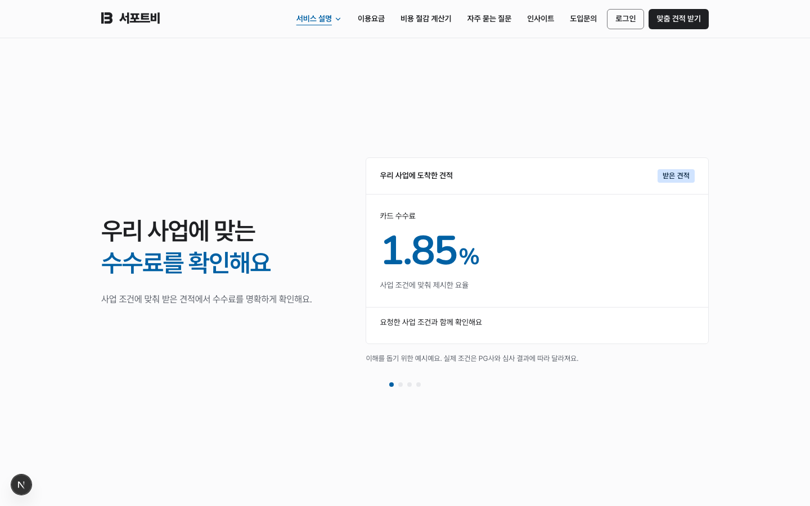
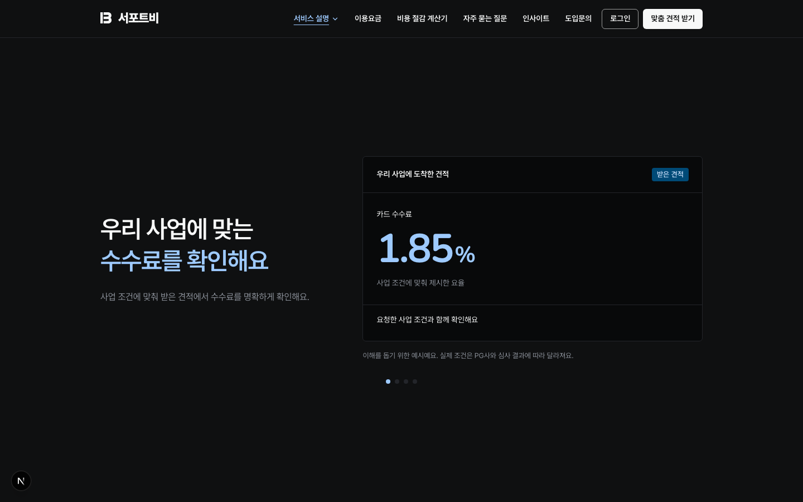
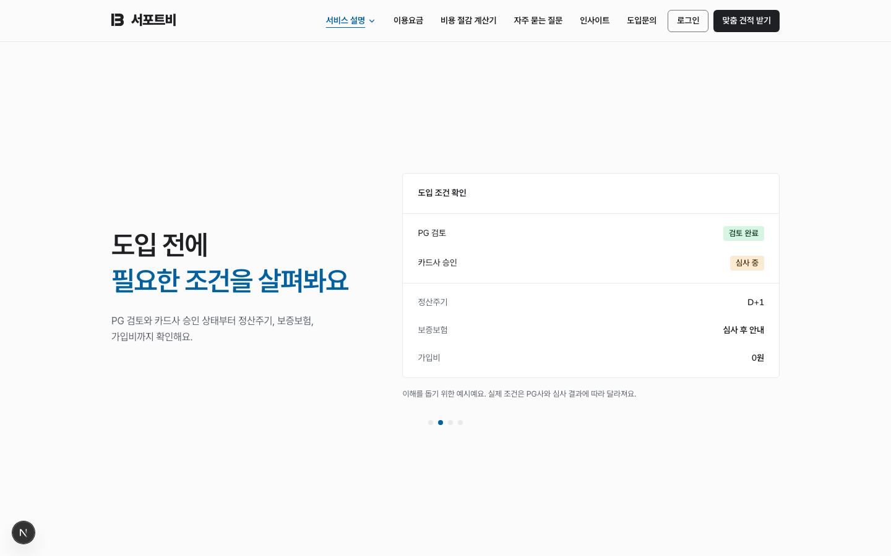
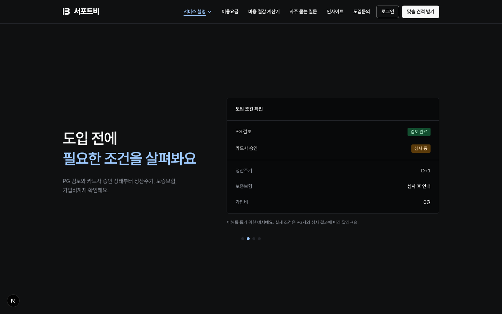
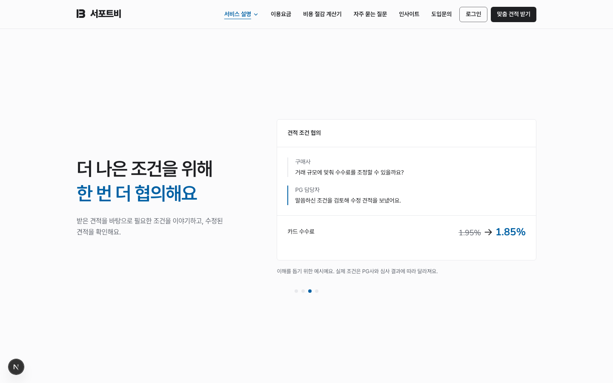
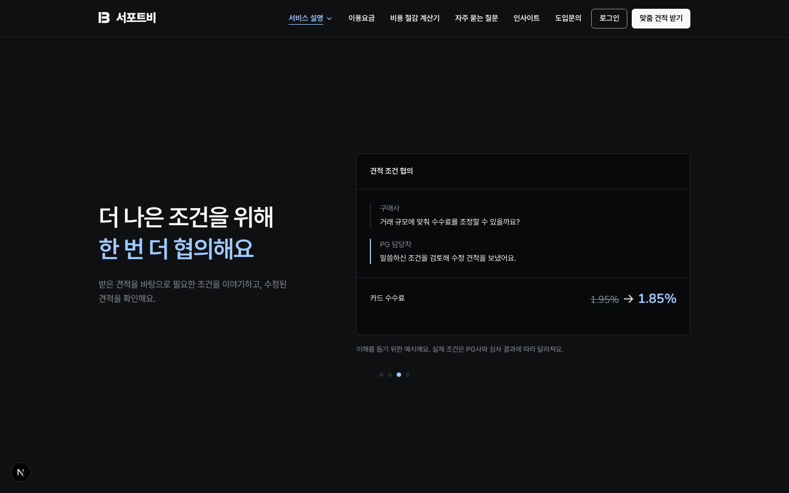
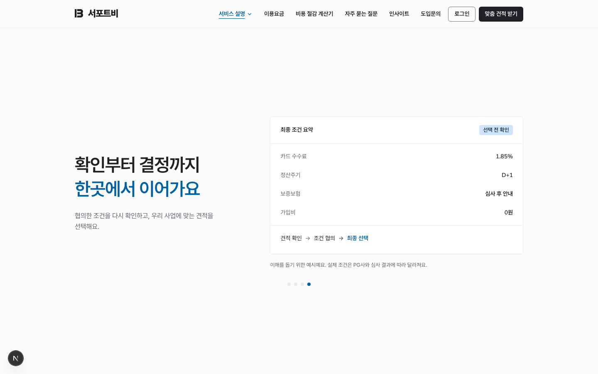
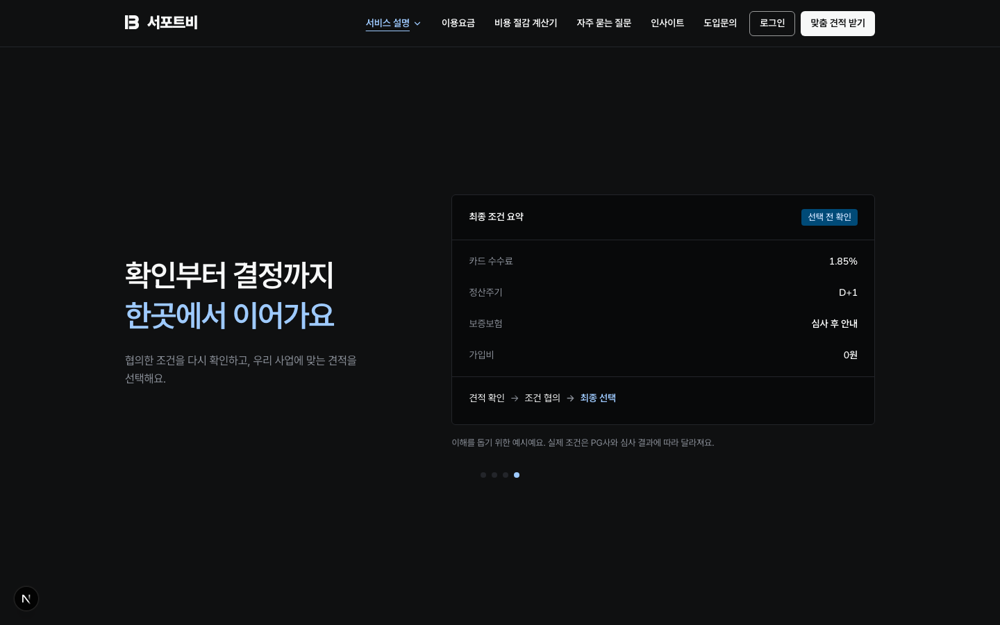

# 서비스 소개 네 장면

구매사 랜딩의 체크 목록·비교표를 큰 효익 문장과 제품 예시 네 장면으로 교체했습니다. 데스크톱은 1440×900, 모바일은 390×844입니다. 모바일 전체 섹션 캡처에서는 고정 헤더와 개발 배지를 숨겨 긴 이미지 중간에 겹치지 않게 했습니다. 데스크톱은 헤더를 포함한 실제 뷰포트입니다. 예시값은 실제 거래 조건을 보장하지 않습니다.

| 장면 | 라이트 | 다크 |
| --- | --- | --- |
| 수수료 |  |  |
| 도입 조건 |  |  |
| 추가 협의 |  |  |
| 최종 결정 |  |  |

| 화면 | 변경 전 | 변경 후 |
| --- | --- | --- |
| 데스크톱 |  |  |
| 모바일 |  |  |

[모바일 다크 전체](mobile-dark.png)

`e2e/landing-solution.spec.ts`에서 1440×900·1280×720·768×1024·390×844·320×568의 라이트·다크 화면, 역스크롤, 화면 크기 변경, 높이 부족 및 모션 감소 폴백을 검증합니다.
